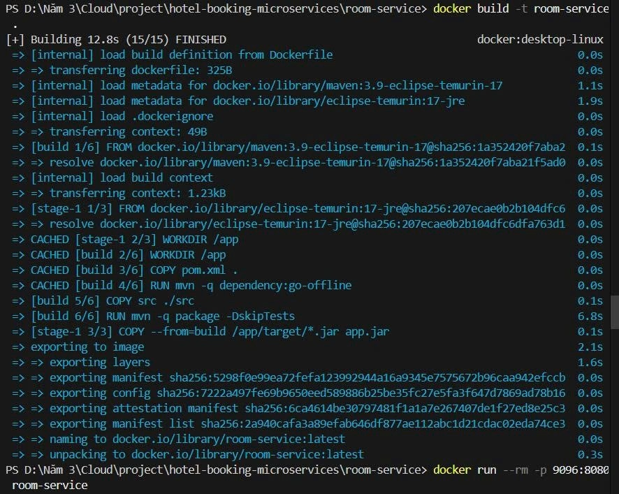
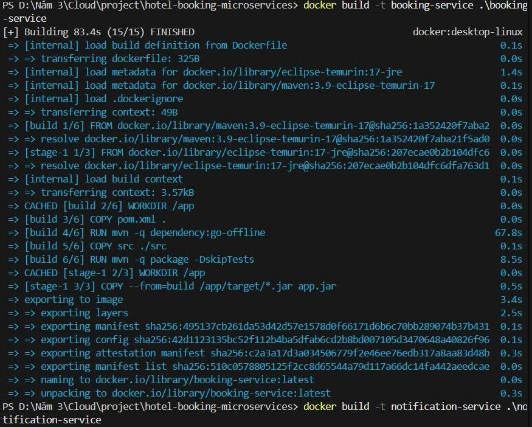
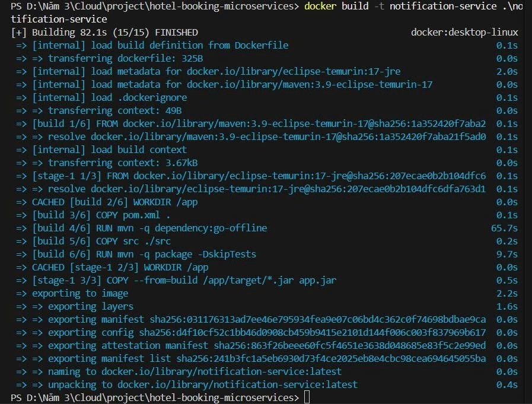
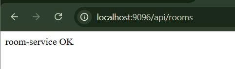
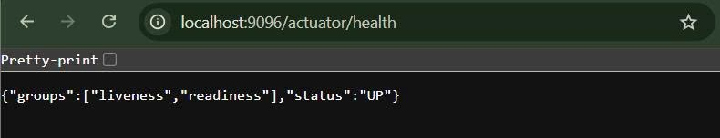
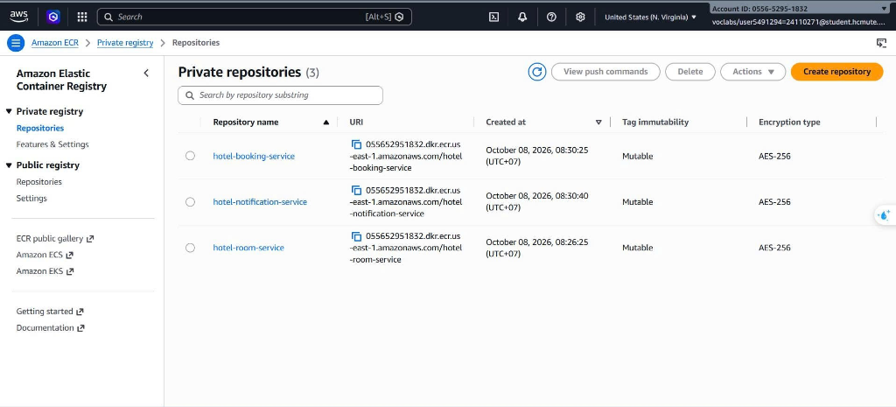
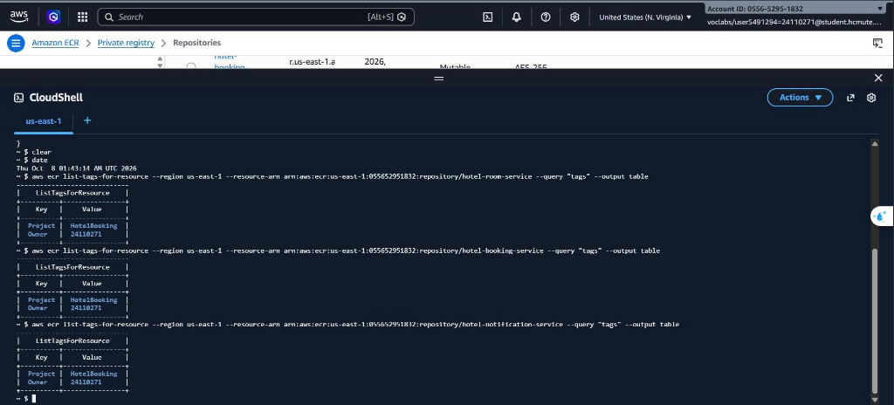
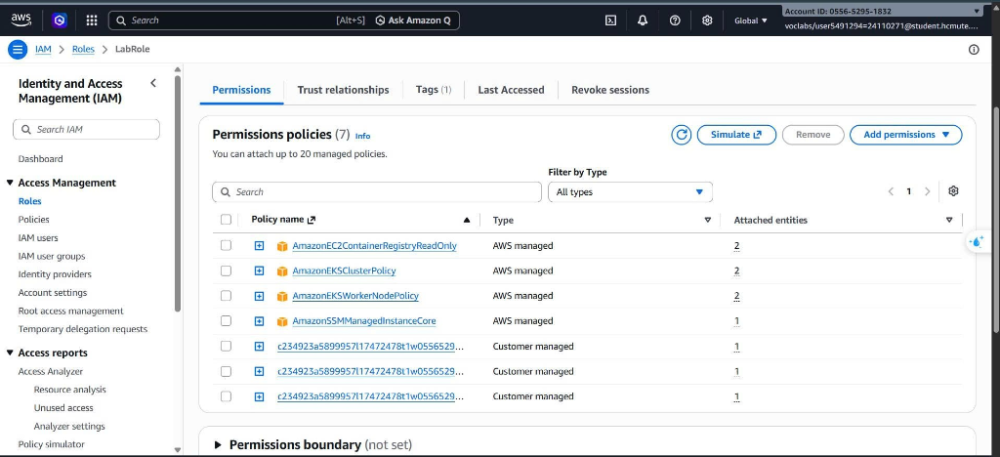

# Báo cáo công việc tuần 1 — Phan Thị Thùy Linh

**Đề tài:** Hệ thống đặt phòng khách sạn với kiến trúc microservices trên ECS  
**Sinh viên:** Phan Thị Thùy Linh — MSSV `24110271`  
**Học phần:** Điện toán đám mây, đợt 1 năm học 2026–2027  
**Môi trường:** Docker Desktop trên Windows & AWS Academy Learner Lab, Region `us-east-1` (Account ID: `0556-5295-1832`)  
**Repository:** https://github.com/pttlinh32/hotel-booking-microservices  
**Phân công:** Khởi tạo Source Code Skeleton, Dockerfile đa tầng & ECR Repositories; Đặc tả chi tiết Communication Pattern & Database Strategy. Số giờ thực hiện: 9.0 giờ.

### Bảng phân công công việc tuần 1 (Worklog)
| Thành viên | Nhiệm vụ chính | Số giờ | Trạng thái |
|---|---|---|---|
| Phan Thị Thùy Linh (`24110271`) | Khởi tạo Source Code Skeleton, Dockerfile đa tầng, ECR Repositories; Đặc tả Communication Pattern & Database Strategy | 9.0 giờ | Hoàn thành |
| Cao Hoàng Phúc (`24110303`) | VPC, Subnets, Route Tables, Security Groups; nghiên cứu ALB & CloudWatch (triển khai tuần 2); sơ đồ kiến trúc | 9.0 giờ | Chưa hoàn thành |

Em thực hiện khởi tạo khung mã nguồn, xây dựng Dockerfile đa tầng, kiểm thử container hóa trên môi trường cục bộ và thiết lập các kho ECR trên AWS Academy Learner Lab. Các hình ảnh minh chứng được chụp trực tiếp từ terminal PowerShell, trình duyệt và AWS Console/CloudShell.

Ảnh trong báo cáo này chụp trên tài khoản Learner Lab của Phan Thị Thùy Linh (Account ID 0556-5295-1832). Ảnh của Cao Hoàng Phúc chụp trên tài khoản riêng của bạn. Từ tuần 2, nhóm triển khai trên tài khoản của Linh theo sự đồng ý của GVHD Huỳnh Xuân Phụng.

---

## 1. Khởi tạo cấu trúc microservices & API endpoints

Em khởi tạo khung dự án (skeleton) cho 3 microservices độc lập dựa trên nền tảng Java 17, Spring Boot 4.1.1 và Maven Wrapper:
- **`room-service`**: Quản lý thông tin và trạng thái phòng (chạy trên cổng container `8080`, root API `/api/rooms`).
- **`booking-service`**: Xử lý nghiệp vụ và quy trình đặt phòng (chạy trên cổng container `8080`, root API `/api/bookings`).
- **`notification-service`**: Tiếp nhận sự kiện và gửi thông báo (chạy trên cổng container `8080`, root API `/api/notifications`).

Mỗi service được cấu hình hai nhóm endpoint chính:
1. **Business Endpoint:** Trả về chuỗi thông báo phản hồi trạng thái cơ bản (ví dụ: `room-service OK`) để phục vụ kiểm tra routing.
2. **Health Check Endpoint:** Tích hợp `spring-boot-starter-actuator` cung cấp `/actuator/health` với nhóm `liveness` và `readiness` sẵn sàng cho Target Group Health Check của Application Load Balancer (ALB) và ECS Container Health Check.

| Dịch vụ | Cổng nội bộ container | Endpoint kiểm tra | Phản hồi mẫu |
|---|---|---|---|
| `room-service` | `8080` | `/api/rooms` & `/actuator/health` | `room-service OK` / `{"status":"UP"}` |
| `booking-service` | `8080` | `/api/bookings` & `/actuator/health` | `booking-service OK` / `{"status":"UP"}` |
| `notification-service` | `8080` | `/api/notifications` & `/actuator/health` | `notification-service OK` / `{"status":"UP"}` |

---

## 2. Thiết kế Dockerfile đa tầng (Multi-stage Build)

Để giải quyết bài toán tối ưu hóa dung lượng image khi triển khai lên Amazon ECR và ECS Fargate, em áp dụng kỹ thuật **Multi-stage build** gồm 2 giai đoạn:
- **Stage 1 (Build environment):** Sử dụng base image `maven:3.9-eclipse-temurin-17`.
  - Khai báo thư mục làm việc `/app`.
  - Copy `pom.xml` và chạy `mvn -q dependency:go-offline` trước để tận dụng cơ chế Docker layer caching, tránh tải lại toàn bộ dependencies khi chỉ sửa đổi source code.
  - Copy thư mục `src/` và đóng gói ứng dụng bằng lệnh `mvn -q package -DskipTests`.
- **Stage 2 (Runtime environment):** Sử dụng base image JRE siêu nhẹ `eclipse-temurin:17-jre`.
  - Chỉ sao chép file thực thi `app.jar` từ Stage 1 sang (`COPY --from=build /app/target/*.jar app.jar`).
  - Mở cổng `EXPOSE 8080` và thiết lập điểm chạy `ENTRYPOINT ["java","-jar","app.jar"]`.
- Đồng thời, em tạo file `.dockerignore` cho từng service để loại bỏ thư mục `target/`, `.git`, `.gitignore`, file log (`*.log`) và các thư mục cấu hình IDE (`.idea/`, `.vscode/`) khỏi context build của Docker daemon, giúp giảm dung lượng context và tăng tốc độ đóng gói image.

---

## 3. Quá trình đóng gói container (Docker Build)

Em tiến hành đóng gói Docker image cho lần lượt cả 3 microservices trên terminal PowerShell:

### 3.1. Đóng gói `room-service`
Quá trình build diễn ra thành công trong 12.8 giây nhờ tận dụng cache các layer phụ thuộc (`dependency:go-offline`, `WORKDIR`, `COPY pom.xml`). Image được xuất ra manifest và gắn tag `room-service:latest`.



### 3.2. Đóng gói `booking-service`
Toàn bộ 15/15 bước build hoàn tất trong 83.4 giây, giải quyết dependencies và biên dịch mã nguồn thành công. Image được gắn tên `booking-service:latest`.



### 3.3. Đóng gói `notification-service`
Tiến trình build kết thúc sau 82.1 giây với đầy đủ các bước tải metadata, build source và export image layers thành công dưới tag `notification-service:latest`.



---

## 4. Chạy thử nghiệm và kiểm thử cục bộ (Local Testing)

Sau khi hoàn tất đóng gói, em tiến hành chạy thử nghiệm container trên máy tính cá nhân để xác minh tính tương thích và hoạt động của ứng dụng:

- Khởi chạy container `room-service` bằng lệnh:
  ```bash
  docker run --rm -p 9096:8080 room-service
  ```
  *(Map cổng `9096` trên máy host vào cổng `8080` của container).*

### 4.1. Kiểm thử Business Endpoint
Truy cập qua trình duyệt tại địa chỉ `http://localhost:9096/api/rooms`. Service phản hồi mã HTTP 200 kèm nội dung `room-service OK`, chứng minh ứng dụng Spring Boot đã bootstrap thành công và xử lý tốt HTTP request bên trong container.



### 4.2. Kiểm thử Actuator Health Endpoint
Truy cập endpoint kiểm tra sức khỏe tại địa chỉ `http://localhost:9096/actuator/health`. Kết quả trả về JSON chuẩn:
```json
{
  "groups": ["liveness", "readiness"],
  "status": "UP"
}
```
Xác nhận trạng thái hệ thống hoàn toàn khỏe mạnh (`UP`), đầy đủ các nhóm probe `liveness` và `readiness` cho việc giám sát tự động của AWS ECS và ALB.



---

## 5. Khởi tạo Amazon ECR Repositories trên AWS

Trên AWS Console (AWS Academy Learner Lab, Region `us-east-1` — N. Virginia, Account ID `0556-5295-1832`), em đã khởi tạo thành công 3 kho lưu trữ container riêng biệt (Private Repositories):

| Tên Repository | URI trên Amazon ECR | Trạng thái Tag | Mã hóa |
|---|---|---|---|
| `hotel-room-service` | `055652951832.dkr.ecr.us-east-1.amazonaws.com/hotel-room-service` | Mutable | AES-256 |
| `hotel-booking-service` | `055652951832.dkr.ecr.us-east-1.amazonaws.com/hotel-booking-service` | Mutable | AES-256 |
| `hotel-notification-service` | `055652951832.dkr.ecr.us-east-1.amazonaws.com/hotel-notification-service` | Mutable | AES-256 |



### Kiểm tra gắn Tagging định danh tài nguyên bằng AWS CloudShell
Để đảm bảo các repository tuân thủ quy tắc quản lý tài nguyên của nhóm, em mở AWS CloudShell và thực hiện truy vấn các tag gán trên từng repository thông qua lệnh `aws ecr list-tags-for-resource`:

```bash
aws ecr list-tags-for-resource --region us-east-1 --resource-arn arn:aws:ecr:us-east-1:055652951832:repository/hotel-room-service --query "tags" --output table
aws ecr list-tags-for-resource --region us-east-1 --resource-arn arn:aws:ecr:us-east-1:055652951832:repository/hotel-booking-service --query "tags" --output table
aws ecr list-tags-for-resource --region us-east-1 --resource-arn arn:aws:ecr:us-east-1:055652951832:repository/hotel-notification-service --query "tags" --output table
```

Kết quả trả về xác nhận cả 3 repository đều đã được gán đầy đủ hai tag định danh:
- `Project`: `hotel-booking-microservices`
- `Owner`: `24110271`



---

## 6. Xác thực IAM Role & Quyền Learner Lab

Trong môi trường AWS Academy Learner Lab, quyền quản trị bị giới hạn theo chính sách học phần (không được tự ý tạo thêm IAM User hay Access Key mới). 

Em đã truy cập IAM Console để kiểm tra quyền hạn của **`LabRole`**:
- `LabRole` đã được tích hợp sẵn policy **`AmazonEC2ContainerRegistryReadOnly`** (AWS managed) cho phép kéo (pull) image từ ECR. Cần lưu ý policy này chỉ cho phép đọc/kéo (read-only/pull), không cấp quyền đẩy (push) image lên kho chứa.
- Role này sẽ được gán làm Task Execution Role và Task Role khi nhóm cấu hình ECS Task Definitions ở các tuần tiếp theo, đảm bảo ECS có thể xác thực và kéo image trực tiếp từ Amazon ECR mà không gặp lỗi phân quyền.



---

---

## 7. Đặc tả Communication Pattern & Database Strategy (Bổ sung hoàn thiện kiến trúc)

Để làm rõ phương thức trao đổi dữ liệu và chiến lược lưu trữ theo nhận xét góp ý của GVHD Huỳnh Xuân Phụng, em đã phối hợp cùng bạn Cao Hoàng Phúc hoàn thiện hai bản đặc tả kỹ thuật chi tiết (đã tích hợp vào tài liệu chung `tasks.md`):

### 7.1. Đặc tả Communication Pattern
1. **Giao tiếp đồng bộ (REST Service-to-Service):**
   - Xác định rõ giao thức gọi nội bộ giữa `booking-service` và `room-service` qua DNS của ALB / Service Discovery trong VPC, bảo mật qua Security Group `ECS-SG`.
   - Xây dựng bảng API Contract với các endpoint `/api/rooms/{id}` và `/api/rooms/{id}/status`, chuẩn hóa định dạng request/response JSON và các mã lỗi phân tán (`200 OK`, `404 NOT_FOUND`, `409 CONFLICT`).
   - Thiết lập các tham số chịu lỗi phân tán: Connection timeout 3s, Read timeout 5s, Retry tối đa 2 lần với Exponential Backoff.
2. **Giao tiếp bất đồng bộ (Event-Driven SNS/SQS):**
   - Chuẩn hóa cấu trúc sự kiện `BookingCreatedEvent` (theo định dạng CloudEvents envelope) chứa đầy đủ thông tin định danh `eventId`, `bookingId`, email khách hàng và chi tiết phòng.
   - Thiết kế giải pháp đảm bảo độ tin cậy: Cơ chế **Idempotency** phía `notification-service` kiểm tra `eventId` tránh gửi trùng lặp thông báo, và cơ chế **Dead Letter Queue (DLQ)** với `maxReceiveCount = 3` để cô lập các bản tin lỗi.

### 7.2. Đặc tả Database Strategy
1. **Mô hình Database-per-Service:**
   - Đảm bảo tính độc lập dữ liệu tuyệt đối giữa các microservice.
   - Giải quyết bài toán hạn mức tài nguyên trên AWS Learner Lab ($100 budget): Đề xuất sử dụng 1 instance Amazon RDS nhưng tách biệt thành 2 logical databases độc lập (`room_db` và `booking_db`), cấp phát user riêng biệt (`room_user` và `booking_user`) cấm truy cập chéo.
2. **Thiết kế mô hình dữ liệu (Data Modeling):**
   - **Cơ sở dữ liệu quan hệ (RDS):** Thiết kế chi tiết cấu trúc bảng `rooms` cho `room-service` và bảng `bookings` cho `booking-service`.
   - **Cơ sở dữ liệu NoSQL (DynamoDB):** Thiết kế bảng `hotel-booking-audit-logs` với Partition Key `bookingId` và Sort Key `timestamp` phục vụ ghi nhận nhật ký trạng thái (Audit Trail) tốc độ cao mà không làm nghẽn RDS.
3. **Chiến lược nhất quán dữ liệu (Data Consistency):**
   - Áp dụng mô hình Nhất quán cuối cùng (Eventual Consistency) theo chu trình Choreography: `PENDING` ➡️ Khóa phòng `RESERVED` ➡️ Lưu đơn `CONFIRMED` ➡️ Phát Event SNS.
   - Bổ sung cơ chế giao dịch bù trừ (Compensating Transaction) để tự động hoàn trả phòng về `AVAILABLE` nếu có sự cố xảy ra.

---

## 8. Kết quả đạt được và kế hoạch tuần tiếp theo

Sau tuần 1, em đã hoàn thành toàn bộ các hạng mục công việc được giao theo đúng kế hoạch:
- Khởi tạo thành công khung mã nguồn chuẩn cho 3 microservices độc lập (`room-service`, `booking-service`, `notification-service`).
- Xây dựng Dockerfile chuẩn multi-stage tối ưu hóa kích thước image và tốc độ đóng gói.
- Đóng gói và kiểm thử container thành công trên môi trường cục bộ (cổng map `9096:8080`), xác nhận cả hai endpoint `/api/rooms` và `/actuator/health` hoạt động ổn định.
- Khởi tạo 3 private repositories trên Amazon ECR, gắn tag quản lý tài nguyên và kiểm tra quyền IAM `LabRole` trên AWS Learner Lab.
- Hoàn thành bản đặc tả chi tiết **Communication Pattern** (API Contract, Event Schema, DLQ, Idempotency) và **Database Strategy** (Database-per-service logical isolation, bảng ERD trên RDS, bảng Audit Logs trên DynamoDB, Eventual Consistency).

**Kế hoạch Tuần 2:**
1. Đăng nhập Docker vào Amazon ECR (`aws ecr get-login-password`) và gắn tag version để push 3 Docker images lên ECR repositories.
2. Triển khai ECS Task Definition, ALB (path-based routing, health check /actuator/health), RDS, DynamoDB, SNS, SQS trên tài khoản Learner Lab của Linh, cùng bạn Cao Hoàng Phúc (Phúc viết template/hướng dẫn hạ tầng, Linh chạy và kiểm thử).
3. Thiết lập kết nối cơ sở dữ liệu (`RDS`/`DynamoDB`) và luồng message giữa các services qua `SNS`/`SQS`.

---

## 9. Ghi nhận sử dụng AI

Em sử dụng AI để tham khảo cấu trúc Dockerfile tối ưu layer cache với `dependency:go-offline` cho Spring Boot, tra cứu cú pháp lệnh AWS CLI truy vấn tag trên ECR, hỗ trợ rà soát định dạng báo cáo công việc và xây dựng các bảng đặc tả schema dữ liệu/API. Toàn bộ mã nguồn, cấu hình và lệnh kiểm thử thực tế trên máy cũng như trên AWS Console/CloudShell đều do em tự thực hiện và ghi nhận lại.
