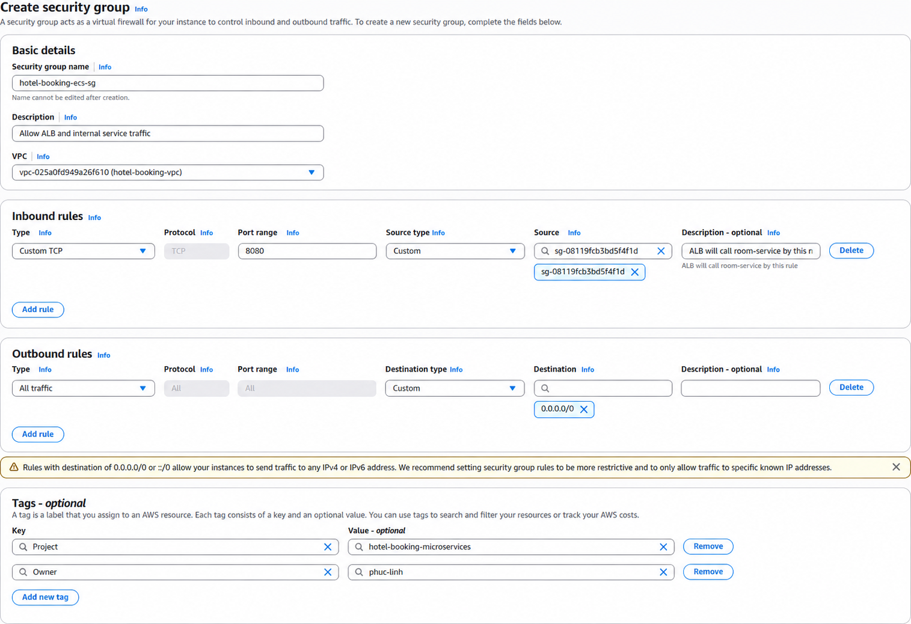
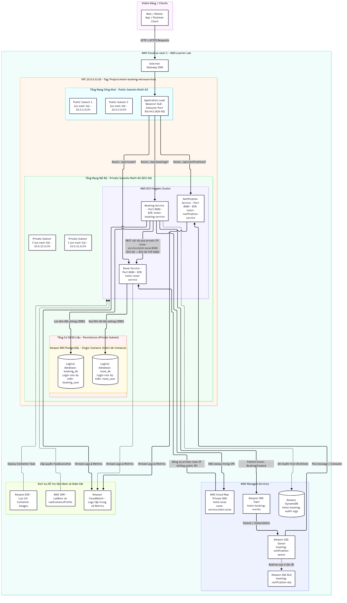

# Báo cáo tuần 1 — Cao Hoàng Phúc

**Đề tài:** Hệ thống đặt phòng khách sạn với kiến trúc microservices trên ECS  
**Sinh viên:** Cao Hoàng Phúc — MSSV `24110303`  
**Phân công:** VPC, Subnet, Route Table, Security Group; nghiên cứu ALB và CloudWatch (triển khai tuần 2); sơ đồ kiến trúc  
**Số giờ:** 9.0 giờ  
**Trạng thái:** Chưa hoàn thành  
**Môi trường:** AWS Academy Learner Lab, `us-east-1`  
**Repository:** https://github.com/pttlinh32/hotel-booking-microservices  
**Ngày thực hiện:** 09/10/2026

> **Cập nhật bổ sung ngày 14/10/2026:** Sau báo cáo tuần 1, em đã dùng EC2 tạm trong VPC để kết nối tới RDS PostgreSQL `hotel-db-instance` và tạo thành công hai logical database `room_db` và `booking_db`. Đã xác minh cả hai database tồn tại. Sau khi khởi tạo, rule truy cập tạm từ EC2 đã được gỡ; RDS Security Group chỉ còn cho phép ECS Security Group truy cập cổng PostgreSQL `5432`. EC2 khởi tạo đã được gửi lệnh dừng và đang chuyển trạng thái dừng. Đây là cập nhật tiến độ hạ tầng, không thay đổi thời điểm thực hiện các công việc tuần 1 nêu bên dưới.

> **Phạm vi đã hoàn tất:** Mới tạo hai database rỗng. Tạo user riêng `room_user`/`booking_user`, thiết lập quyền truy cập riêng và tạo bảng nghiệp vụ vẫn cần thực hiện; bảng DynamoDB `hotel-booking-audit-logs` cùng SNS/SQS và DLQ cũng chưa được xác nhận triển khai trong cập nhật này.

Ảnh trong báo cáo này chụp trên tài khoản Learner Lab của Cao Hoàng Phúc (Account ID xem trong ảnh images/09-console-context.png). Từ tuần 2, nhóm triển khai trên tài khoản của Phan Thị Thùy Linh theo sự đồng ý của GVHD.

## Công việc đã làm

### Kế hoạch phân chia mạng (Subnet Plan)
Kế hoạch phân bổ dải địa chỉ mạng CIDR cho VPC `10.0.0.0/16` bao gồm 2 Public Subnet và 2 Private Subnet trải rộng trên hai Availability Zone (`us-east-1a` và `us-east-1b`) nhằm đảm bảo tính sẵn sàng cao cho ALB và các dịch vụ backend.

1. **Tạo VPC** `hotel-booking-vpc` với CIDR `10.0.0.0/16`. Em chia VPC thành **2 public subnet và 2 private subnet** trên `us-east-1a` và `us-east-1b`: ALB cần hai AZ để nhận truy cập, còn ECS và RDS cần mạng riêng phía sau ALB. Em bật DNS để các tài nguyên phân giải tên và gắn tag `Project=hotel-booking-microservices`, `Owner=24110303` để nhận diện tài nguyên của nhóm.

   

   

   

2. **Cấu hình Internet Gateway và route table.** Hai public subnet dùng route `0.0.0.0/0` tới Internet Gateway để ALB có đường kết nối Internet; các private subnet dùng route table riêng để không có đường vào trực tiếp. Em chưa tạo NAT Gateway vì tuần này chưa chạy ECS và NAT sẽ phát sinh chi phí khi tồn tại.

   

3. **Tạo ba security group** cho ALB, ECS và RDS. ALB SG hiện mở cổng 80 (HTTP); cổng 443 sẽ mở khi có chứng chỉ ở các tuần sau vì đây là điểm tiếp nhận lưu lượng từ người dùng Internet. ECS SG chỉ nhận cổng 8080 từ ALB SG (do cả 3 microservice đều chạy cổng container `8080`) để người dùng không gọi thẳng vào service. RDS SG chưa mở inbound để database không bị truy cập trước khi có kết nối cụ thể từ ECS.

   

   

   *Ảnh minh họa đã chỉnh từ [ảnh bản nháp ban đầu](images/07-ecs-sg-draft.png), không phải ảnh chụp trực tiếp cấu hình hiện tại. Ngày 10/10/2026, đã kiểm tra và cập nhật bằng AWS CLI: `hotel-booking-ecs-sg` (`sg-005ce5a54ed8d4ff2`) chỉ còn inbound TCP `8080` từ ALB SG (`sg-08119fcb3bd5f4f1d`). Các rule `8081` và `8082` đã được gỡ.*

   

**Kết quả:** VPC, subnet, Internet Gateway, route table và security group đã sẵn sàng làm nền cho ALB, ECS Fargate và RDS ở các tuần tiếp theo.

## Nghiên cứu dịch vụ [Phúc kiểm tra và chỉnh lại]

1. **AWS ECS Fargate:**
   - Dịch vụ tính toán serverless cho container, loại bỏ gánh nặng phải tự quản lý, vá lỗi hay mở rộng các máy chủ EC2 bên dưới.
   - Cho phép định nghĩa Task Definition với cấu hình tài nguyên chi tiết (CPU, RAM), thiết lập port mapping `8080` và chỉ định `LabRole` thực thi.
   - Thích hợp cho kiến trúc microservices nhờ khả năng khởi chạy độc lập và dễ dàng scale về 0 khi không sử dụng nhằm tiết kiệm ngân sách Lab. [Phúc kiểm tra và chỉnh lại]

2. **Application Load Balancer (ALB) & Path-based Routing:**
   - Cung cấp điểm vào công khai duy nhất tiếp nhận request từ người dùng và phân phối lưu lượng đến các Target Group phù hợp.
   - Sử dụng luật định tuyến theo đường dẫn (Path-based Routing): `/api/rooms` dẫn tới `room-service`, `/api/bookings` dẫn tới `booking-service`, `/api/notifications` dẫn tới `notification-service`.
   - Kiểm tra sức khỏe tự động qua cấu hình health check endpoint `/actuator/health` để đảm bảo lưu lượng chỉ gửi tới container lành mạnh. [Phúc kiểm tra và chỉnh lại]

3. **Amazon CloudWatch Logs:**
   - Thu thập, giám sát và lưu trữ tập trung luồng stdout/stderr từ các task chạy trên ECS Fargate qua `awslogs` driver.
   - Hỗ trợ việc truy vết lỗi, phân tích hành vi gọi service và debug hệ thống phân tán mà không cần ssh vào container.
   - Cấu hình retention period ngắn (1–3 ngày) phù hợp với môi trường thực hành AWS Learner Lab để tránh phát sinh chi phí. [Phúc kiểm tra và chỉnh lại]

## Sơ đồ kiến trúc

## Kế hoạch tuần 2

- Dựng ECS cluster, cấu hình task definition Fargate (sử dụng `LabRole`, mở cổng container `8080`, cấu hình log CloudWatch) cho 3 microservices trên tài khoản của Linh.
- Thiết lập Application Load Balancer (ALB), các target group tương ứng và cấu hình phân luồng path-based routing.
- Khởi tạo cơ sở dữ liệu quan hệ RDS, bảng DynamoDB và hệ thống message hàng đợi SNS/SQS.
- Triển khai và kiểm thử từng thành phần; tuân thủ quy tắc scale service về 0 sau mỗi buổi làm việc để tiết kiệm tài nguyên.

**Sử dụng AI:** Em dùng AI để tìm hiểu VPC, CIDR, subnet, NAT và hỗ trợ biên tập báo cáo; em tự thực hiện cấu hình trên AWS.
