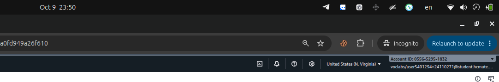
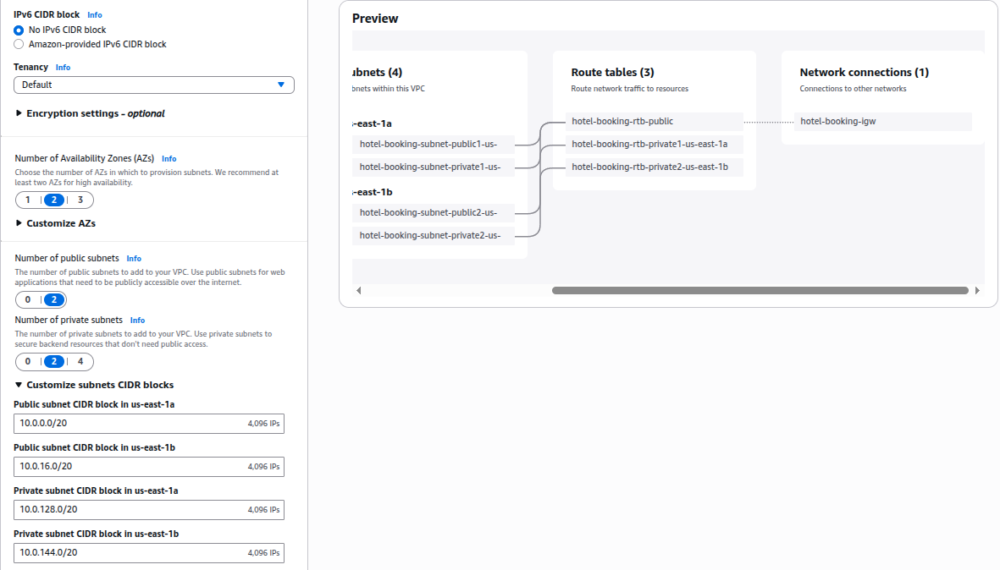
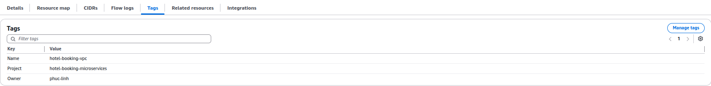
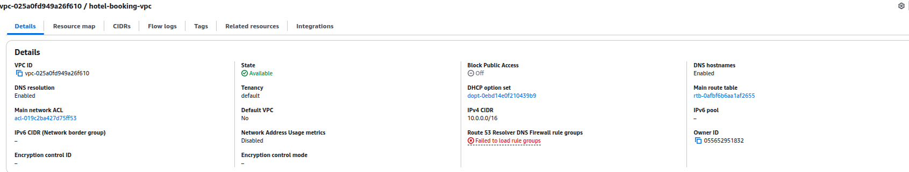
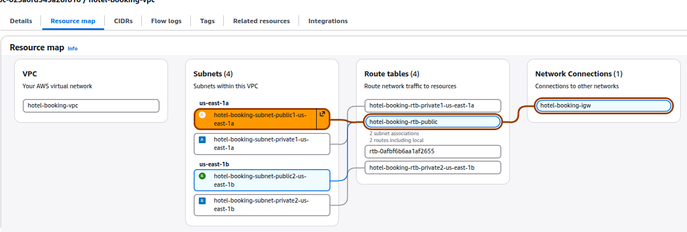
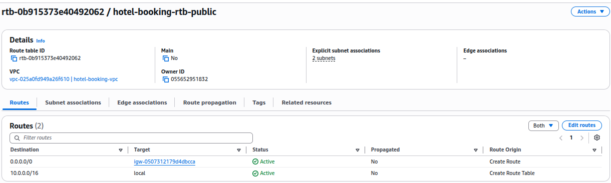
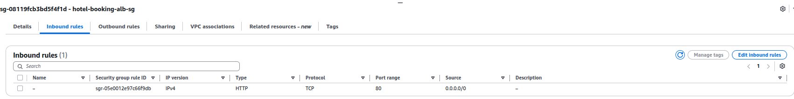
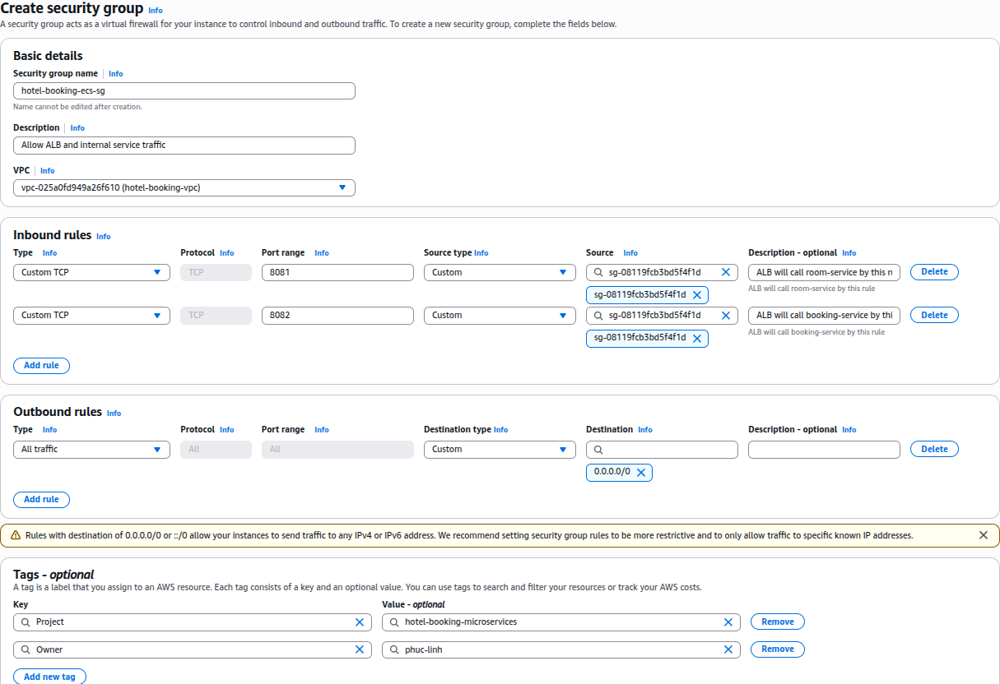
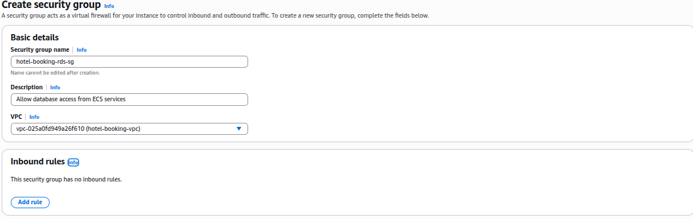

# Báo cáo công việc tuần 1 — Cao Hoàng Phúc

**Đề tài:** Hệ thống đặt phòng khách sạn với kiến trúc microservices trên ECS  
**Sinh viên:** Cao Hoàng Phúc — MSSV `24110303`  
**Học phần:** Điện toán đám mây, đợt 1 năm học 2026–2027  
**Môi trường:** AWS Academy Learner Lab, Region `us-east-1`  
**Phân công:** Thiết kế kiến trúc và hạ tầng mạng cho hệ thống. Kế hoạch tuần 1: 9 giờ.

Em thực hiện cấu hình trên AWS Console vào tối 09/10/2026. Ảnh chụp có thời gian, Region và Account ID của Learner Lab; trong báo cáo em cắt lại từng ảnh để tập trung vào phần cấu hình đang trình bày.

## 1. Chia mạng cho hệ thống

Trước khi tạo VPC, em chọn Region `us-east-1` và dải mạng `10.0.0.0/16`. Em chia mạng thành hai Availability Zone (`us-east-1a`, `us-east-1b`), mỗi AZ có một public subnet và một private subnet. Cách chia này cho phép ALB đặt ở hai public subnet, còn ECS và RDS có không gian mạng riêng ở phía sau ALB.

Em giữ các dải `/20` được AWS Console đề xuất vì chúng nằm trong VPC và không trùng nhau:

| Subnet | Availability Zone | CIDR | Mục đích |
|---|---|---|---|
| Public 1 | `us-east-1a` | `10.0.0.0/20` | ALB |
| Public 2 | `us-east-1b` | `10.0.16.0/20` | ALB |
| Private 1 | `us-east-1a` | `10.0.128.0/20` | ECS, RDS |
| Private 2 | `us-east-1b` | `10.0.144.0/20` | ECS, RDS |

## 2. Chọn kết nối Internet và gắn tag

Em bật DNS resolution và DNS hostnames để tài nguyên trong VPC có thể phân giải tên. Em chọn **NAT Gateway = None** ở tuần dựng nền mạng, vì chưa triển khai ECS task và muốn tránh chi phí NAT phát sinh khi không sử dụng. Khi đưa ECS vào private subnet, em sẽ bổ sung đường ra tới các dịch vụ cần thiết bằng NAT Gateway hoặc VPC endpoint.

Em gắn `Project=hotel-booking-microservices` và `Owner=phuc-linh` để nhận diện tài nguyên của nhóm. Sau khi tạo, em kiểm tra hai tag này trên VPC.

## 3. Tạo và kiểm tra VPC

Em tạo `hotel-booking-vpc` với CIDR `10.0.0.0/16`. VPC nhận ID `vpc-025a0fd949a26f610` và chuyển sang trạng thái `Available`. Ở trang chi tiết, DNS resolution và DNS hostnames đều đã bật.

Em mở Resource map để kiểm tra bố cục mạng sau khi tạo: bốn subnet nằm trên hai AZ, hai public subnet cùng nối vào public route table, và public route table nối tới Internet Gateway `hotel-booking-igw`. Resource map hiển thị bốn route table vì ngoài ba bảng dùng cho subnet còn có main route table mặc định của VPC.

## 4. Kiểm tra đường đi của public subnet

Em kiểm tra `hotel-booking-rtb-public`. Bảng này có route `10.0.0.0/16 → local` để các tài nguyên trong VPC giao tiếp nội bộ, và route `0.0.0.0/0 → Internet Gateway` để hai public subnet có đường ra Internet. Hai private subnet dùng route table riêng và không đi trực tiếp tới Internet Gateway.

## 5. Tạo security group cho ALB

Em tạo `hotel-booking-alb-sg` (`sg-08119fcb3bd5f4f1d`) và mở HTTP port `80` từ `0.0.0.0/0`. Đây là điểm nhận yêu cầu của người dùng trước khi ALB chuyển tiếp đến `room-service` hoặc `booking-service`. Em chưa mở port `443` vì demo hiện dùng HTTP; khi cấu hình HTTPS, em sẽ thêm listener và chứng chỉ phù hợp.

## 6. Tạo security group cho ECS và RDS

Em tạo `hotel-booking-ecs-sg` với hai inbound rule TCP `8081` và `8082`, source là `hotel-booking-alb-sg`. Port `8081` dành cho `room-service`, port `8082` dành cho `booking-service`. Như vậy Internet chỉ gọi qua ALB, không gọi trực tiếp vào hai service. Khi cấu hình kết nối nội bộ từ `booking-service` sang `room-service`, em sẽ bổ sung rule TCP `8081` tự tham chiếu cho ECS SG.

Em tạo `hotel-booking-rds-sg` và để inbound trống trong bước dựng mạng. Khi nhóm chốt loại cơ sở dữ liệu, em sẽ mở đúng port PostgreSQL (`5432`) hoặc MySQL (`3306`) với source là ECS SG. Cách này giới hạn kết nối database cho các service trong VPC.

## 7. Kết quả và công việc tiếp theo

Sau buổi cấu hình, em đã có VPC, bốn subnet trên hai AZ, Internet Gateway, các route table và ba security group phục vụ ALB, ECS, RDS. Nền mạng này chuẩn bị cho ba microservice của nhóm chạy trên ECS Fargate.

Trong giai đoạn tiếp theo, em sẽ hoàn thiện sơ đồ kiến trúc toàn hệ thống, chốt đường ra cho ECS trong private subnet, bổ sung rule kết nối nội bộ và rule RDS theo loại database được chọn. Sau khi nhóm có image chạy được, em sẽ cấu hình ALB path-based routing và CloudWatch Logs, rồi kiểm thử luồng đặt phòng trên AWS.

## 8. Ghi nhận sử dụng AI

Em dùng AI để tìm hiểu các khái niệm VPC, CIDR, subnet, NAT và rà soát cách trình bày báo cáo. Em tự thao tác cấu hình trên AWS Learner Lab và đối chiếu các giá trị đã tạo trên Console.
