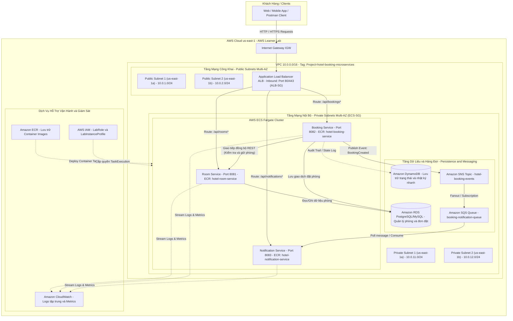
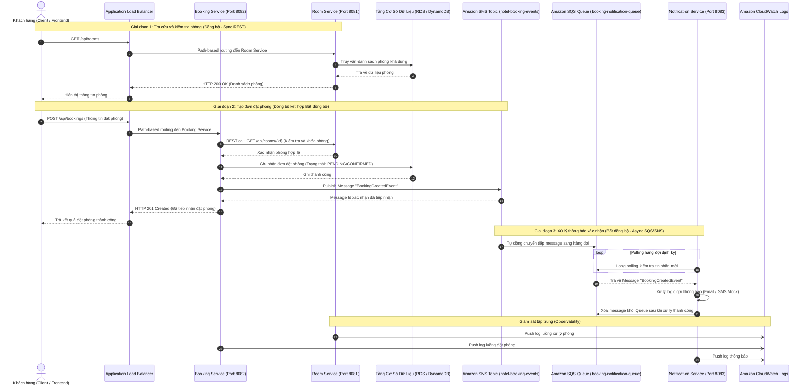

# KẾ HOẠCH & PHÂN CHIA NHIỆM VỤ ĐỒ ÁN (WORKLOG)

## 📌 THÔNG TIN ĐỒ ÁN
- **Đề tài:** Hệ thống đặt phòng khách sạn với kiến trúc microservices trên ECS (Nhóm: Capstone)
- **Học phần:** Điện toán đám mây (Cloud) - Đợt 1 (Năm học 2026–2027)
- **Giảng viên hướng dẫn (GVHD):** Huỳnh Xuân Phụng
- **Công nghệ & Dịch vụ:** Java 17, Spring Boot, Docker, AWS (ECS Fargate, ECR, ALB path-based routing, RDS, DynamoDB, SNS, SQS, CloudWatch)

---

## 👥 THÀNH VIÊN NHÓM
1. **Cao Hoàng Phúc** - MSSV: `24110303` (Thành viên 1)
2. **Phan Thị Thùy Linh** - MSSV: `24110271` (Thành viên 2)

---

## 📅 PHÂN CHIA NHIỆM VỤ TUẦN 1 (DỰNG NỀN TẢNG & MÔI TRƯỜNG)

### 🔹 Thành viên 1: Cao Hoàng Phúc (MSSV: 24110303)
- **Vai trò:** Phụ trách Hạ tầng mạng (VPC/Subnets/Route Tables), Thiết kế kiến trúc & Bảo mật mạng (Security Groups).
- **Số giờ thực hiện:** 9.0 giờ
- **Trạng thái:** Hoàn thành
- **Công việc chi tiết:**
  1. Nghiên cứu tài liệu về ECS Fargate, ALB Path-based routing và CloudWatch.
  2. Thiết kế và vẽ sơ đồ kiến trúc tổng thể cho toàn bộ hệ thống microservices (Đã hoàn thành sơ đồ chi tiết bên dưới).
  3. Tạo VPC (`10.0.0.0/16`) trên AWS Learner Lab tại Region `us-east-1`.
  4. Chia 4 Subnets gồm 2 Public Subnets và 2 Private Subnets trải trên 2 Availability Zones (`us-east-1a`, `us-east-1b`).
  5. Cấu hình Internet Gateway và Route Tables tương ứng cho Public/Private Subnets.
  6. Thiết lập các Security Groups phân tầng: ALB SG mở port 80/443, ECS SG chỉ nhận kết nối nội bộ từ ALB SG.
  7. Gắn tag `Project` và `Owner` cho toàn bộ tài nguyên mạng vừa tạo.

---

### 🔹 Thành viên 2: Phan Thị Thùy Linh (MSSV: 24110271)
- **Vai trò:** Khởi tạo Source Code Skeleton, Dockerfile đa tầng & ECR Repositories.
- **Số giờ thực hiện:** 8.5 giờ
- **Trạng thái:** Hoàn thành
- **Công việc chi tiết:**
  1. Nghiên cứu tài liệu về ECR, cơ chế Event-driven qua SNS/SQS, lưu trữ với RDS và DynamoDB.
  2. Khởi tạo repository trên Git, tạo khung thư mục (skeleton) cho 3 microservices: `room-service`, `booking-service` và `notification-service`.
  3. Viết Dockerfile cơ bản (multi-stage build) và tạo endpoint health check cho từng service.
  4. Chạy thử nghiệm `docker build` và `docker run` trên môi trường máy cục bộ để đảm bảo container hoạt động.
  5. Tạo 3 kho chứa ECR Repositories trên AWS (`hotel-room-service`, `hotel-booking-service`, `hotel-notification-service`).
  6. Gắn tag `Project` và `Owner` cho các ECR Repositories.
  7. Kiểm tra quyền IAM, xác nhận sử dụng `LabRole` / `LabInstanceProfile` theo đúng quy định của AWS Learner Lab.

---

## 🏛️ SƠ ĐỒ THIẾT KẾ KIẾN TRÚC HỆ THỐNG (SYSTEM ARCHITECTURE)

### 1. Sơ đồ kiến trúc hạ tầng AWS (AWS Cloud Infrastructure Diagram)
Kiến trúc phân tầng bảo mật trên AWS Learner Lab (`us-east-1`), phân tách Multi-AZ Public / Private Subnets, cân bằng tải qua Application Load Balancer (ALB) Path-based Routing, các microservices chạy trên ECS Fargate trong mạng Private, lưu trữ đa tầng (RDS & DynamoDB), truyền thông điệp bất đồng bộ (SNS / SQS) và ghi log tập trung qua CloudWatch:

---

### 2. Sơ đồ luồng giao tiếp đồng bộ & bất đồng bộ (Service Communication & Event-Driven Flow)
Mô tả chi tiết 2 cơ chế giao tiếp theo yêu cầu đề tài:
- **Giao tiếp đồng bộ (Synchronous REST):** Khi Client đặt phòng, `booking-service` gọi REST trực tiếp sang `room-service` để xác nhận trạng thái phòng.
- **Giao tiếp bất đồng bộ (Asynchronous Event-Driven):** Sau khi đặt phòng thành công, `booking-service` gửi sự kiện vào `SNS Topic`, sự kiện được chuyển tiếp sang `SQS Queue`, và `notification-service` tiêu thụ hàng đợi để gửi thông báo xác nhận.

---

### 3. Bảng ánh xạ định tuyến trên ALB (Path-Based Routing Rules)

| Thứ tự ưu tiên | Đường dẫn (Path Pattern) | Cổng Service | Đích đến (Target Group) | Mục đích sử dụng |
| :---: | :--- | :---: | :--- | :--- |
| **1** | `/api/rooms*` | `8081` | `tg-hotel-room-service` | Tra cứu danh sách phòng, trạng thái phòng và quản lý phòng |
| **2** | `/api/bookings*` | `8082` | `tg-hotel-booking-service` | Tiếp nhận yêu cầu đặt phòng, quản lý lịch sử đặt chỗ |
| **3** | `/api/notifications*` | `8083` | `tg-hotel-notification-service` | Quản lý cấu hình thông báo, lịch sử thông báo đã gửi |
| **Default** | `/*` | `80` | `Default 404 / Health Check` | Trả về mã lỗi 404 hoặc trang kiểm tra trạng thái chung |

---

### 4. Bảng phân vùng mạng & Security Group (Network & Security Group Mapping)

| Tài nguyên | Định danh / Tên | CIDR / Port | Availability Zone | Mục đích & Chính sách bảo mật |
| :--- | :--- | :---: | :---: | :--- |
| **VPC** | `vpc-hotel-microservices` | `10.0.0.0/16` | Region `us-east-1` | Không gian mạng cô lập cho toàn bộ đồ án |
| **Public Subnet 1** | `subnet-public-1` | `10.0.1.0/24` | `us-east-1a` | Chứa ALB node 1, kết nối Internet qua IGW |
| **Public Subnet 2** | `subnet-public-2` | `10.0.2.0/24` | `us-east-1b` | Chứa ALB node 2, kết nối Internet qua IGW |
| **Private Subnet 1** | `subnet-private-1` | `10.0.11.0/24` | `us-east-1a` | Chứa ECS Fargate Tasks & Data layer (Nội bộ) |
| **Private Subnet 2** | `subnet-private-2` | `10.0.12.0/24` | `us-east-1b` | Chứa ECS Fargate Tasks & Data layer (Nội bộ) |
| **ALB-SG** | `sg-hotel-alb` | Inbound: `80, 443` (`0.0.0.0/0`) | - | Nhận request từ Internet và chuyển tiếp nội bộ |
| **ECS-SG** | `sg-hotel-ecs` | Inbound: `8081, 8082, 8083` (Từ `ALB-SG`) | - | Chỉ cho phép truy cập từ ALB SG, chặn hoàn toàn truy cập ngoài |

---

## 🗓️ KẾ HOẠCH CÁC TUẦN TIẾP THEO
- **Tuần 2:** Triển khai các chức năng lõi trên AWS, kiểm thử từng thành phần.
- **Tuần 3:** Tích hợp, bảo mật, giám sát (CloudWatch); tự động hóa / IaC nếu có.
- **Tuần 4:** Kiểm thử tổng thể, tối ưu chi phí, dọn dẹp tài nguyên; viết báo cáo và demo.
