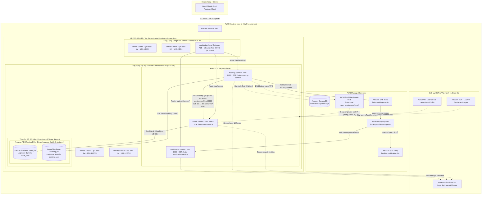
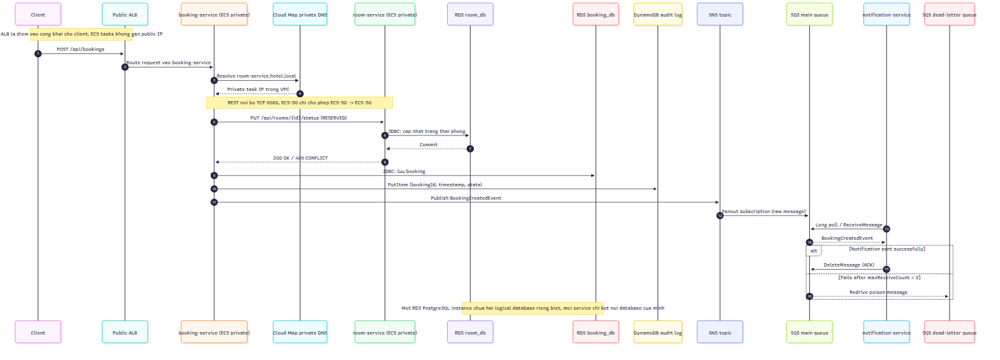
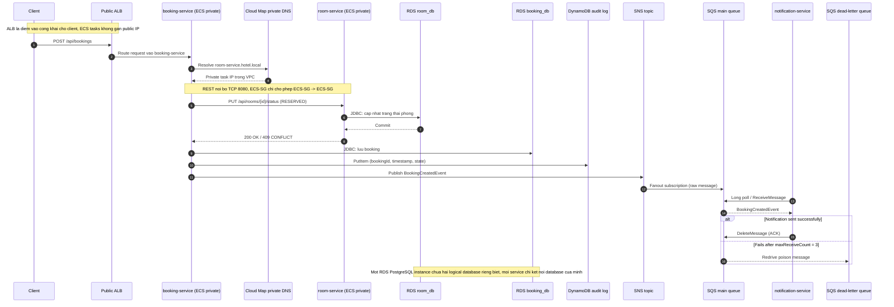

# KẾ HOẠCH & PHÂN CHIA NHIỆM VỤ ĐỒ ÁN (WORKLOG)

## 📌 THÔNG TIN ĐỒ ÁN
- **Đề tài:** Hệ thống đặt phòng khách sạn với kiến trúc microservices trên ECS (Nhóm: Capstone)
- **Học phần:** Điện toán đám mây (Cloud) - Đợt 1 (Năm học 2026–2027)
- **Giảng viên hướng dẫn (GVHD):** Huỳnh Xuân Phụng
- **Công nghệ & Dịch vụ:** Java 17, Spring Boot, Docker, AWS (ECS Fargate, ECR, ALB path-based routing, RDS, DynamoDB, SNS, SQS, CloudWatch)

---

## 👥 THÀNH VIÊN NHÓM
1. **Cao Hoàng Phúc** - MSSV: `24110303` (Thành viên 1)
2. **Phan Thị Thùy Linh** - MSSV: `24110271` (Thành viên 2)

---

## 📅 PHÂN CHIA NHIỆM VỤ TUẦN 1 (DỰNG NỀN TẢNG & MÔI TRƯỜNG)

### 🔹 Thành viên 1: Cao Hoàng Phúc (MSSV: 24110303)
- **Vai trò:** Phụ trách Hạ tầng mạng (VPC/Subnets/Route Tables), Thiết kế kiến trúc & Bảo mật mạng (Security Groups).
- **Số giờ thực hiện:** 9.0 giờ
- **Trạng thái:** Hoàn thành
- **Công việc chi tiết:**
  1. Nghiên cứu tài liệu về ECS Fargate, ALB Path-based routing và CloudWatch.
  2. Thiết kế và vẽ sơ đồ kiến trúc tổng thể cho toàn bộ hệ thống microservices (Đã hoàn thành sơ đồ chi tiết bên dưới).
  3. Tạo VPC (`10.0.0.0/16`) trên AWS Learner Lab tại Region `us-east-1`.
  4. Chia 4 Subnets gồm 2 Public Subnets và 2 Private Subnets trải trên 2 Availability Zones (`us-east-1a`, `us-east-1b`).
  5. Cấu hình Internet Gateway và Route Tables tương ứng cho Public/Private Subnets.
  6. Thiết lập các Security Groups phân tầng: ALB SG mở port 80/443, ECS SG chỉ nhận cổng 8080 từ ALB SG.
  7. Gắn tag `Project` và `Owner` cho toàn bộ tài nguyên mạng vừa tạo.

---

### 🔹 Thành viên 2: Phan Thị Thùy Linh (MSSV: 24110271)
- **Vai trò:** Khởi tạo Source Code Skeleton, Dockerfile đa tầng & ECR Repositories; Đặc tả Communication Pattern & Database Strategy.
- **Số giờ thực hiện:** 9.0 giờ
- **Trạng thái:** Hoàn thành
- **Công việc chi tiết:**
  1. Nghiên cứu tài liệu về ECR, cơ chế Event-driven qua SNS/SQS, lưu trữ với RDS và DynamoDB.
  2. Khởi tạo repository trên Git, tạo khung thư mục (skeleton) cho 3 microservices: `room-service`, `booking-service` và `notification-service`.
  3. Viết Dockerfile cơ bản (multi-stage build) và tạo endpoint health check cho từng service.
  4. Chạy thử nghiệm `docker build` và `docker run` trên môi trường máy cục bộ để đảm bảo container hoạt động.
  5. Tạo 3 kho chứa ECR Repositories trên AWS (`hotel-room-service`, `hotel-booking-service`, `hotel-notification-service`).
  6. Gắn tag `Project` và `Owner` cho các ECR Repositories.
  7. Kiểm tra quyền IAM, xác nhận sử dụng `LabRole` / `LabInstanceProfile` theo đúng quy định của AWS Learner Lab.
  8. Xây dựng tài liệu đặc tả chi tiết **Communication Pattern** (API Contract REST DTOs, Event Payload Schema SNS/SQS, Idempotency).
  9. Xây dựng tài liệu đặc tả chi tiết **Database Strategy** (Database-per-service logical isolation, ERD RDS, bảng Audit Logs trên DynamoDB, Eventual Consistency).

---

## 🏛️ SƠ ĐỒ THIẾT KẾ KIẾN TRÚC HỆ THỐNG (SYSTEM ARCHITECTURE)

### 1. Sơ đồ kiến trúc hạ tầng AWS (AWS Cloud Infrastructure Diagram)
Kiến trúc phân tầng bảo mật trên AWS Learner Lab (`us-east-1`), phân tách Multi-AZ Public / Private Subnets, cân bằng tải qua Application Load Balancer (ALB) Path-based Routing, các microservices chạy trên ECS Fargate trong mạng Private, lưu trữ đa tầng (RDS & DynamoDB), truyền thông điệp bất đồng bộ (SNS / SQS) và ghi log tập trung qua CloudWatch:




**Đường gọi nội bộ được chọn:** dùng AWS Cloud Map với private DNS namespace `hotel.local`; `booking-service` gọi `http://room-service.hotel.local:8080` để kiểm tra/giữ phòng. Cloud Map phân giải tên thành private IP của task trong VPC. Lưu lượng đi thẳng giữa các task qua cổng `8080`, được giới hạn bởi rule self-reference ECS-SG; ALB công khai chỉ là điểm vào cho client và không nằm trên đường gọi service-to-service. Các ECS task dự kiến chạy trong private subnet, không gán public IP.

**Trạng thái triển khai:** AWS Console đã có rule ECS-SG cho TCP `8080` từ chính ECS-SG, nhưng tài khoản hiện chưa có ECS cluster/service nên private namespace, đăng ký Cloud Map và kiểm thử DNS/REST chưa được triển khai. Sơ đồ mô tả kiến trúc mục tiêu; không xem các phần chưa triển khai là tài nguyên đang chạy.

---

### 2. Sơ đồ luồng giao tiếp đồng bộ & bất đồng bộ (Service Communication & Event-Driven Flow)
Mô tả chi tiết 2 cơ chế giao tiếp theo yêu cầu đề tài:
- **Giao tiếp đồng bộ (Synchronous REST):** Khi Client đặt phòng, `booking-service` phân giải `room-service.hotel.local` bằng Cloud Map private DNS rồi gọi REST trực tiếp tới private IP của `room-service` qua TCP `8080` trong VPC. Request từ Client đi qua public ALB; service-to-service không đi qua public ALB và không dùng public IP.
- **Giao tiếp bất đồng bộ (Asynchronous Event-Driven):** Sau khi đặt phòng thành công, `booking-service` gửi sự kiện vào `SNS Topic`, sự kiện được chuyển tiếp sang `SQS Queue`, và `notification-service` tiêu thụ hàng đợi để gửi thông báo xác nhận.
- **Database Strategy:** Một RDS PostgreSQL instance chứa hai logical database độc lập (`room_db`, `booking_db`); mỗi service chỉ kết nối database của mình. Audit log ghi sang DynamoDB. Queue chính chuyển poison message sang DLQ sau 3 lần nhận lỗi.



Nguồn Mermaid có thể chỉnh sửa: [`communication-pattern.mmd`](communication-pattern.mmd). Sơ đồ thể hiện kiến trúc mục tiêu; Cloud Map/ECS service discovery chưa triển khai vì ECS cluster chưa được tạo.



---

### 3. Bảng ánh xạ định tuyến trên ALB (Path-Based Routing Rules)

| Thứ tự ưu tiên | Đường dẫn (Path Pattern) | Cổng Service | Đích đến (Target Group) | Mục đích sử dụng |
| :---: | :--- | :---: | :--- | :--- |
| **1** | `/api/rooms*` | `8080` | `tg-hotel-room-service` | Tra cứu danh sách phòng, trạng thái phòng và quản lý phòng |
| **2** | `/api/bookings*` | `8080` | `tg-hotel-booking-service` | Tiếp nhận yêu cầu đặt phòng, quản lý lịch sử đặt chỗ |
| **3** | `/api/notifications*` | `8080` | `tg-hotel-notification-service` | Quản lý cấu hình thông báo, lịch sử thông báo đã gửi |
| **Default** | `/*` | `80` | `Default 404 / Health Check` | Trả về mã lỗi 404 hoặc trang kiểm tra trạng thái chung |

---

### 4. Bảng phân vùng mạng & Security Group (Network & Security Group Mapping)

| Tài nguyên | Định danh / Tên | CIDR / Port | Availability Zone | Mục đích & Chính sách bảo mật |
| :--- | :--- | :---: | :---: | :--- |
| **VPC** | `vpc-hotel-microservices` | `10.0.0.0/16` | Region `us-east-1` | Không gian mạng cô lập cho toàn bộ đồ án |
| **Public Subnet 1** | `subnet-public-1` | `10.0.1.0/24` | `us-east-1a` | Chứa ALB node 1, kết nối Internet qua IGW |
| **Public Subnet 2** | `subnet-public-2` | `10.0.2.0/24` | `us-east-1b` | Chứa ALB node 2, kết nối Internet qua IGW |
| **Private Subnet 1** | `subnet-private-1` | `10.0.11.0/24` | `us-east-1a` | Chứa ECS Fargate Tasks & Data layer (Nội bộ) |
| **Private Subnet 2** | `subnet-private-2` | `10.0.12.0/24` | `us-east-1b` | Chứa ECS Fargate Tasks & Data layer (Nội bộ) |
| **ALB-SG** | `sg-hotel-alb` | Inbound: `80, 443` (`0.0.0.0/0`) | - | Nhận request từ Internet và chuyển tiếp nội bộ |
| **ECS-SG** | `sg-hotel-ecs` | Inbound: TCP `8080` từ `ALB-SG` và từ chính `ECS-SG` | - | ALB chuyển request client vào service; self-reference cho phép Booking gọi Room qua private IP/DNS trong VPC, không mở cổng service ra Internet |
| **RDS-SG** | `sg-hotel-rds` | Inbound: TCP `5432` từ `ECS-SG` | - | Chỉ workload ECS được kết nối PostgreSQL; không cho phép truy cập công khai |

---

### 5. Đặc tả chi tiết mô hình giao tiếp (Communication Pattern Specification)
*(Do thành viên Phan Thị Thùy Linh thiết kế & phụ trách tích hợp)*

Hệ thống kết hợp cả hai mô hình truyền thông: **Đồng bộ (Synchronous REST)** cho các thao tác yêu cầu phản hồi tức thời để kiểm tra/giữ tài nguyên, và **Bất đồng bộ (Asynchronous Event-Driven)** cho các xử lý hậu kỳ không chặn luồng (non-blocking) như gửi thông báo xác nhận.

#### 5.1. Mô hình giao tiếp đồng bộ (Synchronous REST: Booking ➡️ Room)
Khi nhận yêu cầu tạo đơn từ khách hàng, `booking-service` gọi REST trực tiếp sang `room-service` trong mạng nội bộ VPC để kiểm tra trạng thái phòng và thực hiện khóa phòng (reserve):

- **Đường truyền nội bộ (phương án đã chọn):** AWS Cloud Map private DNS namespace `hotel.local`, tên dịch vụ `room-service.hotel.local`. `booking-service` gọi REST tại `http://room-service.hotel.local:8080`; DNS phân giải tới private IP task trong VPC, không đi qua public ALB và không dùng public IP. ECS-SG giới hạn TCP `8080` từ chính ECS-SG. Rule self-reference này đã có trên `hotel-booking-ecs-sg`; Cloud Map và ECS service registration chưa triển khai vì ECS cluster/service hiện chưa tồn tại.
- **Bảng đặc tả API Contract giữa các Service:**

| Phương thức | Endpoint | Service đích | Mục đích | Request Payload | Response mẫu | Mã HTTP |
| :---: | :--- | :---: | :--- | :--- | :--- | :---: |
| `GET` | `/api/rooms/{id}` | `room-service` | Kiểm tra phòng tồn tại & khả dụng | *Không có* | `{"roomId":101,"roomNumber":"A-101","type":"DELUXE","price":120.0,"status":"AVAILABLE"}` | `200 OK`<br>`404 NOT_FOUND` |
| `PUT` | `/api/rooms/{id}/status` | `room-service` | Cập nhật/Khóa trạng thái phòng | `{"status":"RESERVED","bookingId":"BK-1001"}` | `{"roomId":101,"status":"RESERVED","updatedAt":"2026-10-14T16:00:00Z"}` | `200 OK`<br>`409 CONFLICT` |

- **Cấu trúc DTO trao đổi mẫu (JSON):**
```json
// Request: Cập nhật trạng thái phòng
{
  "targetStatus": "RESERVED",
  "bookingReference": "BK-20261014-9981",
  "reason": "Lock room for pending customer booking"
}

// Response: Xác nhận trạng thái phòng
{
  "roomId": 101,
  "roomNumber": "A-101",
  "roomType": "DELUXE",
  "pricePerNight": 120.00,
  "status": "RESERVED",
  "lastUpdated": "2026-10-14T16:00:00.120Z"
}
```

- **Cơ chế chịu lỗi phân tán (Fault Tolerance & Resilience):**
  - **Connection & Read Timeout:** Cấu hình trong `RestClient` / `WebClient`: Connection Timeout = `3000ms`, Read Timeout = `5000ms`.
  - **Retry Policy:** Tối đa 2 lần retry với Exponential Backoff (`500ms`, `1000ms`) chỉ áp dụng cho các lỗi mạng (I/O, 503 Service Unavailable), không retry lỗi 4xx.
  - **Circuit Breaker:** Ngắt mạch khi tỷ lệ lỗi vượt quá 50% trong 10 cuộc gọi liên tiếp, trả về fallback response `ROOM_SERVICE_TEMPORARILY_UNAVAILABLE`.

#### 5.2. Mô hình giao tiếp bất đồng bộ (Asynchronous Event-Driven: Booking ➡️ SNS ➡️ SQS ➡️ Notification)
Sau khi `booking-service` ghi nhận đơn đặt phòng thành công vào cơ sở dữ liệu, service phát hành sự kiện (Publish Event) vào **Amazon SNS Topic**, sau đó cơ chế Fanout tự động đẩy sang **Amazon SQS Queue** để `notification-service` tiêu thụ (Consume) độc lập.

- **Đặc tả cấu trúc sự kiện (Event Schema - CloudEvents Envelope Standard):**
```json
{
  "eventId": "evt-7e4a8b2c-9d1f-4b3a-8210-e5c9f28a1102",
  "eventType": "BookingCreatedEvent",
  "eventSource": "com.hotel.booking-service",
  "eventTimestamp": "2026-10-14T16:00:05.450Z",
  "schemaVersion": "1.0",
  "data": {
    "bookingId": "BK-20261014-9981",
    "customerId": "CUST-5501",
    "customerName": "Nguyen Van A",
    "customerEmail": "nguyenvana@example.com",
    "customerPhone": "+84901234567",
    "roomId": 101,
    "roomNumber": "A-101",
    "checkInDate": "2026-10-20",
    "checkOutDate": "2026-10-23",
    "numberOfNights": 3,
    "totalPrice": 360.00,
    "currency": "USD",
    "bookingStatus": "CONFIRMED"
  }
}
```

- **Cơ chế đảm bảo chất lượng truyền thông điệp (QoS & Message Reliability):**
  - **At-least-once Delivery & Idempotency (Chống trùng lặp):** Amazon SQS đảm bảo gửi tin nhắn ít nhất 1 lần, có khả năng trùng lặp tin nhắn. `notification-service` duy trì bảng cache/DynamoDB kiểm tra `eventId`. Nếu `eventId` đã được đánh dấu là `PROCESSED`, service lập tức xác nhận xóa tin nhắn khỏi SQS mà không thực hiện gửi email lần 2.
  - **Dead Letter Queue (DLQ) & Redrive Policy:**
    - Queue chính: `booking-notification-queue` (Message Retention: 4 ngày).
    - Queue dự phòng lỗi: `booking-notification-dlq` (Message Retention: 14 ngày).
    - Thiết lập `maxReceiveCount = 3`: Khi `notification-service` ném ngoại lệ hoặc không thể xử lý sau 3 lần retry, message tự động chuyển về DLQ để bảo toàn dữ liệu và cảnh báo cho quản trị viên, tránh tình trạng tắc nghẽn hàng đợi chính (poison message).

---

### 6. Đặc tả chiến lược cơ sở dữ liệu (Database Strategy & Data Modeling)
*(Do thành viên Phan Thị Thùy Linh thiết kế & phụ trách mô hình hóa)*

#### 6.1. Triết lý Database-per-Service & Giải pháp thích ứng AWS Learner Lab
- **Nguyên tắc cốt lõi Microservices:** Mỗi dịch vụ phải tự làm chủ dữ liệu của mình (Loose Coupling). Tuyệt đối cấm các dịch vụ truy vấn hoặc join bảng trực tiếp sang database của dịch vụ khác.
- **Ràng buộc hạ tầng AWS Learner Lab:** Hạn mức ngân sách cố định $100 và số lượng RDS instances bị giới hạn (tối đa 1–2 DB instance loại nhỏ). Nếu tạo riêng biệt 3 RDS instance cho 3 microservices sẽ gây cạn kiệt tài nguyên vCPU và chi phí vượt định mức.
- **Giải pháp cách ly logic (Logical Database Isolation):**
  - Nhóm sử dụng **1 RDS PostgreSQL instance** (`hotel-db-instance`) để tiết kiệm hạn mức, nhưng tạo **2 logical database riêng biệt** (database, không phải schema):
    - `room_db`: mục tiêu cấp quyền kết nối cho login role `room_user`.
    - `booking_db`: mục tiêu cấp quyền kết nối cho login role `booking_user`.
  - Sau khi tạo các login role, `room_user` sẽ không có quyền trên `booking_db` và `booking_user` sẽ không có quyền trên `room_db`. Đây là phân quyền mục tiêu; tại thời điểm cập nhật, hai role này chưa được tạo.

**Trạng thái AWS ngày 14/10/2026:** Hai database rỗng `room_db` và `booking_db` đã được tạo và xác minh trên RDS. Chưa tạo/xác minh hai login role, quyền sở hữu riêng hoặc bảng nghiệp vụ; không khẳng định hiện đã có phân quyền tách biệt ở tầng PostgreSQL.

#### 6.2. Sơ đồ dữ liệu quan hệ & NoSQL (Data Model & ERD Diagram)

> 🎨 **File thiết kế trực quan trên Draw.io:** Toàn bộ sơ đồ kiến trúc dữ liệu và ERD đã được thiết kế sẵn dưới dạng file Draw.io chuẩn tại [`docs/week-1/hotel-microservices-erd-and-db-strategy.drawio`](hotel-microservices-erd-and-db-strategy.drawio). Bạn có thể mở trực tiếp bằng extension **Draw.io Integration** trên VS Code hoặc truy cập trang web [app.diagrams.net](https://app.diagrams.net) và chọn *Open Existing Diagram*.

```mermaid
erDiagram
    loai_phong ||--|{ phong : "co"
    phong ||--o{ dat_phong : "duoc dat"
    khach_hang ||--o{ dat_phong : "thuc hien"
    dat_phong ||--|| thanh_toan : "thanh toan"
    dat_phong ||--o{ thong_bao : "gui"
    dich_vu ||--o{ chi_tiet_dich_vu : "bao gom"
    dat_phong ||--o{ chi_tiet_dich_vu : "su dung"
    dat_phong ||--o{ nhat_ky_trang_thai : "ghi nhat ky"

    loai_phong {
        bigserial id PK
        varchar ten_loai UK
        text mo_ta
        int suc_chua
        decimal gia_mot_dem
    }

    phong {
        bigserial id PK
        bigint loai_phong_id FK
        varchar so_phong UK
        int tang
        varchar trang_thai
        datetime ngay_tao
        datetime ngay_cap_nhat
    }

    khach_hang {
        varchar id PK
        varchar ho_ten
        varchar email UK
        varchar so_dien_thoai
        varchar cmnd_cccd
        datetime ngay_tao
    }

    dat_phong {
        varchar id PK
        varchar so_dat_phong UK
        varchar khach_hang_id FK
        bigint phong_id FK
        date ngay_nhan_phong
        date ngay_tra_phong
        int so_dem
        decimal tong_tien
        varchar trang_thai
        datetime ngay_tao
        datetime ngay_cap_nhat
    }

    thanh_toan {
        varchar id PK
        varchar dat_phong_id FK
        varchar phuong_thuc
        decimal so_tien
        varchar trang_thai
        varchar ma_giao_dich UK
        datetime thoi_gian
    }

    thong_bao {
        varchar id PK
        varchar dat_phong_id FK
        varchar loai_thong_bao
        varchar tieu_de
        varchar nguoi_nhan
        varchar trang_thai
        datetime thoi_gian_gui
    }

    dich_vu {
        varchar id PK
        varchar ten_dich_vu UK
        decimal don_gia
        varchar don_vi
        varchar trang_thai
    }

    chi_tiet_dich_vu {
        varchar id PK
        varchar dat_phong_id FK
        varchar dich_vu_id FK
        int so_luong
        decimal don_gia
        decimal thanh_tien
        varchar ghi_chu
    }

    nhat_ky_trang_thai {
        varchar booking_id PK "Partition Key"
        varchar thoi_gian SK "Sort Key"
        varchar ma_nhat_ky
        varchar hanh_dong
        varchar trang_thai_truoc
        varchar trang_thai_moi
        varchar nguoi_thuc_hien
        text chi_tiet
    }
```

##### 📦 Database 1: `room_db` (Dành riêng cho Room Service)
Quản lý danh mục phòng khách sạn và tình trạng sẵn sàng của từng phòng.

```
+---------------------------------------------------------------------------------+
|                                 TABLE: rooms                                    |
+-------------------+---------------+----------+----------------------------------+
| Tên cột           | Kiểu dữ liệu  | Khóa     | Mô tả / Ràng buộc                |
+-------------------+---------------+----------+----------------------------------+
| id                | BIGSERIAL     | PK       | Định danh phòng (Primary Key)    |
| room_number       | VARCHAR(20)   | UNIQUE   | Số hiệu phòng (vd: A-101, B-202) |
| type              | VARCHAR(50)   | NOT NULL | Loại phòng: SINGLE, DOUBLE, SUITE|
| price_per_night   | NUMERIC(10,2) | NOT NULL | Giá thuê một đêm (USD)           |
| status            | VARCHAR(30)   | NOT NULL | AVAILABLE, RESERVED, OCCUPIED    |
| description       | TEXT          | NULL     | Tiện ích đi kèm của phòng        |
| created_at        | TIMESTAMP     | NOT NULL | Thời điểm khởi tạo bản ghi       |
| updated_at        | TIMESTAMP     | NOT NULL | Thời điểm cập nhật trạng thái    |
+-------------------+---------------+----------+----------------------------------+
```

##### 📋 Database 2: `booking_db` (Dành riêng cho Booking Service)
Lưu trữ các giao dịch đặt phòng, dữ liệu khách hàng và trạng thái vòng đời đơn đặt.

```
+---------------------------------------------------------------------------------+
|                                TABLE: bookings                                  |
+-------------------+---------------+----------+----------------------------------+
| Tên cột           | Kiểu dữ liệu  | Khóa     | Mô tả / Ràng buộc                |
+-------------------+---------------+----------+----------------------------------+
| id                | VARCHAR(36)   | PK       | Mã UUID đơn đặt phòng            |
| booking_code      | VARCHAR(30)   | UNIQUE   | Mã tra cứu thân thiện (BK-XXXX)  |
| customer_id       | VARCHAR(50)   | NOT NULL | Mã định danh khách hàng          |
| customer_name     | VARCHAR(100)  | NOT NULL | Họ và tên khách hàng             |
| customer_email    | VARCHAR(150)  | NOT NULL | Email liên hệ nhận thông báo     |
| customer_phone    | VARCHAR(20)   | NULL     | Số điện thoại người đặt          |
| room_id           | BIGINT        | NOT NULL | Mã phòng (Tham chiếu logic)      |
| check_in_date     | DATE          | NOT NULL | Ngày bắt đầu nhận phòng          |
| check_out_date    | DATE          | NOT NULL | Ngày trả phòng                   |
| total_price       | NUMERIC(12,2) | NOT NULL | Tổng tiền thanh toán (USD)       |
| status            | VARCHAR(30)   | NOT NULL | PENDING, CONFIRMED, CANCELLED    |
| created_at        | TIMESTAMP     | NOT NULL | Thời điểm khách tạo đơn          |
| updated_at        | TIMESTAMP     | NOT NULL | Thời điểm cập nhật đơn           |
+-------------------+---------------+----------+----------------------------------+
```

#### 6.3. Sơ đồ dữ liệu NoSQL (Amazon DynamoDB - Audit Logging & State History)
- **Lý do lựa chọn DynamoDB cho Audit Trail:**
  - Nhật ký thay đổi trạng thái và dấu vết kiểm toán (Audit Log) có tần suất ghi liên tục (Write-heavy), tính chất chỉ chèn thêm (Append-only), không đòi hỏi JOIN phức tạp.
  - Sử dụng Amazon DynamoDB giúp phân tách triệt để luồng ghi log ra khỏi RDS, đảm bảo hiệu năng tối đa cho các giao dịch nghiệp vụ chính, đồng thời hỗ trợ mở rộng tự động với chế độ tính cước `On-Demand`.
- **Cấu hình bảng `hotel-booking-audit-logs`:**
  - **Partition Key (PK):** `bookingId` (String) - Nhóm toàn bộ lịch sử trạng thái của cùng một đơn đặt phòng vào một Partition.
  - **Sort Key (SK):** `timestamp` (String ISO-8601) - Sắp xếp dòng lịch sử thay đổi theo trình tự thời gian chính xác đến mili-giây.
- **Cấu trúc Document mẫu (JSON Item trong DynamoDB):**
```json
{
  "bookingId": "BK-20261014-9981",
  "timestamp": "2026-10-14T16:00:05.120Z",
  "auditId": "aud-1a2b3c-4d5e-6f7a",
  "action": "STATUS_CHANGED",
  "previousStatus": "PENDING",
  "newStatus": "CONFIRMED",
  "actor": "system-booking-worker",
  "details": {
    "roomId": 101,
    "paymentReference": "PAY-SUCCESS-9921",
    "sourceIp": "10.0.11.45"
  }
}
```

#### 6.4. Chiến lược đảm bảo tính nhất quán dữ liệu (Data Consistency Strategy)
Do các microservices sở hữu cơ sở dữ liệu riêng, hệ thống không áp dụng giao dịch phân tán (Two-Phase Commit - 2PC) nhằm tránh nguy cơ thắt nút cổ chai (blocking) và giảm tính sẵn sàng của hệ thống. Thay vào đó, nhóm áp dụng mô hình **Nhất quán cuối cùng (Eventual Consistency)** theo chu trình nghiệp vụ (Choreography Transaction Pattern):

1. **Khởi tạo (Pending):** Khi khách bấm đặt phòng, `booking-service` tạo bản ghi với trạng thái `PENDING`.
2. **Khóa tạm thời (Reserve):** `booking-service` gửi request đồng bộ sang `room-service` để cập nhật trạng thái phòng thành `RESERVED`.
3. **Xác nhận giao dịch (Confirm):**
   - Nếu phòng khả dụng và được khóa thành công: `booking-service` cập nhật đơn thành `CONFIRMED`, ghi audit log vào DynamoDB và phát sinh sự kiện `BookingCreatedEvent` sang Amazon SNS.
   - Nếu phòng không khả dụng (xung đột do khách khác đặt cùng lúc): `booking-service` hủy đơn với mã lỗi `409 CONFLICT`, trả thông báo rõ ràng cho Client.
4. **Giao dịch bù trừ (Compensating Transaction):** Nếu sau khi khóa phòng mà quá trình ghi đơn hoặc thanh toán bị gián đoạn, `booking-service` tự động kích hoạt lời gọi bù trừ (Compensating Call) sang `room-service` để hoàn trả trạng thái phòng về `AVAILABLE`, loại bỏ hoàn toàn nguy cơ treo phòng (deadlock).

---

## 🗓️ KẾ HOẠCH CÁC TUẦN TIẾP THEO
- **Tuần 2:** Triển khai các chức năng lõi trên AWS, kiểm thử từng thành phần.
- **Tuần 3:** Tích hợp, bảo mật, giám sát (CloudWatch); tự động hóa / IaC nếu có.
- **Tuần 4:** Kiểm thử tổng thể, tối ưu chi phí, dọn dẹp tài nguyên; viết báo cáo và demo.
