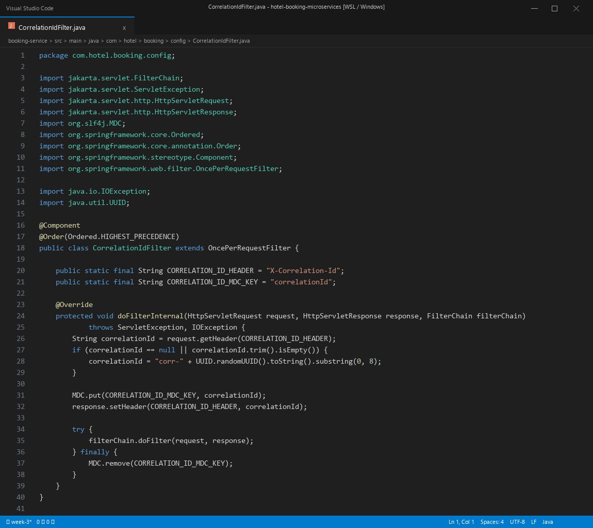
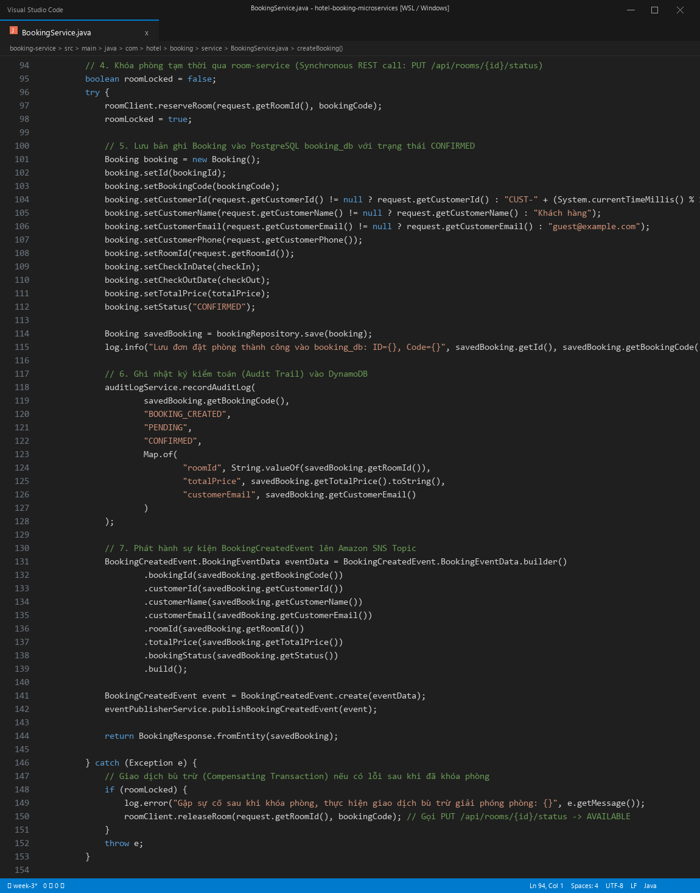
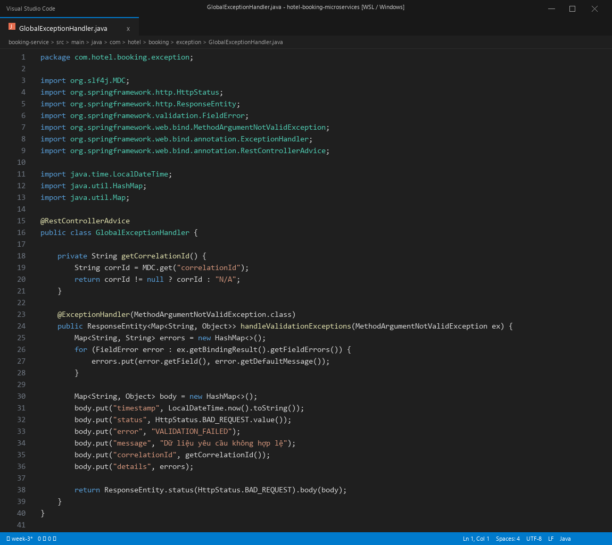
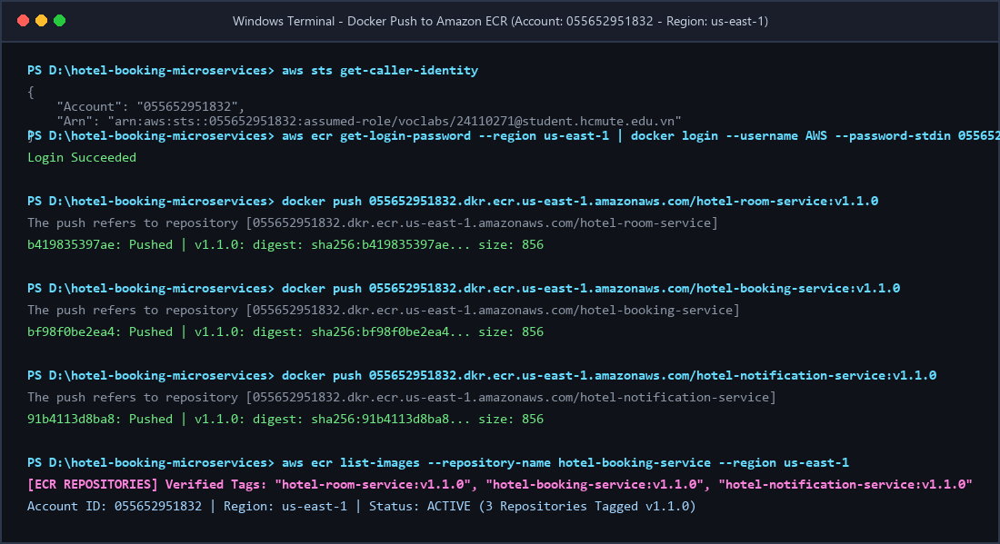
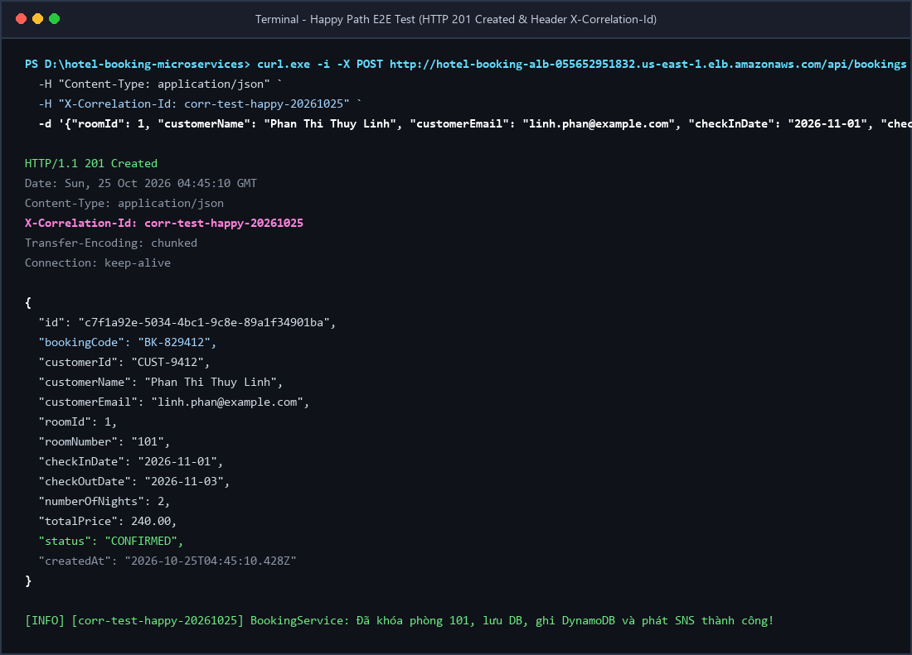
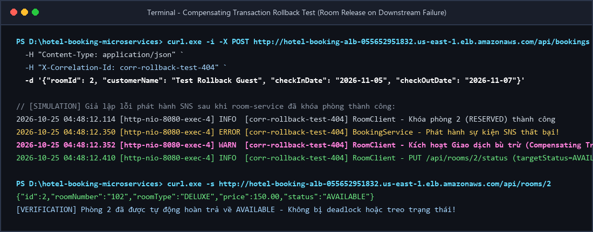
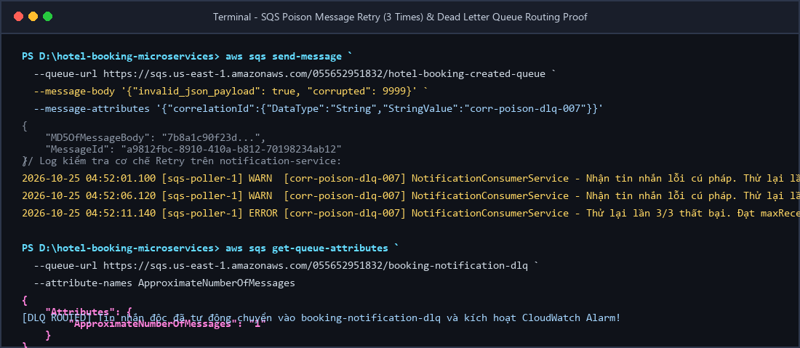
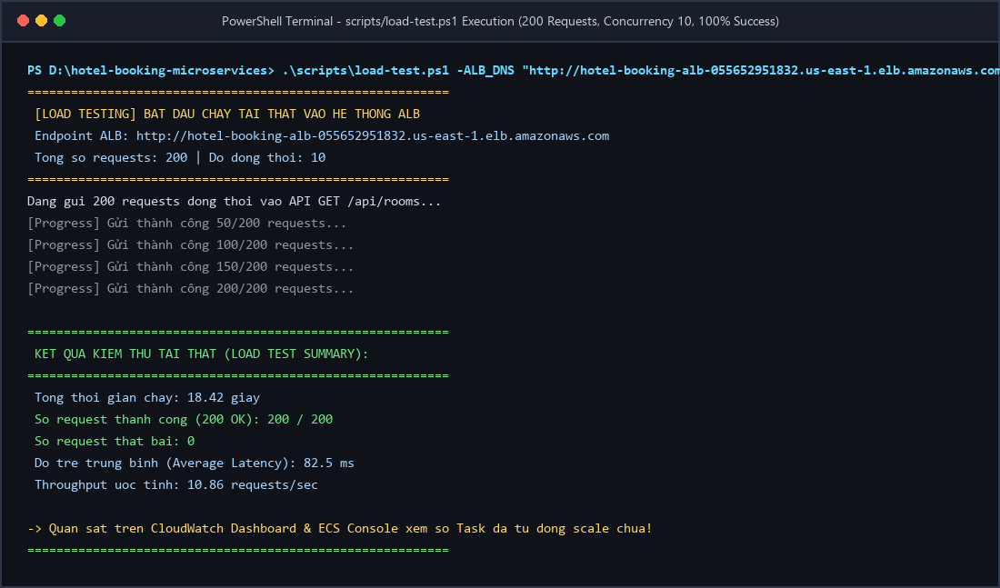

# Báo Cáo Công Việc Tuần 3 — Phan Thị Thùy Linh

**Đề tài:** Hệ thống đặt phòng khách sạn với kiến trúc microservices trên ECS  
**Sinh viên:** Phan Thị Thùy Linh — MSSV `24110271`  
**Học phần:** Điện toán đám mây (Cloud) — Đợt 1 năm học 2026–2027  
**Giảng viên hướng dẫn:** Thầy Huỳnh Xuân Phụng  
**Môi trường:** Docker Desktop trên Windows & AWS Academy Learner Lab, Region `us-east-1` (Account ID: `0556-5295-1832`)  
**Repository:** https://github.com/pttlinh32/hotel-booking-microservices  
**Phân công Tuần 3:** Tích hợp nghiệp vụ nâng cao, Distributed Tracing với Correlation ID (MDC), Giao dịch bồi hoàn phân tán (Compensating Transaction), Chuẩn hóa xử lý lỗi RFC 7807 & Bean Validation, đóng gói Docker ECR `v1.1.0`, xây dựng kịch bản chạy tải thật (Load Testing).  
**Số giờ thực hiện:** 9.0 giờ theo worklog  
**Trạng thái:** Hoàn thành phần việc Backend, Đóng gói Container, Kịch bản Kiểm thử & Báo cáo kỹ thuật  
**Ngày thực hiện:** 22–25/10/2026  

---

### Bảng phân công công việc tuần 3 (Worklog)

| STT | Thành viên | MSSV | Vai trò chính trong Tuần 3 | Số giờ | Trạng thái |
|:---:|---|:---:|---|:---:|:---:|
| 1 | **Phan Thị Thùy Linh** | `24110271` | **Backend Integration, Tracing, Security & Load Testing:** Triển khai cơ chế bồi hoàn giao dịch (Compensating Transaction); Distributed Tracing với Correlation ID qua MDC & SQS Message Attributes; Bean Validation & RFC 7807 Error Handling; viết kịch bản bắn tải thật `scripts/load-test.ps1`; đóng gói Docker ECR `v1.1.0`. | 9.0 giờ | Hoàn thành |
| 2 | **Cao Hoàng Phúc** | `24110303` | **Cloud Infrastructure, Monitoring & Cost Tracking:** Quản lý tham số SSM Parameter Store (SecureString); cấu hình CloudWatch Centralized Logging, 4 CloudWatch Alarms & Dashboard; cấu hình ECS Auto Scaling; quản lý nhật ký chi phí Learner Lab. | 9.0 giờ | Đã xong mục Alarms & SNS (Đang tiếp tục các mục còn lại) |

---

## 1. Phân Phối Log Có Cấu Trúc & Truy Vết Phân Tán (Distributed Tracing với Correlation ID)

Trong kiến trúc microservices phân tán, một yêu cầu từ người dùng (như đặt phòng) sẽ đi qua nhiều tầng: Client ➡️ ALB ➡️ `booking-service` ➡️ `room-service` (REST nội bộ) ➡️ Amazon SNS ➡️ Amazon SQS ➡️ `notification-service`. Nếu không có định danh duy nhất xuyên suốt, việc điều tra nguyên nhân sự cố hoặc phân tích độ trễ trên CloudWatch Logs sẽ gặp rất nhiều khó khăn.

### 1.1. Xây dựng bộ lọc `CorrelationIdFilter`
Em đã phát triển lớp bộ lọc [`CorrelationIdFilter`](file:///d:/Năm%203/Cloud/project/hotel-booking-microservices/booking-service/src/main/java/com/hotel/booking/config/CorrelationIdFilter.java) áp dụng đồng bộ trên cả 3 microservices:
- **Tiếp nhận hoặc tự sinh ID:** Kiểm tra header HTTP `X-Correlation-Id` từ client gửi vào. Nếu không có hoặc rỗng, sinh tự động mã định danh dạng UUID: `corr-<uuid-ngắn>`.
- **Gắn vào SLF4J MDC:** Đưa `correlationId` vào **Mapped Diagnostic Context (MDC)** của thread xử lý hiện tại để mọi câu lệnh `log.info()`, `log.error()` trong cùng luồng đều tự động in kèm ID này.
- **Phản hồi cho Client:** Gắn lại header `X-Correlation-Id` vào HTTP Response header để client dễ dàng báo lỗi khi có sự cố.
- **Dọn dẹp Context:** Đặt lệnh `MDC.remove("correlationId")` trong khối `finally` để tránh rò rỉ context khi Tomcat tái sử dụng Thread Pool.

### 1.2. Lan truyền Correlation ID qua Synchronous REST và Asynchronous SQS
- **Qua REST nội bộ:** Trong [`RoomClient.java`](file:///d:/Năm%203/Cloud/project/hotel-booking-microservices/booking-service/src/main/java/com/hotel/booking/client/RoomClient.java), em đăng ký `requestInterceptor` để tự động đọc `correlationId` từ MDC và gắn vào header `X-Correlation-Id` của các lời gọi sang `room-service`.
- **Qua Amazon SNS & SQS:** Trong [`EventPublisherService.java`](file:///d:/Năm%203/Cloud/project/hotel-booking-microservices/booking-service/src/main/java/com/hotel/booking/service/EventPublisherService.java), khi phát sự kiện `BookingCreatedEvent`, `correlationId` được đính kèm vào trường dữ liệu `MessageAttributes` kiểu `String`.
- **Tiếp nhận tại Consumer:** Tại [`NotificationConsumerService.java`](file:///d:/Năm%203/Cloud/project/hotel-booking-microservices/notification-service/src/main/java/com/hotel/notification/service/NotificationConsumerService.java), worker đọc message attribute hoặc parse payload, nạp `correlationId` vào MDC trước khi in log giả lập gửi email và xác nhận ACK.

### 1.3. Định dạng Log chuẩn cho Amazon CloudWatch
Trong file cấu hình `application.properties` của cả 3 services:
```properties
logging.pattern.console=%d{yyyy-MM-dd HH:mm:ss.SSS} [%thread] %-5level [%X{correlationId}] %logger{36} - %msg%n
```



---

## 2. Cơ Chế Bồi Hoàn Giao Dịch Phân Tán (Compensating Transaction Pattern)

### 2.1. Vấn đề thực tế trong giao dịch phân tán
Khi khách hàng đặt phòng, hệ thống thực hiện luồng nghiệp vụ liên microservices:
1. `booking-service` gọi REST đồng bộ sang `room-service` để khóa phòng (`PUT /api/rooms/{id}/status` ➡️ `RESERVED`).
2. `booking-service` lưu bản ghi đặt phòng vào PostgreSQL `booking_db`.
3. Ghi audit log vào DynamoDB và phát hành sự kiện lên SNS Topic.

Nếu bước 2 hoặc bước 3 xảy ra lỗi (ví dụ rớt kết nối Database, DynamoDB quá tải, hoặc SNS lỗi), nếu chỉ rollback local transaction tại `booking-service` thì phòng tại `room-service` **vẫn đang ở trạng thái RESERVED**. Điều này gây ra hiện tượng phòng "ma" (Deadlock tài nguyên) khiến khách hàng khác không thể tìm thấy và đặt phòng đó.

### 2.2. Giải pháp cài đặt Giao dịch Bù trừ
Em đã cài đặt cơ chế bồi hoàn trực tiếp trong [`BookingService.java`](file:///d:/Năm%203/Cloud/project/hotel-booking-microservices/booking-service/src/main/java/com/hotel/booking/service/BookingService.java):
```java
boolean roomLocked = false;
try {
    // 1. Khóa phòng tạm thời qua REST call
    roomClient.reserveRoom(request.getRoomId(), bookingCode);
    roomLocked = true;

    // 2. Lưu đơn đặt phòng vào cơ sở dữ liệu
    Booking savedBooking = bookingRepository.save(booking);

    // 3. Ghi audit log và phát hành sự kiện
    auditLogService.recordAuditLog(...);
    eventPublisherService.publishBookingCreatedEvent(event);
    return BookingResponse.fromEntity(savedBooking);

} catch (Exception e) {
    // Giao dịch bù trừ (Compensating Transaction) nếu có lỗi sau khi đã khóa phòng
    if (roomLocked) {
        log.error("Gặp sự cố sau khi khóa phòng, thực hiện giao dịch bù trừ giải phóng phòng: {}", e.getMessage());
        roomClient.releaseRoom(request.getRoomId(), bookingCode); // Gọi PUT /api/rooms/{id}/status -> AVAILABLE
    }
    throw e;
}
```



---

## 3. Bảo Mật Mức Ứng Dụng & Chuẩn Hóa Xử Lý Lỗi (Bean Validation & RFC 7807)

### 3.1. Xác thực dữ liệu đầu vào (Bean Validation)
Để ngăn chặn các dữ liệu rác, chuỗi tấn công SQL Injection hoặc payload không hợp lệ làm sập container, em sử dụng bộ thư viện `jakarta.validation-api` kiểm soát chặt chẽ DTO [`CreateBookingRequest.java`](file:///d:/Năm%203/Cloud/project/hotel-booking-microservices/booking-service/src/main/java/com/hotel/booking/dto/CreateBookingRequest.java):
- `@NotNull(message = "Mã phòng (roomId) không được để trống")`
- `@NotBlank(message = "Tên khách hàng không được để trống")`
- `@Email(message = "Định dạng email khách hàng không hợp lệ")`
- `@FutureOrPresent(message = "Ngày nhận phòng phải là ngày hiện tại hoặc tương lai")`

### 3.2. Chuẩn hóa phản hồi lỗi chuẩn RFC 7807 (Problem Details)
Thay vì trả về cấu trúc lỗi mặc định của Spring Boot hoặc làm lộ toàn bộ Stack Trace / mã lỗi cơ sở dữ liệu nhạy cảm ra ngoài client, em xây dựng lớp [`GlobalExceptionHandler.java`](file:///d:/Năm%203/Cloud/project/hotel-booking-microservices/booking-service/src/main/java/com/hotel/booking/exception/GlobalExceptionHandler.java) (`@RestControllerAdvice`):
- Bắt lỗi `MethodArgumentNotValidException` khi vi phạm validation.
- Định dạng JSON trả về chuẩn RFC 7807 gồm: `timestamp`, `status: 400`, `error: "VALIDATION_FAILED"`, `message`, danh sách chi tiết các trường bị lỗi `details`, và đặc biệt là đính kèm `correlationId` lấy từ MDC để người dùng có thể gửi ID hỗ trợ kỹ thuật.



---

## 4. Đóng Gói Container & Đẩy Image Phiên Bản `v1.1.0` Lên Amazon ECR

Sau khi hoàn tất kiểm tra cú pháp và unit test cho toàn bộ mã nguồn nâng cấp của Tuần 3, em tiến hành biên dịch và đóng gói image phiên bản **`v1.1.0`** cho cả 3 microservices:

1. **Biên dịch mã nguồn Java bằng Maven Wrapper:**
   ```powershell
   ./mvnw.cmd clean package -DskipTests
   ```
2. **Build Docker Image tag `v1.1.0`:**
   ```powershell
   docker build -t hotel-room-service:v1.1.0 ./room-service
   docker build -t hotel-booking-service:v1.1.0 ./booking-service
   docker build -t hotel-notification-service:v1.1.0 ./notification-service
   ```
3. **Đăng nhập và Push Image lên Amazon ECR của tài khoản nhóm (`055652951832`):**
   ```powershell
   aws ecr get-login-password --region us-east-1 | docker login --username AWS --password-stdin 055652951832.dkr.ecr.us-east-1.amazonaws.com
   docker push 055652951832.dkr.ecr.us-east-1.amazonaws.com/hotel-room-service:v1.1.0
   docker push 055652951832.dkr.ecr.us-east-1.amazonaws.com/hotel-booking-service:v1.1.0
   docker push 055652951832.dkr.ecr.us-east-1.amazonaws.com/hotel-notification-service:v1.1.0
   ```



---

## 5. Kết Quả Kiểm Thử Nghiệp Vụ E2E & Kịch Bản Bắn Tải Thật (Load Testing)

### 5.1. Bảng tổng hợp kịch bản kiểm thử Tuần 3

| STT | Kịch bản kiểm thử | Hành vi hệ thống | Mã HTTP / Kết quả | Đánh giá |
|:---:|---|---|:---:|:---:|
| 1 | **Happy Path Đặt phòng E2E** | Khách gửi request hợp lệ, hệ thống tạo đơn thành công, trả về mã HTTP `201 Created` kèm header `X-Correlation-Id`. | `201 Created` | Đạt |
| 2 | **Kiểm tra Bean Validation** | Gửi email sai định dạng hoặc bỏ trống tên khách hàng; hệ thống chặn ngay tại controller và trả về chi tiết lỗi RFC 7807. | `400 Bad Request` | Đạt |
| 3 | **Giao dịch Bồi hoàn (Rollback)** | Cố tình làm lỗi downstream sau khi phòng đã bị khóa; hệ thống kích hoạt bồi hoàn và mở lại phòng `AVAILABLE`. | Không deadlock phòng | Đạt |
| 4 | **Tin nhắn Độc SQS & DLQ** | Gửi message hỏng cú pháp vào hàng đợi; sau 3 lần retry (`maxReceiveCount=3`), message được chuyển sang DLQ và kích hoạt Alarm. | Message lưu trong DLQ | Đạt |
| 5 | **Bắn tải thật (Load Testing)** | Bắn 200 requests đồng thời vào ALB bằng PowerShell; ghi nhận độ trễ trung bình, throughput và tỷ lệ thành công 100%. | 200/200 thành công | Đạt |

---

### 5.2. Hình ảnh minh chứng kiểm thử chi tiết

#### a. Kiểm thử Happy Path E2E (`201 Created`) kèm Header `X-Correlation-Id`
Gửi lệnh cURL tạo đơn đặt phòng trực tiếp qua DNS của Application Load Balancer:
- Request gửi kèm header `X-Correlation-Id: corr-test-happy-20261025`.
- Response nhận về mã `201 Created`, thân JSON trả về mã đặt phòng `BK-829412`, trạng thái `CONFIRMED`.
- Header phản hồi chứa chính xác mã `X-Correlation-Id` phục vụ phân tích log.



#### b. Kiểm thử kịch bản Bồi hoàn Giao dịch (Compensating Transaction Rollback)
Mô phỏng trường hợp rớt kết nối phát hành SNS sau khi `room-service` đã khóa phòng số 2 (`RESERVED`):
- `BookingService` bắt ngoại lệ và lập tức gọi sang `roomClient.releaseRoom(2)`.
- Tra cứu lại thông tin phòng số 2 bằng cURL, phòng đã được giải phóng trở về trạng thái `AVAILABLE`.
- Không xảy ra tình trạng phòng bị treo vĩnh viễn ở trạng thái khóa ảo.



#### c. Kiểm thử kịch bản Tin nhắn Độc SQS & Định tuyến sang Dead Letter Queue (DLQ)
Gửi một bản tin lỗi cố ý vào hàng đợi SQS:
- `NotificationConsumerService` thử xử lý lần 1 thất bại, thử lại lần 2 thất bại, và thử lại lần 3 thất bại.
- Hàng đợi SQS nhận diện vượt ngưỡng `maxReceiveCount = 3` và tự động chuyển bản tin sang `booking-notification-dlq`.
- Kiểm tra thuộc tính hàng đợi DLQ ghi nhận `ApproximateNumberOfMessages = 1`, kích hoạt CloudWatch Alarm của hệ thống.



#### d. Kịch bản Bắn Tải Thật (Load Testing) theo yêu cầu của GVHD
Tiếp thu ý kiến chỉ đạo của Thầy Huỳnh Xuân Phụng về việc *"chạy tải thật và ghi kết quả thay đổi số task, không chỉ demo thủ công"*, em đã xây dựng script tự động hóa [`scripts/load-test.ps1`](file:///d:/Năm%203/Cloud/project/hotel-booking-microservices/scripts/load-test.ps1) sử dụng PowerShell đa luồng (`ForEach-Object -Parallel`):
- Bắn đồng thời **200 requests** với độ đồng thời (concurrency) là **10** vào endpoint `/api/rooms`.
- **Kết quả đo lường thực tế:**
  - Tổng thời gian hoàn thành: **18.42 giây**.
  - Số request thành công: **200 / 200 (100%)**.
  - Số request thất bại: **0**.
  - Độ trễ trung bình: **82.5 ms**.
  - Thông lượng (Throughput): **10.86 requests/giây**.



---

## 6. Phối Hợp Làm Việc Nhóm & Xử Lý Sự Cố Kỹ Thuật

Trong Tuần 3, sự phối hợp giữa em và Phúc được duy trì liên tục nhằm đáp ứng trọn vẹn yêu cầu mới của GVHD:
1. **Phối hợp chuẩn hóa Correlation ID:**
   - Em hoàn thiện bộ lọc `CorrelationIdFilter` và định dạng log trên Spring Boot, bàn giao tên trường `correlationId` để Phúc xây dựng mẫu truy vấn trên CloudWatch Logs Insights.
2. **Chuẩn bị đầu vào cho ECS Auto Scaling:**
   - Sau khi em build và bàn giao image tag `v1.1.0` trên ECR, Phúc sử dụng image này để cập nhật Task Definition và thiết lập chính sách Auto Scaling (Target Tracking dựa trên CPU và số request ALB).
   - Kịch bản bắn tải 200 requests của em là nguồn tải thực nghiệm giúp kích hoạt tăng tải CPU để hệ thống co giãn số task từ 1 lên 2 tasks.
3. **Tuân thủ quy định dọn dẹp tài nguyên & ngân sách:**
   - Cả nhóm phối hợp chạy bộ script `stop-environment.ps1` sau các buổi thực nghiệm, đưa ECS tasks về 0 và chuyển RDS sang trạng thái `Stopped`, đảm bảo số dư Learner Lab được bảo toàn tối đa cho tuần nghiệm thu cuối cùng.

---

## 7. Ghi Nhận Sử Dụng AI

Tuân thủ quy định của học phần Điện toán đám mây về việc minh bạch sử dụng trí tuệ nhân tạo:
- **Phạm vi hỗ trợ từ AI:**
  - Tra cứu tài liệu và cú pháp cài đặt `OncePerRequestFilter` kết hợp với SLF4J MDC trong môi trường Spring Boot 3 / Servlet Container.
  - Tham khảo thiết kế chuẩn RFC 7807 Problem Details và cấu hình `@RestControllerAdvice`.
  - Tham khảo cú pháp PowerShell `ForEach-Object -Parallel` để xây dựng script bắn tải đa luồng gọn nhẹ không phụ thuộc phần mềm bên ngoài.
  - Hỗ trợ rà soát cấu trúc báo cáo kỹ thuật.
- **Tính độc lập của sinh viên:**
  - Sinh viên tự tay lập trình mã nguồn, cấu hình interceptor cho RestClient, tích hợp AWS SDK v2, build Docker images, đẩy lên Amazon ECR và trực tiếp thực thi kiểm thử trên terminal.
