# Báo cáo tuần 3 — Cao Hoàng Phúc

**Đề tài:** Hệ thống đặt phòng khách sạn với kiến trúc microservices trên ECS\
**Sinh viên:** Cao Hoàng Phúc — MSSV `24110303`\
**Phân công:** SSM Parameter Store, CloudWatch, ECS Auto Scaling và quản lý chi phí\
**Trạng thái:** Đã triển khai SSM, image v1.1.0, logging, alarms, dashboard và chính sách Auto Scaling; chưa kiểm thử tải thật theo giới hạn chỉ dùng UI; đang chốt dọn tài nguyên cuối phiên\
**Môi trường:** AWS Academy Learner Lab, tài khoản nhóm `055652951832`, Region `us-east-1`\
**Repository:** https://github.com/pttlinh32/hotel-booking-microservices\
**Ngày thực hiện:** 24–25/10/2026

## Công việc đã làm

### Thiết lập kênh nhận sự kiện cảnh báo bằng Amazon SNS

Em tạo SNS topic **`hotel-system-alerts`**, loại **Standard**, để tập trung sự kiện cảnh báo của hệ thống. Khi một CloudWatch alarm chuyển sang trạng thái `ALARM`, CloudWatch được cấu hình phát thông báo tới topic này.

Topic có ARN `arn:aws:sns:us-east-1:055652951832:hotel-system-alerts`. Em gắn cùng ARN này vào hành động **In alarm** của cả bốn alarm, giúp quản lý nơi nhận cảnh báo tập trung thay vì cấu hình riêng cho từng tài nguyên.

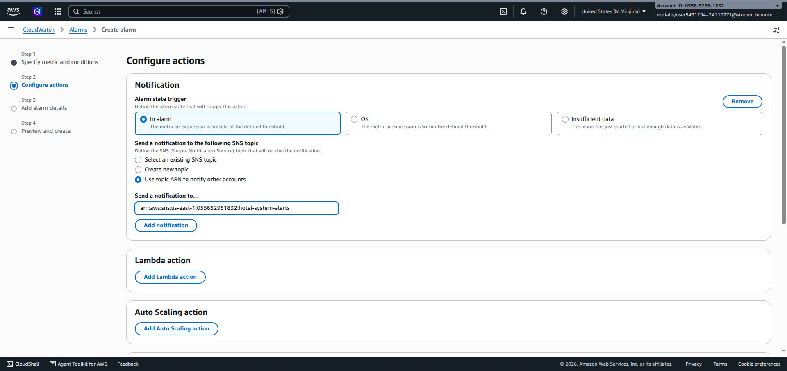

Topic hiện chưa có subscription. Vì vậy, phần đã hoàn thành là tạo kênh SNS và cấu hình hành động từ CloudWatch; chưa xác nhận việc gửi email hoặc chuyển thông báo tới người nhận cuối.

### Cấu hình cảnh báo CPU và bộ nhớ của ECS

Em cấu hình hai alarm theo dõi tài nguyên của **`booking-service`** trong cluster **`hotel-cluster`**. Cả hai sử dụng namespace `AWS/ECS`, với hai dimension `ClusterName=hotel-cluster` và `ServiceName=booking-service`. Việc chỉ định đủ dimension giúp alarm theo dõi đúng service thay vì gộp nhầm dữ liệu của các service khác.

| Alarm | Metric | Thống kê | Chu kỳ | Điều kiện kích hoạt |
|---|---|---|---|---|
| `ECS-High-CPU-Utilization` | `CPUUtilization` | Average | 60 giây | CPU ≥80% trong 2/2 kỳ đánh giá liên tiếp |
| `ECS-High-Memory-Utilization` | `MemoryUtilization` | Average | 60 giây | Memory ≥85% trong 2/2 kỳ đánh giá liên tiếp |

Với cấu hình trên, alarm CPU chỉ kích hoạt khi giá trị trung bình vượt hoặc bằng 80% trong hai phút liên tiếp. Điều này hạn chế cảnh báo do một lần tăng tải ngắn. Alarm bộ nhớ được cấu hình tương tự với ngưỡng 85%.

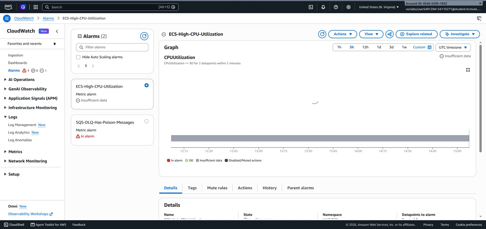

Em tạo alarm bộ nhớ từ cấu hình CPU, đổi metric thành `MemoryUtilization`, đổi ngưỡng thành `85` và đặt tên alarm riêng. Cách này giữ thống nhất chu kỳ đánh giá và SNS action giữa hai alarm.

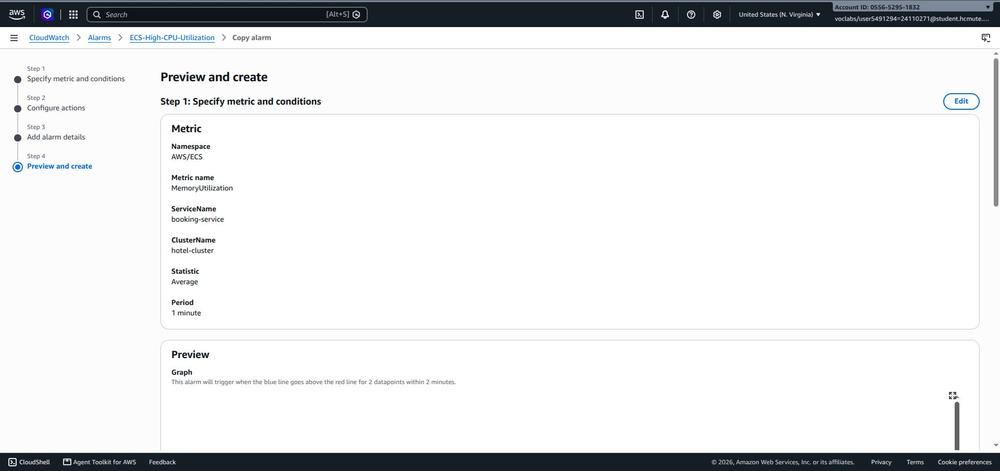

Hai alarm hiện giám sát `booking-service`; chưa mở rộng sang `room-service` và `notification-service`. Đây là cảnh báo vận hành, chưa phải chính sách ECS Auto Scaling.

### Cấu hình cảnh báo lỗi 5XX từ target của ALB

Em kiểm tra danh sách load balancer để xác định đúng ALB đang tồn tại, do CloudWatch còn lưu metric của một ALB cũ cùng tên. ALB được chọn là **`hotel-booking-alb`**, trạng thái **Active**, có dimension:

`LoadBalancer=app/hotel-booking-alb/4bb29c65802c7069`

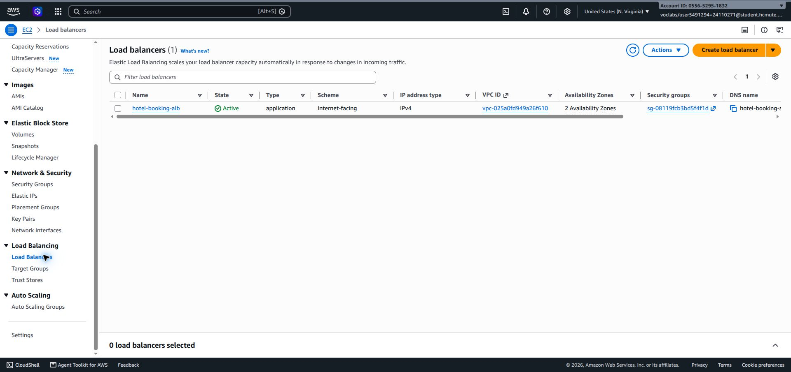

Em tạo alarm **`ALB-High-Target-5XX-Errors`** với namespace `AWS/ApplicationELB`, metric **`HTTPCode_Target_5XX_Count`**, thống kê **Sum**, chu kỳ **60 giây** và điều kiện **≥5 lỗi trong một kỳ đánh giá**. Metric này đếm lỗi HTTP 5XX do ứng dụng phía target trả về; không phải metric lỗi do chính ALB tạo ra.

Trong danh sách metric gần đây chưa có metric lỗi target cần dùng. Em chọn dimension của ALB hiện hành rồi sửa tên metric trong biểu mẫu Console thành `HTTPCode_Target_5XX_Count`. Cấu hình đã được AWS lưu; cần phát sinh dữ liệu thực tế để xác nhận alarm chuyển trạng thái theo đúng ngưỡng.

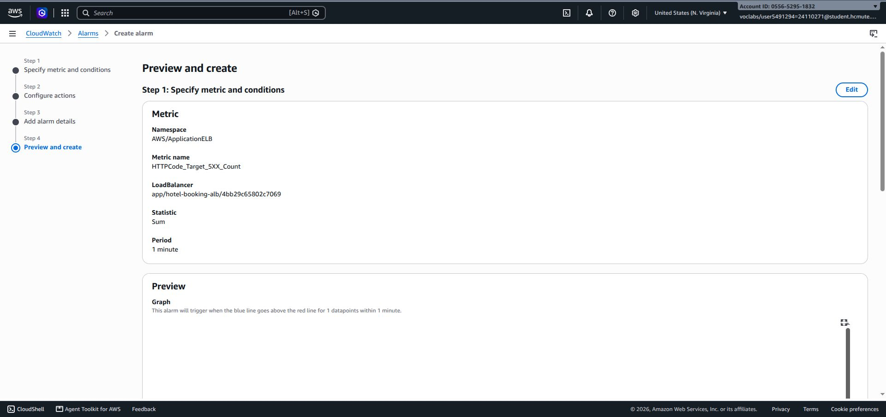

### Cấu hình cảnh báo tin nhắn lỗi trong DLQ

Em tạo alarm **`SQS-DLQ-Has-Poison-Messages`** theo dõi queue **`booking-notification-dlq`**. Alarm sử dụng metric `ApproximateNumberOfMessagesVisible` trong namespace `AWS/SQS`, dimension `QueueName=booking-notification-dlq`, thống kê **Maximum**, chu kỳ **60 giây**, điều kiện **≥1 tin nhắn trong một kỳ đánh giá**.

Mục đích là phát hiện khi DLQ còn tin nhắn chờ xử lý để nhóm kiểm tra nguyên nhân và có phương án xử lý lại. Giá trị Maximum giúp ghi nhận tình huống có ít nhất một tin nhắn nhìn thấy được trong kỳ đo.

Sau khi tạo, alarm đã chuyển sang trạng thái **ALARM** dựa trên dữ liệu có sẵn của queue. Trong phiên này em không gửi thêm poison message và không xóa tin nhắn trong DLQ. Kết quả này chứng minh alarm đã đánh giá dữ liệu và kích hoạt; chưa thay thế cho kiểm thử luồng retry/redrive end-to-end.

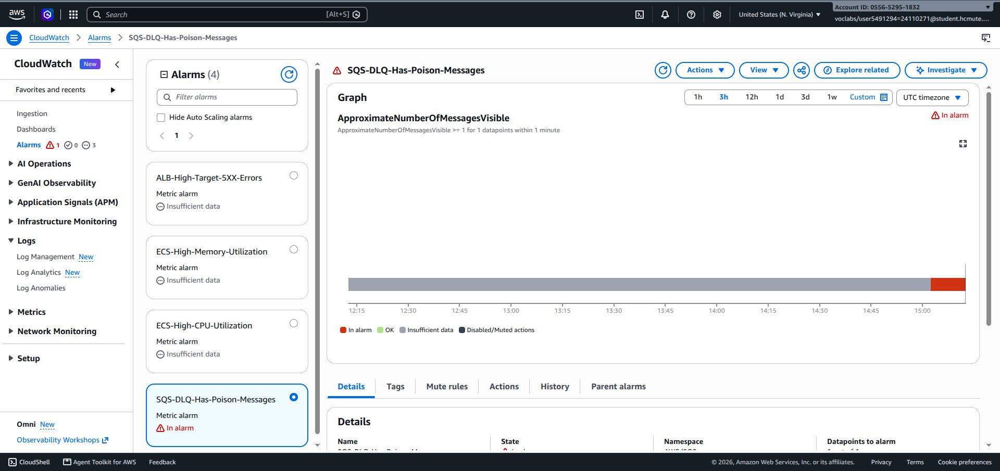

### Kiểm tra kết quả cấu hình

AWS Console xác nhận đã tạo thành công cả bốn alarm. Các alarm đều bật actions, gửi sự kiện khi vào trạng thái `ALARM` tới `hotel-system-alerts`, và giữ cách xử lý dữ liệu thiếu là **Treat missing data as missing**.

| Nội dung kiểm tra | Kết quả quan sát |
|---|---|
| SNS topic cảnh báo | Đã tạo `hotel-system-alerts`, loại Standard; chưa có subscription |
| Danh sách CloudWatch Alarms | Có đủ bốn alarm đã cấu hình |
| Alarm DLQ | Đã chuyển sang `ALARM` từ dữ liệu có sẵn |
| Alarm CPU và Memory | `Insufficient data` tại thời điểm chụp |
| Alarm ALB target 5XX | `Insufficient data` tại thời điểm chụp |
| Kiểm thử bằng tải thật hoặc tạo lỗi 5XX | Chưa thực hiện trong phiên này |
| Gửi cảnh báo tới email | Chưa kiểm thử vì SNS chưa có subscription |

Trạng thái `Insufficient data` cho biết alarm chưa có đủ điểm dữ liệu để kết luận bình thường hay vượt ngưỡng; không được xem là kết quả kiểm thử thành công dưới tải.

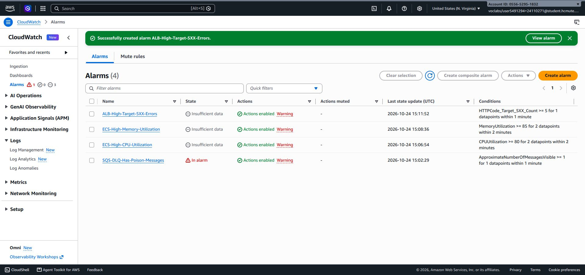

### Kiểm tra log và kết thúc buổi thực hành

Em kiểm tra ba log group đang được hệ thống dùng: `/ecs/hotel/room-service`, `/ecs/hotel/booking-service` và `/ecs/hotel/notification-service`. Cả ba đã có retention **3 ngày** từ trước phiên này. Tên thực tế khác với tên dự kiến trong kế hoạch tuần 3; em ghi nhận theo tài nguyên hiện có, chưa đổi tên log group hoặc sửa cấu hình ECS.

Đầu phiên, Learner Lab hiển thị **đã dùng $8.80/$50**, tương đương **còn $41.20**. Đây là số đầu phiên, không phải chi phí chốt sau khi thực hành.

Sau khi hoàn tất cấu hình và lưu báo cáo lên nhánh `week-3`, em chọn **End Lab**. Giao diện Learner Lab xác nhận **AWS Status: Terminated**, thời gian **00:00**. Trong phiên này chưa kiểm tra riêng trạng thái RDS `Stopped` và ECS task bằng 0, nên việc End Lab không được dùng làm bằng chứng đã hoàn thành hai yêu cầu dọn tài nguyên đó.

### Bảo mật kết nối database bằng SSM Parameter Store

Em tạo đủ sáu tham số `SecureString` ở Standard tier, mã hóa bằng khóa `alias/aws/ssm`: `/hotel/database/room_url`, `room_username`, `room_password`, `booking_url`, `booking_username`, `booking_password` (cùng tiền tố `/hotel/database/`). Giá trị được đối chiếu từ cấu hình database hiện có trong Secrets Manager, không đổi mật khẩu và không đưa giá trị bí mật vào báo cáo.

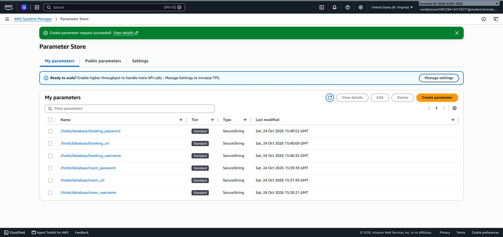

Trong ECS Console, em tạo revision 2 cho room và booking, chuyển cả ba biến `SPRING_DATASOURCE_URL`, `SPRING_DATASOURCE_USERNAME`, `SPRING_DATASOURCE_PASSWORD` sang `secrets.valueFrom` tham chiếu ARN SSM. Hai task definition tiếp tục dùng `LabRole`, mạng `awsvpc`, cổng container `8080` và image ECR tag `v1.1.0`. Notification cũng được cập nhật lên revision 2 với image `v1.1.0`; không thay đổi mã ứng dụng.

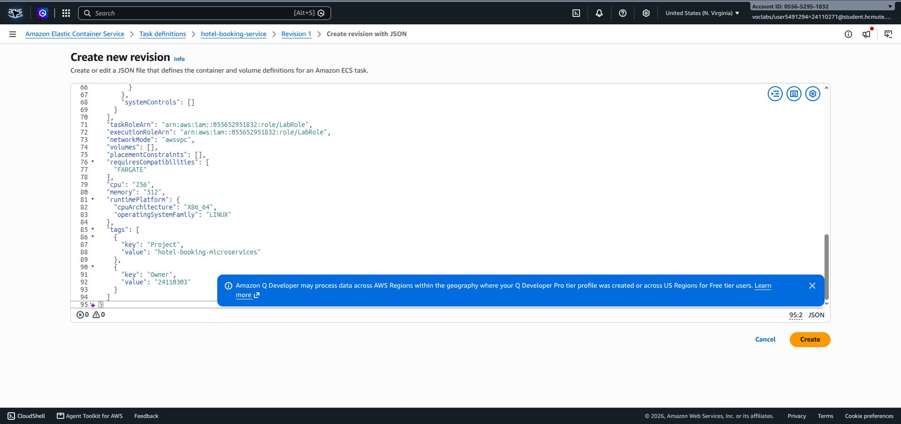

Em triển khai cả ba service với desired count 1. ECS Console xác nhận cả ba chạy 1/1 task. Booking có một target Healthy; log ghi nhận HikariPool thêm kết nối PostgreSQL và Tomcat khởi động ở cổng 8080. Đây là bằng chứng khởi động và kết nối database; chưa thay thế cho kiểm thử một giao dịch đặt phòng hoàn chỉnh.

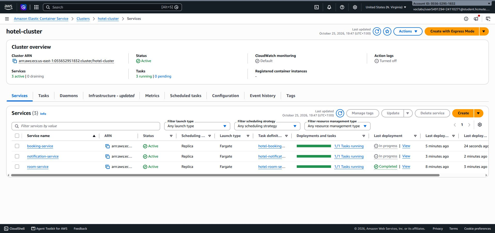

Do private subnet chưa có NAT khi bắt đầu triển khai, em tạo NAT tạm `hotel-week3-nat-temp` (`nat-05f89d39857e9cd3b`) tại public subnet us-east-1a, dùng Elastic IP `18.214.73.140`. Hai route table private được thêm route `0.0.0.0/0` qua NAT để tải image và truy cập dịch vụ AWS. Đây là tài nguyên tính phí cần dọn sau kiểm thử. Task vẫn không được cấp public IP. Record DNS private `room-service.hotel.local` được sửa từ IP task cũ sang `10.0.143.249`, TTL 30 giây; cơ chế record tĩnh hiện tại cần cập nhật khi task thay IP.

Em rà soát các inbound rule: ALB chỉ mở HTTP 80 từ Internet; chưa cấu hình listener HTTPS/certificate nên không tuyên bố đã có HTTPS 443. ECS cho phép TCP 8080 từ ALB SG và chính ECS SG. RDS chỉ cho phép PostgreSQL 5432 từ ECS SG, không mở database trực tiếp ra Internet.

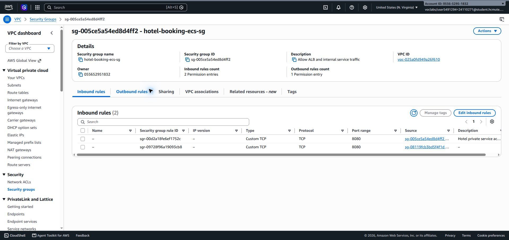
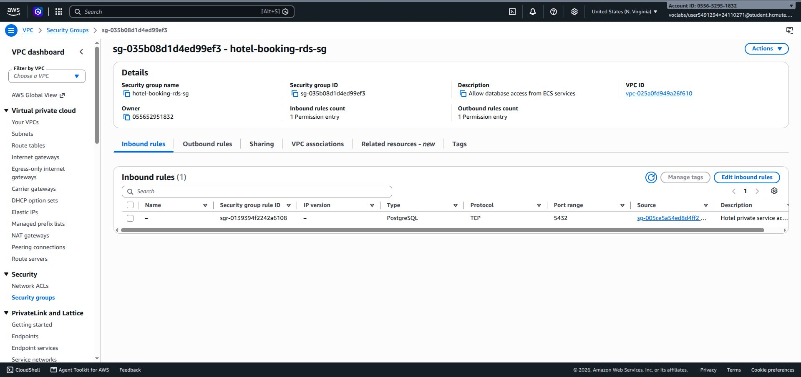

### Giám sát log tập trung và truy vấn Logs Insights

Ba log group thực tế là `/ecs/hotel/room-service`, `/ecs/hotel/booking-service`, `/ecs/hotel/notification-service`. Em giữ tên tài nguyên đang dùng để không chia tách lịch sử log; cả ba có retention 3 ngày. Cấu hình này được kiểm tra lại trên Console ngày 25/10.

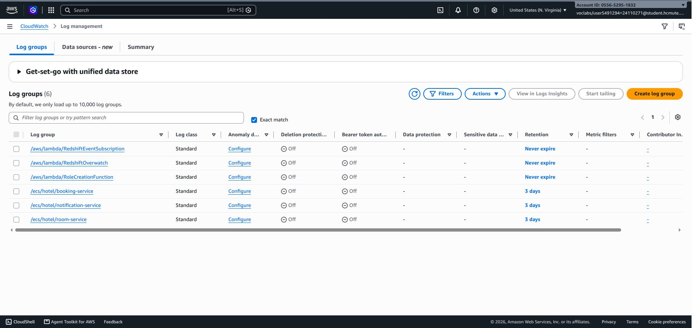

Em chạy và lưu mẫu `hotel-errors-last-3h` trong Log Analytics/Logs Insights, truy vấn đồng thời ba log group, lọc `ERROR`, sắp xếp log mới nhất và giới hạn 100 dòng. AWS trả kết quả Complete, không có dòng ERROR khớp trong khoảng ba giờ được truy vấn; kết quả rỗng không được hiểu là đã kiểm thử mọi tình huống lỗi.

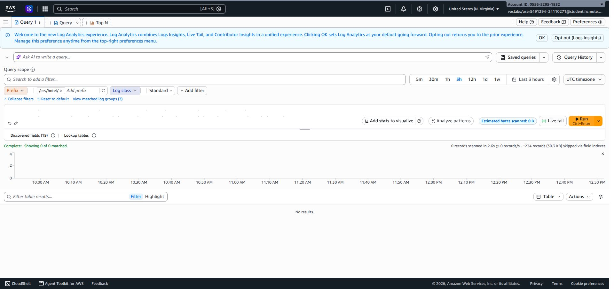

Mẫu `hotel-correlation-trace` cũng được lưu để trích correlation ID dạng UUID trong cặp ngoặc vuông của log, hiển thị timestamp, log group và thông điệp theo thứ tự thời gian. Lần truy vấn một ngày gần nhất chưa có dòng khớp, nên chưa có bằng chứng hành trình giao dịch xuyên ba service. Cần phát sinh giao dịch có correlation ID rồi truy vấn lại trước khi nghiệm thu E2E.

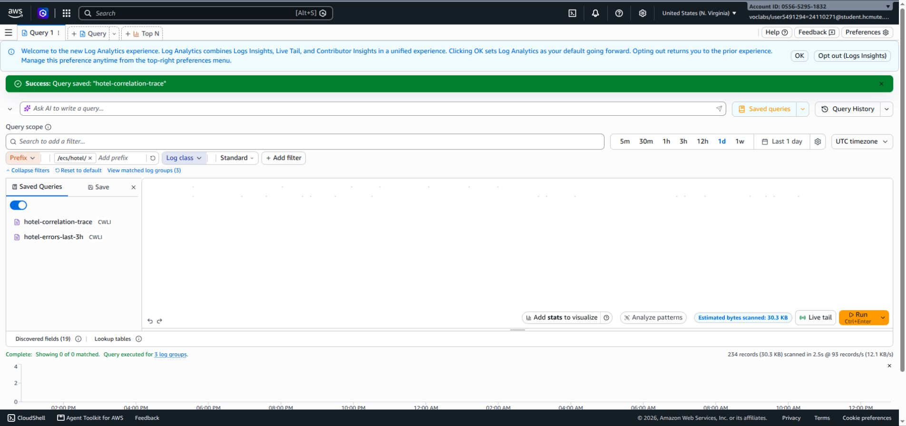

### Xây dựng dashboard vận hành

Em tạo và lưu dashboard `HotelBooking-System-Dashboard` tại us-east-1 với bảy widget: CPU và Memory của cả ba ECS service; ALB RequestCount (Sum); TargetResponseTime (Average); HealthyHostCount (Minimum) của ba target group; số tin nhắn visible ở SQS queue và DLQ (Maximum); bảng log ERROR của ba service. Chu kỳ metric 60 giây, khoảng xem ban đầu ba giờ.

Dashboard đã hiển thị dữ liệu thực của ECS, ALB và hai queue `booking-notification-queue`, `booking-notification-dlq`. Widget log ERROR chưa có dữ liệu khớp trong khoảng xem. Metric ALB được gắn với ALB hiện hành, không dùng dimension của ALB cũ.

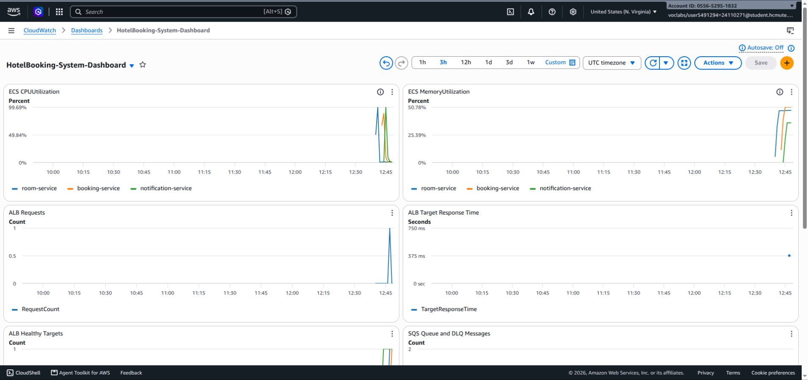
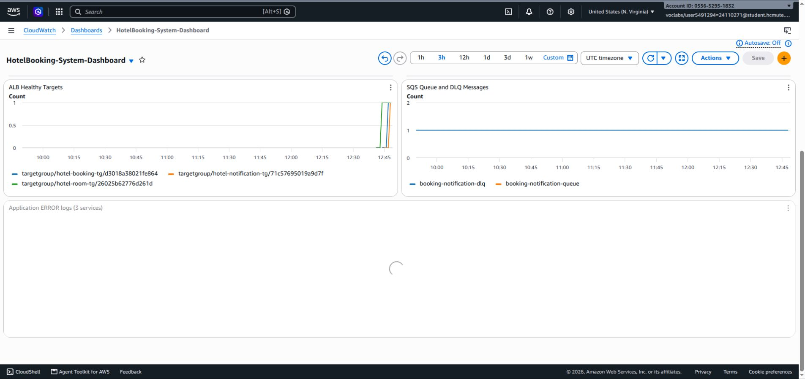

### Cấu hình ECS Service Auto Scaling

Em tạo chính sách Target Tracking cho room và booking với cùng cấu hình: minimum 1, maximum 3 task, `ECSServiceAverageCPUUtilization` mục tiêu 50%, scale-out cooldown 60 giây và scale-in cooldown 120 giây. Tên chính sách là `room-cpu-target-50` và `booking-cpu-target-50`. Console hiển thị cả hai Active và phạm vi 1–3 task.

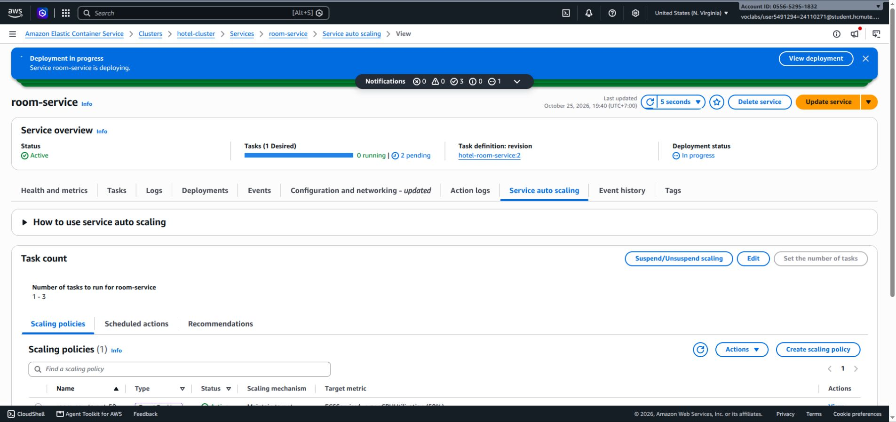
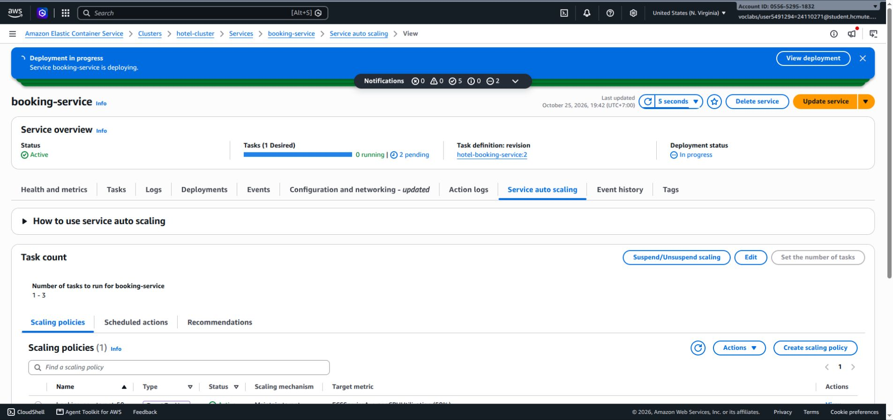

Cấu hình chính sách đã hoàn tất; chưa có bằng chứng tăng task dưới tải thật. Đỉnh CPU khi khởi động container không được tính là kết quả load test. Người dùng xác nhận chỉ thao tác UI, không chạy script. Vì vậy phiên này không chạy load-test cục bộ, AWS CLI hoặc CloudShell; mục tăng task do tải thật chưa được nghiệm thu.

## Nghiên cứu dịch vụ

1. **CloudWatch Metrics và Alarms:** Dùng namespace, metric và dimension để xác định đúng tài nguyên cần giám sát; kết hợp ngưỡng, chu kỳ và số kỳ đánh giá để quyết định lúc cảnh báo.
2. **Amazon SNS:** Tập trung sự kiện cảnh báo vào một topic. Subscription là bước tiếp theo để chuyển thông báo tới người nhận hoặc hệ thống xử lý.
3. **ALB target 5XX:** Phân biệt lỗi do target ứng dụng trả về với lỗi do ALB tạo ra, lựa chọn thống kê Sum để đếm số lỗi trong một phút.
4. **SQS DLQ:** Dùng số tin nhắn nhìn thấy trong DLQ làm tín hiệu phát hiện sự kiện xử lý thất bại cần được kiểm tra.

### Chốt vận hành ngày 25/10/2026

Em kiểm tra form cấu hình RDS: `Not publicly accessible` được chọn, port 5432. Sau đó thoát form và gửi yêu cầu Stop temporarily, không thay đổi thông số database. RDS chuyển sang Stopping. AWS thông báo instance tự khởi động lại sau tối đa bảy ngày; dừng instance không loại bỏ phí storage và backup.

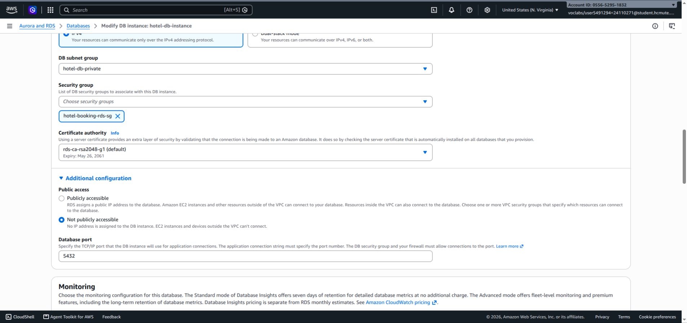
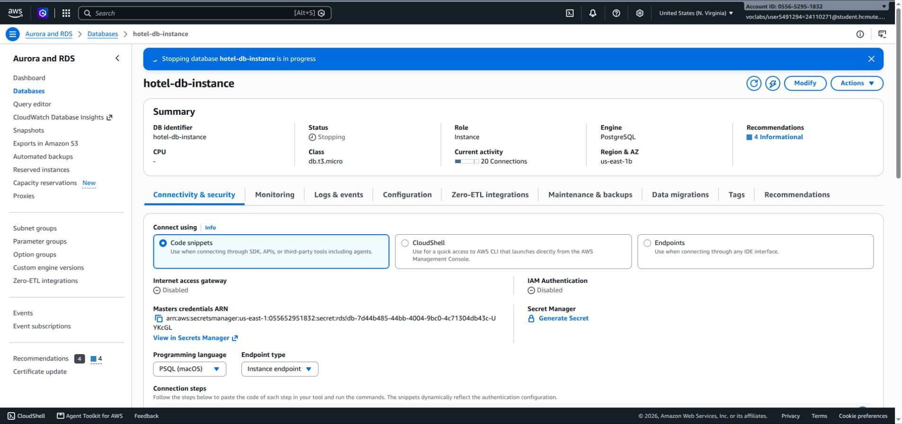

Em hạ desired count cả ba service về 0 bằng UI. Với room và booking, minimum của Auto Scaling cũng hạ từ 1 về 0 trong thời gian nghỉ; maximum 3 và policy CPU50 vẫn được giữ. Khi mở lại phiên kiểm thử cần phục hồi minimum1 và desired1. Danh sách ECS xác nhận cả ba service 0/0 Tasks running.

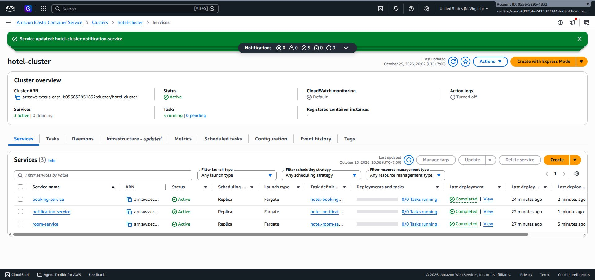

| Ngày ghi nhận | Tổng đã dùng hiển thị | Còn lại trên hạn mức50USD | Trạng thái |
|---|---:|---:|---|
| 24/10/2026 đầu phiên | $8.80 | $41.20 | Số đầu phiên, không phải chốt chi phí |
| 25/10/2026 cuối thao tác | $10.20 | $39.80 | ECS0/0; RDS đang Stopping khi chụp; NAT/EIP đang chờ xác nhận dọn |

Số ngân sách do Learner Lab hiển thị có độ trễ, không đại diện cho hóa đơn tức thời hoặc riêng chi phí phiên này.

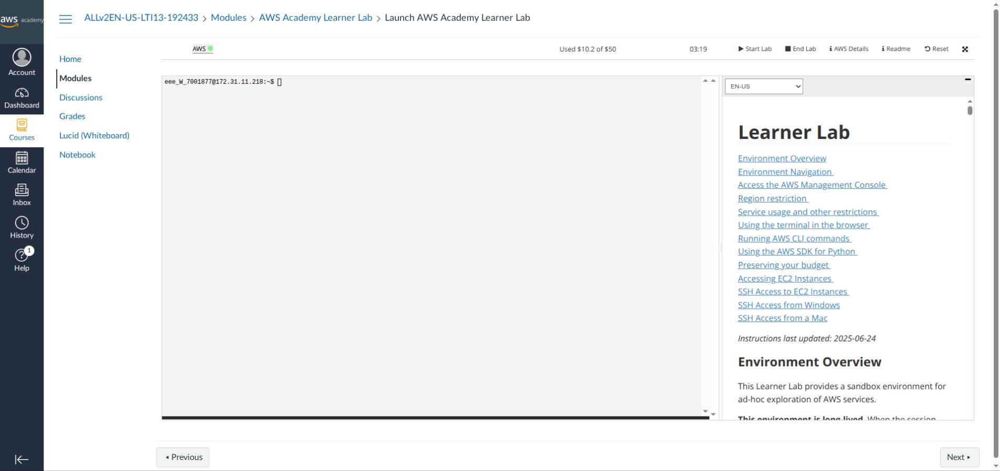

## Công việc còn cần nghiệm thu

- Phát sinh giao dịch có correlation ID và ghi nhận truy vết xuyên các service.
- Chạy tải thật và ghi bằng chứng Auto Scaling tự tăng task; chưa dùng thay đổi desired count thủ công để thay kết quả này.
- Xác nhận health cuối cùng của cả ba target group khi thực hiện kiểm thử E2E. RDS đã được kiểm tra: Not publicly accessible, port 5432 (ảnh 334).
- Rà soát, thực thi bộ script vận hành khi được phép dùng CLI; hiện các thao tác AWS đã thực hiện bằng UI theo yêu cầu. Script stop hiện có chưa xử lý giới hạn minimum 1 của Auto Scaling nên cần sửa trước khi chạy.
- Chốt chi phí, đưa ECS về 0, stop RDS, dọn NAT/EIP tạm và xác nhận End Lab sau khi hoàn tất kiểm thử.

SNS chưa có subscription; không tuyên bố đã gửi email cảnh báo. Bốn alarm đã cấu hình và DLQ từng ALARM từ dữ liệu có sẵn, chưa kiểm thử riêng toàn bộ ngưỡng CPU/Memory/5XX.

**Sử dụng AI:** Em sử dụng AI để nghiên cứu tài liệu, hỗ trợ cấu hình AWS, kiểm tra kết quả và biên tập báo cáo; em rà soát và tự thực hiện trên aws console.
