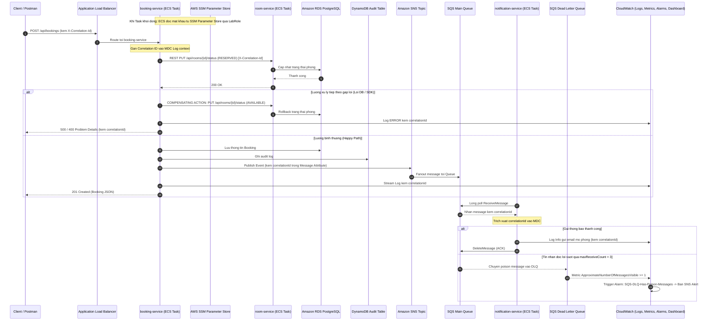

# KẾ HOẠCH & PHÂN CHIA NHIỆM VỤ TUẦN 3 (WORKLOG TUẦN 3)

## 📌 THÔNG TIN ĐỒ ÁN
- **Đề tài:** Hệ thống đặt phòng khách sạn với kiến trúc microservices trên ECS (Nhóm: Capstone)
- **Học phần:** Điện toán đám mây (Cloud) - Đợt 1 (Năm học 2026–2027)
- **Giảng viên hướng dẫn (GVHD):** Thầy Huỳnh Xuân Phụng
- **Mục tiêu Tuần 3:** Tích hợp hệ thống, tăng cường bảo mật (Secrets Management / SSM Parameter Store), giám sát tập trung toàn diện (Amazon CloudWatch Logs, Metrics, Alarms, Dashboard) và tự động hóa vận hành/IaC (Mỗi sinh viên thực hiện $\ge$ 8.0 giờ/tuần).
- **Môi trường thực hành:** AWS Academy Learner Lab, Region `us-east-1`, Account ID: `0556-5295-1832` (Tài khoản nhóm của Phan Thị Thùy Linh).
- **Quy định IAM bắt buộc:** Sử dụng `LabRole` / `LabInstanceProfile` (Không tạo IAM User / Custom Role).

---

## 👥 BẢNG PHÂN CÔNG CÔNG VIỆC TUẦN 3 (WORKLOG)

| STT | Thành viên | MSSV | Vai trò chính trong Tuần 3 | Số giờ dự kiến | Trạng thái |
|:---:|---|:---:|---|:---:|:---:|
| 1 | **Cao Hoàng Phúc** | `24110303` | **Cloud Infrastructure, Security & Monitoring (DevOps):** Quản lý bí mật qua SSM/Secrets Manager; cấu hình CloudWatch Centralized Logging, Metrics, Alarms & Dashboard; viết scripts tự động hóa vận hành (start/stop) và kịch bản IaC/CLI deployment. | 9.0 giờ | Đã lập kế hoạch |
| 2 | **Phan Thị Thùy Linh** | `24110271` | **Backend Integration, Security & E2E Testing:** Triển khai cơ chế bồi hoàn giao dịch (Compensating Transaction); Distributed Tracing với Correlation ID qua MDC & Message Attributes; Bean Validation & Security Exception Handling; xây dựng kịch bản kiểm thử E2E & DLQ, đóng gói Docker ECR `v1.1.0`. | 9.0 giờ | Đã lập kế hoạch |

---

## 🛠️ CHI TIẾT CÔNG VIỆC TỪNG THÀNH VIÊN

### 🔹 Thành viên 1: Cao Hoàng Phúc (MSSV: 24110303)
- **Vai trò:** Phụ trách Tích hợp Bảo mật Hạ tầng, Giám sát Tập trung (CloudWatch Monitoring & Alerting), và Tự động hóa Vận hành (Automation Scripts / IaC).
- **Số giờ dự kiến:** 9.0 giờ.
- **Nhiệm vụ chi tiết:**

1. **Bảo mật dữ liệu nhạy cảm (Secrets Management & SSM Parameter Store):**
   - Rà soát các thông tin nhạy cảm trong hệ thống: Database Passwords (`room_password`, `booking_password`), Database URLs, SNS Topic ARN, SQS Queue URL.
   - Khởi tạo các tham số an toàn trên **AWS Systems Manager (SSM) Parameter Store** (hoặc AWS Secrets Manager) thuộc dạng `SecureString` có mã hóa AWS KMS (sử dụng Default KMS key khả dụng trong Learner Lab):
     - `/hotel/database/room_url`
     - `/hotel/database/room_username`
     - `/hotel/database/room_password`
     - `/hotel/database/booking_url`
     - `/hotel/database/booking_username`
     - `/hotel/database/booking_password`
   - Cập nhật ECS Task Definitions của `room-service` và `booking-service`: Chuyển các trường nhạy cảm từ `environment` sang `secrets` với cú pháp `valueFrom: arn:aws:ssm:us-east-1:055652951832:parameter/hotel/...` để container nạp tự động lúc khởi động thông qua `LabRole`.
   - Rà soát các Security Groups: Đảm bảo nguyên tắc đặc quyền tối thiểu (Least Privilege). ALB SG chỉ mở cổng `80/443`, ECS SG chỉ nhận inbound `8080` từ ALB SG và từ chính nó (cho internal communication), RDS SG chỉ nhận `5432` từ ECS SG. Tuyệt đối không gán Public IP cho container và database.

2. **Cấu hình Giám sát tập trung (Centralized Logging với Amazon CloudWatch):**
   - Chuẩn hóa các Log Groups trên Amazon CloudWatch:
     - `/ecs/hotel-room-service`
     - `/ecs/hotel-booking-service`
     - `/ecs/hotel-notification-service`
   - Thiết lập thời gian lưu trữ log (**Retention Policy**) về **3 ngày** (hoặc tối đa 7 ngày) cho toàn bộ log groups nhằm tiết kiệm tối đa ngân sách $100 của Learner Lab.
   - Xây dựng các mẫu truy vấn chuyên sâu trên **CloudWatch Logs Insights**:
     - Mẫu 1: Tìm kiếm toàn bộ hành trình của một giao dịch theo `correlationId` xuyên suốt cả 3 services:
       ```sql
       fields @timestamp, @logStream, @message
       | filter @message like /correlationId/ or @message like /BK-/
       | sort @timestamp asc
       | limit 100
       ```
     - Mẫu 2: Lọc các bản ghi lỗi (`ERROR` hoặc `WARN` hoặc Exception) trong 1 giờ gần nhất.
     - Mẫu 3: Đếm số lượng đơn đặt phòng thành công theo thời gian thực.

3. **Thiết lập CloudWatch Metrics & Cảnh báo tự động (CloudWatch Alarms):**
   - Tạo SNS Topic chuyên nhận cảnh báo hệ thống: `hotel-system-alerts`.
   - Thiết lập 4 CloudWatch Alarms trọng yếu phục vụ vận hành:
     - **Alarm 1 - ECS High CPU Utilization:** Giám sát `CPUUtilization` của ECS Cluster/Services $\ge 80\%$ trong 2 chu kỳ 1 phút liên tiếp.
     - **Alarm 2 - ECS High Memory Utilization:** Giám sát `MemoryUtilization` $\ge 85\%$ trong 2 chu kỳ 1 phút.
     - **Alarm 3 - ALB 5XX Target Error Rate:** Giám sát `HTTPCode_Target_5XX_Count` trên ALB Target Groups $\ge 5$ lỗi trong khoảng thời gian 1 phút.
     - **Alarm 4 - SQS DLQ Poison Message Alarm:** Giám sát metric `ApproximateNumberOfMessagesVisible` trên `booking-notification-dlq` $\ge 1$ (phát hiện ngay khi có message gửi email thất bại bị đẩy vào Dead Letter Queue).
   - Gắn action thông báo của các Alarm tới SNS Topic `hotel-system-alerts`.

4. **Xây dựng CloudWatch Operational Dashboard:**
   - Tạo một Dashboard tập trung duy nhất tên là: **`HotelBooking-System-Dashboard`**.
   - Thiết kế các Widgets trực quan:
     - Widget 1 (Line chart): ECS CPU & Memory Utilization theo thời gian thực của cả 3 services.
     - Widget 2 (Line chart): ALB Request Count và Target Response Time (độ trễ phản hồi API).
     - Widget 3 (Number/Gauge): Số lượng Healthy Hosts của từng Target Group (room, booking, notification).
     - Widget 4 (Line chart): SQS Number of Messages Sent / Received và DLQ Message Count.
     - Widget 5 (Log Table): Bảng hiển thị 10 log lỗi (`ERROR`) gần nhất truy vấn từ CloudWatch Logs.

5. **Tự động hóa vận hành & Scripts IaC (Automation / IaC):**
   - Viết bộ kịch bản tự động hóa quản lý chi phí hàng ngày (đặt tại thư mục `scripts/`):
     - `stop-environment.ps1`: Tự động gửi lệnh AWS CLI scale cả 3 ECS Services về desired count = `0`, sau đó ra lệnh Stop RDS Instance `hotel-db-instance`.
     - `start-environment.ps1`: Tự động khởi động RDS Instance (chờ trạng thái `available`) và scale 3 ECS Services lên desired count = `1`.
   - Viết kịch bản tự động build & deploy (CI/CD Deployment Script) `deploy-services.ps1`:
     - Tự động chạy `mvn package`, `docker build`, đăng nhập ECR, `docker push` image tag `v1.1.0` và gọi `aws ecs update-service --force-new-deployment`.
   - Viết CloudFormation template hoặc script CLI tái tạo hạ tầng giám sát CloudWatch (Dashboard, Alarms) để có thể khôi phục nhanh chóng.

6. **Ghi nhận minh chứng & Tuân thủ quy định:**
   - Chụp ảnh minh chứng Console (có đầy đủ Account ID `0556-5295-1832`, Region `us-east-1` và ngày giờ).
   - Gắn tag định danh: `Project=hotel-booking-microservices`, `Owner=24110303`.
   - Tuân thủ quy định dừng dịch vụ sau mỗi buổi làm việc.

---

### 🔹 Thành viên 2: Phan Thị Thùy Linh (MSSV: 24110271)
- **Vai trò:** Phụ trách Tích hợp Nghiệp vụ Phân tán, Truy vết Phân tán (Distributed Tracing), Bảo mật Mức Ứng dụng & Bộ Kiểm thử E2E.
- **Số giờ dự kiến:** 9.0 giờ.
- **Nhiệm vụ chi tiết:**

1. **Xử lý Bồi hoàn Giao dịch Phân tán (Compensating Transaction / Rollback Pattern):**
   - Nâng cấp luồng đặt phòng tại `booking-service` theo hướng đảm bảo tính nhất quán cuối cùng (Eventual Consistency):
     - Bước 1: Gọi đồng bộ sang `room-service` để khóa phòng (`status = RESERVED`).
     - Bước 2: Thực hiện lưu bản ghi đặt phòng vào `booking_db` và ghi log audit DynamoDB.
     - Bước 3: Đẩy sự kiện `BookingCreatedEvent` sang SNS Topic.
     - **Cơ chế Bồi hoàn (Compensating Action):** Nếu Bước 2 hoặc Bước 3 gặp sự cố bất ngờ (lỗi Database, lỗi kết nối AWS SDK SNS, timeout mạng), `booking-service` sẽ tự động thực hiện lời gọi HTTP bồi hoàn sang `room-service` (`PUT /api/rooms/{id}/status` với trạng thái `AVAILABLE`) nhằm giải phóng phòng ngay lập tức, ngăn ngừa hiện tượng khóa phòng "ma" (Deadlock phòng) trong hệ thống.

2. **Phân phối Log Có Cấu Trúc & Truy vết Phân tán (Distributed Tracing với Correlation ID):**
   - Xây dựng bộ lọc `CorrelationIdFilter` trên cả 3 microservices:
     - Đọc header HTTP `X-Correlation-Id` từ client gửi đến; nếu chưa có thì tự động sinh UUID mới (ví dụ: `corr-8f92a1b3-...`).
     - Gán giá trị vào SLF4J **MDC** (`MDC.put("correlationId", correlationId)`).
     - Đính kèm header `X-Correlation-Id` vào HTTP Response trả về cho client.
   - Khi `booking-service` gọi REST nội bộ sang `room-service`: Tự động truyền header `X-Correlation-Id` qua `RestClient` / `WebClient`.
   - Khi `booking-service` gửi sự kiện vào SNS: Đính kèm `correlationId` vào **Message Attributes** của tin nhắn SNS.
   - Khi `notification-service` poll tin nhắn từ SQS: Trích xuất `correlationId` từ Message Attributes và đưa vào MDC trước khi xử lý logic gửi thông báo.
   - Cấu hình file `logback-spring.xml` định dạng log chuẩn: `[%d{yyyy-MM-dd HH:mm:ss.SSS}] [%thread] [%-5level] [%X{correlationId}] %logger{36} - %msg%n`. Đảm bảo toàn bộ log in ra console và stream lên CloudWatch đều có trường `correlationId`.

3. **Bảo mật Ứng dụng & Chuẩn hóa Xử lý Lỗi (Application Security & Bean Validation):**
   - Bổ sung Bean Validation (`jakarta.validation-api`):
     - Ràng buộc dữ liệu trong `CreateBookingRequest`: `@NotBlank` cho tên/email, `@Email` cho email khách hàng, `@Future` cho `checkInDate`, `@Min(1)` cho số đêm/phòng.
     - Ràng buộc dữ liệu trong `UpdateRoomStatusRequest`: Kiểm tra enum trạng thái hợp lệ (`AVAILABLE`, `RESERVED`, `OCCUPIED`, `MAINTENANCE`).
   - Xây dựng `GlobalExceptionHandler` sử dụng `@RestControllerAdvice`:
     - Bắt `MethodArgumentNotValidException`, `ResourceNotFoundException`, `IllegalStateException`, `Exception`.
     - Chuẩn hóa phản hồi lỗi theo định dạng RFC 7807 (Problem Details: `timestamp`, `status`, `error`, `message`, `path`, `correlationId`).
     - Tuyệt đối che giấu cấu trúc database / stack trace nội bộ để phòng ngừa tấn công rò rỉ thông tin (Information Disclosure).
   - Thêm cấu hình CORS an toàn cho phép Client truy cập các API cần thiết và gắn các Security Headers cơ bản.

4. **Nâng cấp Giám sát Sức khỏe Ứng dụng (Spring Boot Actuator Health Indicators):**
   - Bổ sung cấu hình `management.endpoint.health.show-details=always`.
   - Viết Custom Health Indicators kiểm tra khả năng sẵn sàng của các phụ thuộc đám mây (Database connectivity, DynamoDB ping, AWS SDK readiness).
   - Cung cấp dữ liệu chi tiết cho ALB Target Group Health Check tại `/actuator/health`.

5. **Xây dựng Bộ Kiểm thử Tích hợp Đầu Cuối (E2E Integration Test Suite) & Thử nghiệm Lỗi:**
   - Xây dựng bộ kịch bản kiểm thử tích hợp tự động (Postman Collection kèm Newman hoặc Script PowerShell test tự động) bao gồm các kịch bản:
     - **Kịch bản 1 (Happy Path E2E):** Gọi API tạo đơn đặt phòng hoàn chỉnh $\rightarrow$ kiểm tra phòng chuyển `RESERVED` $\rightarrow$ đơn lưu `booking_db` $\rightarrow$ audit log vào DynamoDB $\rightarrow$ thông báo email mô phỏng thành công trong log `notification-service`.
     - **Kịch bản 2 (Compensating Rollback):** Giả lập request tạo booking với dữ liệu cố ý gây lỗi DB hoặc ngắt kết nối SNS $\rightarrow$ kiểm tra API trả mã lỗi chuẩn $\rightarrow$ kiểm tra phòng được rollback tự động về `AVAILABLE`.
     - **Kịch bản 3 (Validation Test):** Gửi dữ liệu rỗng/sai định dạng email $\rightarrow$ nhận mã lỗi `400 Bad Request` kèm chi tiết vi phạm.
     - **Kịch bản 4 (Poison Message & DLQ Trigger):** Bơm một tin nhắn sai định dạng JSON trực tiếp vào SQS Queue $\rightarrow$ kiểm tra `notification-service` xử lý thất bại 3 lần $\rightarrow$ message bị đẩy vào `booking-notification-dlq` $\rightarrow$ kiểm tra CloudWatch Alarm `SQS-DLQ-Has-Poison-Messages` chuyển sang trạng thái **ALARM**.
     - **Kịch bản 5 (Stress Test / Spike):** Gửi liên tiếp 50-100 requests để quan sát đồ thị metrics trên CloudWatch Dashboard.

6. **Đóng gói Docker Image & Đẩy ECR Phiên bản `v1.1.0`:**
   - Biên dịch và đóng gói mã nguồn Maven: `mvn clean package -DskipTests`.
   - Build Docker Image gắn tag phiên bản `v1.1.0`:
     - `docker build -t hotel-room-service:v1.1.0 ./room-service`
     - `docker build -t hotel-booking-service:v1.1.0 ./booking-service`
     - `docker build -t hotel-notification-service:v1.1.0 ./notification-service`
   - Đẩy (Push) cả 3 images lên Amazon ECR và bàn giao Image URIs cho Phúc cập nhật Task Definitions trên ECS.

---

## 🔄 QUY TRÌNH PHỐI HỢP LIÊN TỤC GIỮA 2 THÀNH VIÊN TRONG TUẦN 3

```
[BƯỚC 1 - Phúc]: Khởi tạo SSM Parameter Store (SecureString) lưu trữ Database credentials & AWS ARNs
       │
       ▼ (Bàn giao: Danh sách Parameter Keys và cấu trúc biến)
[BƯỚC 2 - Linh]: Nâng cấp code backend: Correlation ID, Compensating Transaction, Validation, Actuator
       │
       ▼ (Đóng gói JAR, Build Docker và Push ECR tag v1.1.0)
[BƯỚC 3 - Linh]: Bàn giao Image URIs v1.1.0 cho Phúc
       │
       ▼
[BƯỚC 4 - Phúc]: Cập nhật ECS Task Definitions inject secrets từ SSM; cấu hình CloudWatch Log Retention
       │
       ▼ (Triển khai Task v1.1.0 lên ECS Cluster)
[BƯỚC 5 - Phúc]: Thiết lập 4 CloudWatch Alarms & xây dựng CloudWatch Dashboard "HotelBooking-System-Dashboard"
       │
       ▼ (Hạ tầng và Ứng dụng đã sẵn sàng)
[BƯỚC 6 - Cả hai]: Chạy Bộ Kiểm thử Tích hợp E2E:
       ├── Linh: Thực thi Happy path, Rollback bồi hoàn, Bơm tin nhắn lỗi kiểm tra DLQ
       └── Phúc: Quan sát CloudWatch Dashboard, kiểm tra Correlation ID trên Logs Insights, xác nhận Alarms kích hoạt
       │
       ▼ (Thử nghiệm tự động hóa)
[BƯỚC 7 - Phúc]: Kiểm thử chạy script stop-environment.ps1 (scale về 0, stop RDS) và start-environment.ps1
       │
       ▼ (KẾT THÚC BUỔI THỰC HÀNH)
[BƯỚC 8 - BẮT BUỘC]: Chạy stop-environment.ps1 để dừng toàn bộ tài nguyên tránh hao phí tài khoản Lab!
```

---

## 🏛️ SƠ ĐỒ KIẾN TRÚC TÍCH HỢP & GIÁM SÁT TUẦN 3



---

## 📋 DANH MỤC MINH CHỨNG NGHIỆM THU TUẦN 3 (CHECKLIST ẢNH)

### 1. Minh chứng Bảo mật, Giám sát & Tự động hóa (Phúc):
- [ ] **Ảnh 1:** Danh sách các biến bí mật được mã hóa lưu trữ an toàn trong **AWS Systems Manager Parameter Store** (`/hotel/database/...`).
- [ ] **Ảnh 2:** Cấu hình ECS Task Definition hiển thị trường `secrets` ánh xạ từ SSM Parameter ARN (không lộ plaintext trong `environment`).
- [ ] **Ảnh 3:** Giao diện CloudWatch Log Groups cho 3 services với **Retention policy** được cấu hình về **3 ngày**.
- [ ] **Ảnh 4:** Kết quả truy vấn **CloudWatch Logs Insights** hiển thị toàn bộ hành trình của 1 giao dịch xuyên suốt qua `correlationId`.
- [ ] **Ảnh 5:** Danh sách 4 **CloudWatch Alarms** được cấu hình đầy đủ (High CPU, High Memory, ALB 5XX, SQS DLQ Messages).
- [ ] **Ảnh 6:** CloudWatch Alarm kích hoạt trạng thái **ALARM** (đỏ) khi có poison message trong DLQ hoặc khi thực hiện stress test.
- [ ] **Ảnh 7:** Giao diện tổng quan **CloudWatch Dashboard** (`HotelBooking-System-Dashboard`) hiển thị đầy đủ các widget chỉ số ECS, ALB, SQS và Logs.
- [ ] **Ảnh 8:** Terminal thực thi script tự động hóa tắt tài nguyên `stop-environment.ps1` (scale Task về 0, Stop RDS) và bật lại `start-environment.ps1`.

### 2. Minh chứng Ứng dụng, Tích hợp & Kiểm thử E2E (Linh):
- [ ] **Ảnh 9:** Mã nguồn bộ lọc `CorrelationIdFilter` và cấu hình `logback-spring.xml` xuất `correlationId` trong log console.
- [ ] **Ảnh 10:** Mã nguồn xử lý bồi hoàn (Compensating Transaction) giải phóng phòng khi tạo booking thất bại.
- [ ] **Ảnh 11:** Mã nguồn `@RestControllerAdvice` xử lý validation và trả về lỗi chuẩn hóa RFC 7807 (Problem Details).
- [ ] **Ảnh 12:** Giao diện Amazon ECR hiển thị 3 repository có image tag mới **`v1.1.0`**.
- [ ] **Ảnh 13:** Kiểm thử Postman gọi API `/actuator/health` hiển thị chi tiết component sức khỏe của service.
- [ ] **Ảnh 14:** Kiểm thử Happy Path E2E thành công (Response trả về `201 Created` kèm header `X-Correlation-Id`).
- [ ] **Ảnh 15:** Kiểm thử kịch bản Bồi hoàn (Compensating Rollback): Khi cố ý làm hỏng bước tiếp theo, phòng tự động được mở lại trạng thái `AVAILABLE`.
- [ ] **Ảnh 16:** Kiểm thử kịch bản đưa tin nhắn lỗi vào SQS $\rightarrow$ sau 3 lần retry, tin nhắn vào DLQ và in log cảnh báo.
