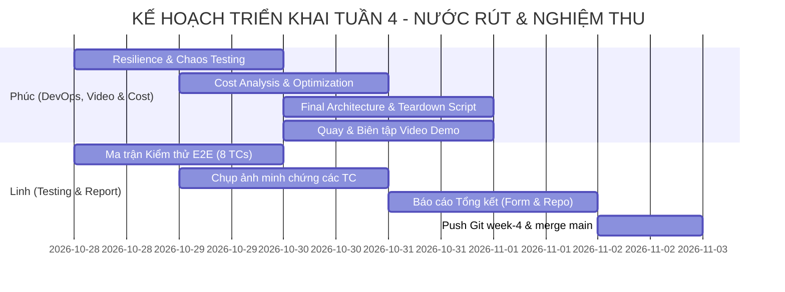

# KẾ HOẠCH & PHÂN CHIA NHIỆM VỤ TUẦN 4 (WORKLOG TUẦN 4 - NƯỚC RÚT & NGHIỆM THU)

## 📌 THÔNG TIN ĐỒ ÁN
- **Đề tài:** Hệ thống đặt phòng khách sạn với kiến trúc microservices trên ECS (Nhóm: Capstone)
- **Học phần:** Điện toán đám mây (Cloud) - Đợt 1 (Năm học 2026–2027)
- **Giảng viên hướng dẫn (GVHD):** Thầy Huỳnh Xuân Phụng
- **Mục tiêu Tuần 4:** Kiểm thử tổng thể E2E & Resilience Testing, Tối ưu hóa chi phí & Báo cáo sử dụng ngân sách AWS Learner Lab, Xây dựng kịch bản dọn dẹp tài nguyên an toàn (Teardown Script), Sản xuất Video Demo nghiệm thu ($\le 10$ phút), và Hoàn thiện Báo cáo Tổng kết Đồ án (Mỗi sinh viên thực hiện $\ge$ 8.0 giờ/tuần).
- **Môi trường thực hành:** AWS Academy Learner Lab, Region `us-east-1`, Account ID: `0556-5295-1832` (Tài khoản nhóm của Phan Thị Thùy Linh).
- **Quy định IAM bắt buộc:** Sử dụng `LabRole` / `LabInstanceProfile` (Không tạo IAM User / Custom Role).

---

## 📢 TIẾP THU NHẬN XÉT CỦA GVHD SAU BÁO CÁO TUẦN 3 & ĐỊNH HƯỚNG TUẦN 4

> **Trích nhận xét đánh giá của Thầy Huỳnh Xuân Phụng (Tuần 3):**  
> *"I. Phần đạt:  
> - 9 commit trên nhánh week-3 thầy đã kiểm tra đủ: 6 của Linh (400de7f — Bean Validation + RFC 7807 + Correlation ID; 54ec1f9 — ECR v1.1.0; 10ccbe3 — cập nhật kế hoạch theo góp ý GVHD; ffbe430, 6e61d7b, 6a70a05 — báo cáo + ảnh minh chứng) và 3 của Phúc (6607c95, b6f9851 — CloudWatch alarms; 794be84 — SSM deployment monitoring).  
> - 3 file tài liệu (tasks.md, báo cáo của Phúc, báo cáo của Linh) và 3 thư mục service trên nhánh week-3 đều mở được.  
> - Phân công rõ: Phúc (24110303) 9h — SSM SecureString, ECS Task Definitions v2, 4 CloudWatch Alarms, dashboard, auto scaling; Linh (24110271) 9h — Bean Validation/RFC 7807, image ECR v1.1.0, load test 200 requests, E2E 5/5 kịch bản.  
> - Mục "Khai báo sử dụng AI" trung thực (GPT-4o, Claude 3.5 Sonnet, Antigravity — rà soát cú pháp SSM, tham khảo cấu trúc filter, dàn ý báo cáo); tuần 2 đã được duyệt nên tiến độ liên tục.  
> - Lưu ý 1: phạm vi AI có mục "hoàn thiện dàn ý báo cáo" — thầy chấp nhận ở mức dàn ý, phần nội dung chi tiết các em tự viết.  
> - Lưu ý 2: báo cáo có file .docx đính kèm, file đính kèm thầy không mở khi chấm, việc duyệt dựa trên nội dung trong form và repo — nếu file có nội dung quan trọng hơn form, em đưa vào form.  
> III. Kết luận: Duyệt."*

### Hành động cụ thể của nhóm trong Tuần 4 nhằm đáp ứng triệt để góp ý của GVHD:
1. **Tuân thủ nguyên tắc sử dụng AI (Lưu ý 1):** Tiếp tục khai báo trung thực. Các công cụ AI (Antigravity IDE, Claude 3.5 Sonnet, GPT-4o) chỉ được dùng để hỗ trợ lập dàn ý báo cáo, format bảng biểu Markdown, và rà soát cú pháp câu lệnh PowerShell. Toàn bộ phần phân tích số liệu tải, đánh giá chi phí, triển khai trên AWS Learner Lab và nội dung chi tiết trong báo cáo tổng kết đều do 2 sinh viên trực tiếp thực hiện và tự viết.
2. **Hình thức nộp báo cáo (Lưu ý 2):** Tuyệt đối không phụ thuộc vào file đính kèm `.docx`. Toàn bộ nội dung Báo cáo Tổng kết Đồ án, Bảng phân công, Worklog, Nhật ký chi phí, Ma trận kiểm thử, Link Video Demo, và Ảnh chụp minh chứng đều được định dạng chuẩn GitHub Flavored Markdown để **dán trực tiếp vào khung nội dung Form Báo cáo Online trên LMS**, đồng thời đồng bộ đầy đủ trên kho mã nguồn GitHub nhánh `week-4` và `main`.
3. **Tiếp nối tiến độ liên tục:** Sau khi hoàn thành tích hợp, giám sát và auto-scaling ở Tuần 3, Tuần 4 là giai đoạn nước rút tập trung vào nghiệm thu chất lượng hệ thống, quay dựng video demo cô đọng $\le 10$ phút và giải phóng tài nguyên an toàn.

---

## 👥 BẢNG PHÂN CÔNG CÔNG VIỆC TUẦN 4 (WORKLOG TỔNG THỂ)

| STT | Thành viên | MSSV | Vai trò chính trong Tuần 4 | Số giờ dự kiến | Trạng thái |
|:---:|---|:---:|---|:---:|:---:|
| 1 | **Cao Hoàng Phúc** | `24110303` | **Cloud Infrastructure, Video Demo, Resilience & Cost Optimization (DevOps Lead):** Toàn quyền sản xuất Video Demo nghiệm thu ($\le 10$ phút) — quay màn hình, thuyết minh, biên tập, upload; Kiểm thử chịu lỗi hạ tầng (Resilience & Chaos Testing trên ECS Fargate / ALB / RDS); Phân tích & Tối ưu hóa chi phí AWS Learner Lab; Xây dựng Sơ đồ Kiến trúc Tổng thể cuối kỳ; Xây dựng kịch bản & quy trình dọn dẹp tài nguyên an toàn (`scripts/teardown-environment.ps1`). | 9.5 giờ | **Đang thực hiện** |
| 2 | **Phan Thị Thùy Linh** | `24110271` | **Comprehensive E2E Testing & Final Documentation (Project Lead):** Kiểm thử tổng thể E2E đa kịch bản (8 test cases bao gồm Happy Path, Rollback bồi hoàn, DLQ poison message) và chụp ảnh minh chứng; Soạn thảo Báo cáo Tổng kết Đồ án hoàn chỉnh định dạng Markdown, dán trực tiếp vào Form LMS; Push toàn bộ mã nguồn & tài liệu lên nhánh `week-4` và merge vào `main`. | 9.0 giờ | **Đang thực hiện** |

---

## 🛠️ CHI TIẾT NHIỆM VỤ TỪNG THÀNH VIÊN TRONG TUẦN 4

### 🔹 Thành viên 1: Cao Hoàng Phúc (MSSV: 24110303)
- **Vai trò:** Toàn quyền Sản xuất Video Demo nghiệm thu; Phụ trách Kiểm thử Chịu lỗi Hạ tầng (Resilience Testing), Đánh giá & Tối ưu Chi phí Vận hành, Hoàn thiện Sơ đồ Kiến trúc và Dọn dẹp Tài nguyên.
- **Số giờ dự kiến:** 9.5 giờ.
- **Nhiệm vụ chi tiết:**

1. **Toàn quyền Sản xuất Video Demo Nghiệm thu ($\le 10$ phút - 3.0 giờ):**
   - Bật lại toàn bộ hệ thống trên AWS Learner Lab (ECS, RDS, ALB) để thực hiện demo thực tế.
   - Quay màn hình toàn bộ 6 phân đoạn demo nghiệm thu:
     - **Phần 1 (00:00–01:30):** Giới thiệu nhóm, đề tài & Sơ đồ kiến trúc tổng thể.
     - **Phần 2 (01:30–04:30):** Demo Happy Path (Postman → RDS → DynamoDB → SQS → Notification log).
     - **Phần 3 (04:30–06:30):** Demo Compensating Rollback & SQS Dead Letter Queue.
     - **Phần 4 (06:30–08:30):** Demo CloudWatch Logs Insights, Dashboard & ECS Auto Scaling.
     - **Phần 5 (08:30–09:30):** Demo Self-healing Fargate & chạy `teardown-environment.ps1`.
     - **Phần 6 (09:30–10:00):** Tổng kết chi phí Learner Lab & lời cảm ơn.
   - Thu âm giọng thuyết minh rõ ràng cho toàn bộ video.
   - Biên tập, ghép video, xuất Full HD 1080p, upload YouTube Unlisted (hoặc Google Drive mở quyền xem) và kiểm tra link công khai.

2. **Kiểm thử Chịu lỗi Hạ tầng & Phục hồi Tự động (Resilience & Chaos Testing - 2.5 giờ):**
   - **Kịch bản 1 (ECS Task Self-healing):** Giả lập sự cố bằng cách cưỡng bức dừng (`Stop-Task`) 1 container Fargate đang chạy của `booking-service`. Quan sát ECS Service Scheduler phát hiện container bị down và tự động khởi tạo task mới để duy trì `Desired Count = 1`.
   - **Kịch bản 2 (ALB Target Deregistration & Health Check):** Khi container lỗi hoặc khởi động chậm, kiểm chứng ALB Target Group chuyển trạng thái sang `Unhealthy`, ngừng điều phối lưu lượng vào task này, và tự động khôi phục chuyển traffic khi task mới `Healthy`.
   - **Kịch bản 3 (RDS / Database Network Blocker):** Tạm thời chặn Security Group hoặc dừng RDS để kiểm chứng ứng dụng bắt lỗi gracefully, trả về mã lỗi 503 RFC 7807, không bị crash toàn bộ service và ghi nhận alarm kích hoạt.

3. **Phân tích & Tối ưu hóa Chi phí Sử dụng AWS (Cost Analysis & Optimization Report - 2.0 giờ):**
   - Truy xuất dữ liệu từ AWS Cost Explorer / Billing Dashboard của tài khoản Learner Lab `0556-5295-1832`.
   - Lập bảng tổng kết chi phí thực tế đã sử dụng qua 4 tuần (So sánh với hạn mức $50.00 USD được cấp ban đầu).
   - Phân tích cơ cấu chi phí theo từng dịch vụ: ECS Fargate vCPU/Memory, ALB (Hourly + LCU), RDS PostgreSQL (`db.t3.micro`), DynamoDB, CloudWatch (Logs retention, metrics, alarms), Data Transfer.
   - Xây dựng báo cáo đề xuất tối ưu hóa chi phí cho môi trường Production thực tế:
     - Ứng dụng **AWS Fargate Spot** (tiết kiệm đến 70% chi phí tính toán cho các service phi trạng thái như `notification-service`).
     - Áp dụng **Compute Savings Plans / Reserved Instances** cho cụm container cố định.
     - Thiết lập Lifecycle Rules lưu trữ CloudWatch Logs sang S3 Glacier sau 7 ngày.
     - Tận dụng DynamoDB On-Demand Capacity thay vì Provisioned.

4. **Hoàn thiện Sơ đồ Kiến trúc Tổng thể Cuối Kỳ (Final Architecture Diagram - 0.5 giờ):**
   - Cập nhật sơ đồ kiến trúc chuẩn AWS Architecture Icons với đầy đủ các thành phần:
     - VPC 2 Availability Zones (`us-east-1a`, `us-east-1b`), Public Subnets (ALB, NAT/IGW) và Private Subnets (ECS Fargate, RDS PostgreSQL).
     - Luồng định tuyến Application Load Balancer (Path-based routing: `/api/rooms*`, `/api/bookings*`).
     - Tầng dữ liệu: Amazon RDS PostgreSQL (`hotel-db-instance`), Amazon DynamoDB (`booking-audit-log`).
     - Tầng trao đổi thông điệp bất đồng bộ: Amazon SNS (`booking-events-topic`), Amazon SQS (`booking-notification-queue`) kèm Dead Letter Queue (`booking-notification-dlq`).
     - Tầng bảo mật & giám sát: AWS Systems Manager Parameter Store (`SecureString`), Amazon CloudWatch (Logs Groups retention 3 ngày, Metrics, 4 Alarms, Dashboard tập trung).

5. **Xây dựng Kịch bản & Quy trình Dọn dẹp Triệt để Tài nguyên (Teardown Script - 1.5 giờ):**
   - Phát triển kịch bản PowerShell `scripts/teardown-environment.ps1` tự động giải phóng toàn bộ tài nguyên trên Learner Lab theo thứ tự an toàn:
     - Bước 1: Scale toàn bộ ECS Services về `desired-count 0`, xóa service và cluster.
     - Bước 2: Hủy đăng ký targets và xóa ALB Target Groups, ALB Listeners, ALB.
     - Bước 3: Dừng và xóa RDS Database instance (skip final snapshot theo đặc thù lab).
     - Bước 4: Xóa Amazon SQS Queues, DLQ và Amazon SNS Topics.
     - Bước 5: Xóa CloudWatch Alarms và Dashboard (giữ lại logs cần thiết làm minh chứng).
     - Bước 6: Xóa các tham số trong SSM Parameter Store (`/hotel/...`).
   - Kiểm tra xác nhận số dư Credits còn lại của Learner Lab sau khi dọn dẹp để đảm bảo tài khoản không bị phát sinh chi phí ngầm.

---

### 🔹 Thành viên 2: Phan Thị Thùy Linh (MSSV: 24110271)
- **Vai trò:** Phụ trách Kiểm thử Nghiệp vụ Toàn diện E2E (8 test cases), Soạn thảo Báo cáo Tổng kết Đồ án và Push mã nguồn & tài liệu lên Git.
- **Số giờ dự kiến:** 9.0 giờ.
- **Nhiệm vụ chi tiết:**

1. **Kiểm thử Toàn diện End-to-End & Ma Trận Kiểm Thử Nghiệp Vụ (Comprehensive E2E Testing - 3.5 giờ):**
   - Xây dựng bảng Ma trận Kiểm thử (Test Matrix) gồm 8 kịch bản bao quát mọi trường hợp:
     - **TC01 (Tra cứu phòng):** `GET /api/rooms` và `GET /api/rooms?status=AVAILABLE` trả về danh sách kèm header `X-Correlation-Id`.
     - **TC02 (Happy Path Đặt phòng):** `POST /api/bookings` thành công (201 Created), trừ phòng bên `room-service`, ghi PostgreSQL, ghi DynamoDB audit log, phát SNS sang SQS, `notification-service` tiêu thụ message và giả lập gửi email thành công.
     - **TC03 (Validation Lỗi Đầu vào):** Gửi payload thiếu thông tin, sai định dạng email hoặc ngày quá khứ $\rightarrow$ Trả về mã 400 Bad Request kèm chi tiết lỗi RFC 7807 (Problem Details).
     - **TC04 (Phòng Đã Đặt):** Cố gắng đặt phòng có trạng thái khác `AVAILABLE` $\rightarrow$ Trả về mã 409 Conflict hoặc 400.
     - **TC05 (Compensating Rollback):** Giả lập lỗi ở bước ghi booking hoặc SNS $\rightarrow$ Giao dịch bồi hoàn tự động gọi `room-service` mở khóa lại phòng về trạng thái `AVAILABLE`.
     - **TC06 (Dead Letter Queue):** Gửi payload sai cấu trúc JSON vào SQS $\rightarrow$ Consumer thử lại 3 lần thất bại $\rightarrow$ Đẩy vào DLQ và kích hoạt Alarm.
     - **TC07 (Distributed Tracing):** Truy vết cùng một mã `X-Correlation-Id` qua toàn bộ chuỗi log từ `booking-service` đến `room-service` và `notification-service` trên CloudWatch Logs Insights.
     - **TC08 (Hiệu Năng & Độ Ổn Định):** Gửi liên tiếp 20 requests qua ALB, đo lường độ trễ trung bình (< 150ms) và tỷ lệ thành công 100% qua `scripts/e2e-test.ps1`.
   - Chụp ảnh minh chứng từng TC với đầy đủ: **Account ID, Region `us-east-1`, timestamp** hiển thị trên màn hình (theo đúng yêu cầu minh chứng của GVHD).
   - Tổng hợp kết quả vào bảng Ma trận Kiểm thử với HTTP status code thực tế nhận được.

2. **Soạn thảo Báo cáo Tổng kết Đồ án (Final Project Report - 4.0 giờ):**
   - Tổng hợp toàn bộ tài liệu từ Tuần 1 đến Tuần 4 thành một Báo cáo Tổng kết Đồ án hoàn chỉnh, chuẩn chỉnh văn phong học thuật và kỹ thuật.
   - Cấu trúc báo cáo bám sát yêu cầu đề cương:
     - Chương 1: Đặt vấn đề, mục tiêu và phạm vi đề tài.
     - Chương 2: Kiến trúc hệ thống microservices và thiết kế hạ tầng trên AWS ECS Fargate.
     - Chương 3: Hiện thực các dịch vụ cốt lõi, bảo mật SSM, và xử lý giao dịch phân tán.
     - Chương 4: Giám sát tập trung CloudWatch, Cảnh báo và Auto Scaling.
     - Chương 5: Đánh giá kiểm thử toàn diện, ma trận kết quả và phân tích chi phí vận hành.
     - Chương 6: Kết luận, hạn chế và hướng phát triển tương lai.
   - Định dạng toàn bộ báo cáo bằng Markdown để **dán trực tiếp vào Form Báo cáo Online trên LMS** (theo đúng lưu ý của Thầy Phụng: không để thông tin quan trọng trong file `.docx` đính kèm).
   - Lưu file tại `docs/week-4/linh/bao-cao-tuan-4.md`.

3. **Push mã nguồn & Tài liệu lên GitHub (Git & Repo Management - 1.5 giờ):**
   - Đảm bảo toàn bộ source code 3 services, scripts và tài liệu tuần 4 được commit đầy đủ lên nhánh `week-4`.
   - Tạo Pull Request và merge vào nhánh `main`.
   - Kiểm tra repo GitHub: đủ các thư mục `booking-service/`, `room-service/`, `notification-service/`, `scripts/`, `docs/week-4/`.

---

## 📅 LỊCH TRÌNH THỰC HIỆN CHI TIẾT THEO NGÀY (TIMELINE & MILESTONES)

| Ngày | Công việc chính của Cao Hoàng Phúc | Công việc chính của Phan Thị Thùy Linh | Sản phẩm bàn giao trong ngày |
|:---:|---|---|---|
| **28/10 (Thứ 4)** | Họp chốt kế hoạch tuần 4; Rà soát cluster ECS và cấu hình IAM LabRole; Dựng kịch bản Chaos Test. | Họp chốt kế hoạch tuần 4; Xây dựng Ma trận 8 test cases E2E; Chuẩn bị môi trường Postman / curl script. | File `docs/week-4/tasks.md` hoàn chỉnh; Bộ test cases sẵn sàng. |
| **29/10 (Thứ 5)** | Thực hiện Chaos Testing (kill task Fargate, ngắt RDS test 503); Thu thập metrics hồi phục trên CloudWatch. | Chạy toàn bộ 8 test cases E2E; Chụp ảnh minh chứng từng TC (có Account ID, Region, timestamp). | Ảnh chụp minh chứng đủ 8 TCs; Bảng Ma trận kết quả hoàn chỉnh. |
| **30/10 (Thứ 6)** | Trích xuất báo cáo Billing / Cost Explorer; Lập bảng phân tích chi phí và giải pháp tối ưu; Viết script teardown; Bắt đầu quay thô video. | Soạn thảo Báo cáo Tổng kết Đồ án (Chương 1–3). | File `scripts/teardown-environment.ps1`; Nháp báo cáo Chương 1–3. |
| **31/10 (Thứ 7)** | Biên tập, lồng tiếng toàn bộ video; Render Full HD 1080p và upload YouTube Unlisted; Hoàn thiện Sơ đồ Kiến trúc. | Hoàn thiện Báo cáo Tổng kết Đồ án (Chương 4–6); Lưu `docs/week-4/linh/bao-cao-tuan-4.md`. | Video Demo hoàn chỉnh ($\le 10$ phút) kèm link công khai; Báo cáo Tổng kết hoàn chỉnh. |
| **01/11 (Chủ Nhật)** | Kiểm thử kịch bản teardown trên môi trường lab; Rà soát repo & tài liệu. | Đưa toàn bộ nội dung Báo cáo Tổng kết vào Form Online trên LMS; Commit & push tài liệu tuần 4. | Form LMS có đủ nội dung; Repo nhánh `week-4` cập nhật đầy đủ. |
| **02/11 (Thứ 2)** | Thực thi teardown dọn dẹp toàn bộ tài nguyên trên AWS Learner Lab; Chốt số dư Credits cuối cùng. | Merge nhánh `week-4` vào `main`; Kiểm tra lần cuối toàn bộ repo và Form LMS. | Form LMS đã nộp; Repo GitHub cập nhật 100%; Tài khoản AWS về $0/giờ. |

---

## 💰 KẾ HOẠCH THEO DÕI & TỔNG KẾT CHI PHÍ (AWS LEARNER LAB BUDGET - $50.00)

Theo dõi số dư ngân sách thực tế qua các mốc thời gian để đảm bảo hoàn thành đồ án an toàn trong hạn mức $50.00 USD:

| Giai đoạn | Ngày ghi nhận | Số dư Credits dự kiến | Chi phí tích lũy | Trạng thái tài nguyên ngoài giờ | Ghi chú vận hành |
|:---:|:---:|:---:|:---:|:---:|---|
| **Chốt Tuần 3** | 25/10/2026 | **$39.80** | **$10.20** | ECS tasks = 0, RDS `Stopped` | Đã nghiệm thu Tuần 3 (Đạt) |
| **Giữa Tuần 4** | 30/10/2026 | $37.50 | $12.50 | Chạy kiểm thử E2E, Chaos & quay demo | Bật lại hệ thống trong thời gian ngắn để quay video |
| **Chốt Nghiệm thu**| 02/11/2026 | **$\ge \$35.00$** | **$\le \$15.00$** | **ĐÃ DỌN DẸP 100% (TEARDOWN)** | Chạy `teardown-environment.ps1`, giải phóng toàn bộ tài nguyên |

---

## 🎬 KỊCH BẢN CHI TIẾT VIDEO DEMO NGHIỆM THU (THỜI LƯỢNG $\le$ 10 PHÚT)

| Phân đoạn | Thời lượng | Nội dung trình bày & Thao tác kỹ thuật | Người phụ trách thể hiện |
|:---:|:---:|---|:---:|
| **Phần 1: Giới thiệu** | 00:00 - 01:30 | - Giới thiệu nhóm Capstone, thành viên (Phúc & Linh) và đề tài. - Trình chiếu Sơ đồ Kiến trúc Tổng thể: Mô hình Microservices trên ECS Fargate, ALB, RDS, DynamoDB, SNS/SQS, SSM và CloudWatch. | Phúc |
| **Phần 2: Luồng Nghiệp Vụ Chuẩn (Happy Path)** | 01:30 - 04:30 | - Gửi request `GET /api/rooms` qua ALB để tra cứu phòng trống. - Gửi request `POST /api/bookings` tạo đơn đặt phòng thành công. - Minh chứng kiểm tra: Trạng thái phòng đổi sang `RESERVED`, bản ghi trong RDS `booking_db`, bản ghi trong DynamoDB `booking-audit-log`, và log xác nhận tiêu thụ tin nhắn trong SQS tại `notification-service`. | Phúc |
| **Phần 3: Xử Lý Lỗi & Chịu Tải Nghiệp Vụ** | 04:30 - 06:30 | - Demo **Compensating Rollback**: Cố tình gây lỗi lưu trữ, chứng minh phòng tự động hoàn về `AVAILABLE` (chống deadlock phòng). - Demo **Bean Validation & RFC 7807**: Nhập email sai định dạng, trả về chuẩn lỗi bảo mật. - Demo **SQS DLQ**: Tin nhắn độc hại retry 3 lần rồi rơi vào DLQ, kích hoạt CloudWatch Alarm. | Phúc |
| **Phần 4: Giám Sát, Tracing & Auto Scaling** | 06:30 - 08:30 | - Trình diễn **CloudWatch Logs Insights**: Truy vết toàn bộ luồng request qua duy nhất 1 mã `X-Correlation-Id`. - Trình chiếu **CloudWatch Dashboard**: Các biểu đồ CPU, RAM, ALB Request Count, Healthy Host. - Chạy script sinh tải (`scripts/load-test.ps1`), quan sát ECS Service Auto Scaling tự động tăng từ 1 task lên 2 tasks. | Phúc |
| **Phần 5: Chịu Lỗi Hạ Tầng & Dọn Dẹp Tài Nguyên** | 08:30 - 09:30 | - Demo **Self-healing ECS Fargate**: Cưỡng bức kill 1 task đang chạy, ECS tự động spawn task mới thay thế trong vài giây, ALB tự định tuyến lại. - Trình chiếu kịch bản dọn dẹp tài nguyên tự động `scripts/teardown-environment.ps1`. | Phúc |
| **Phần 6: Tổng Kết** | 09:30 - 10:00 | - Tổng kết chi phí thực tế trên AWS Learner Lab (sử dụng ~\$12-14 / \$50). - Tóm tắt kết quả đạt được, bài học kinh nghiệm và lời cảm ơn GVHD. | Phúc |

---

## 🤖 KHAI BÁO SỬ DỤNG AI (MINH BẠCH & ĐÚNG QUY ĐỊNH GVHD)

Tuân thủ nghiêm ngặt **Lưu ý 1** của Thầy Huỳnh Xuân Phụng:
- **Các công cụ AI đã tham khảo:** Antigravity IDE, Claude 3.5 Sonnet, ChatGPT-4o.
- **Phạm vi hỗ trợ cụ thể của AI:**
  1. Hỗ trợ xây dựng khung dàn ý cho kế hoạch Tuần 4 và bố cục Báo cáo Tổng kết Đồ án.
  2. Rà soát cú pháp câu lệnh PowerShell trong script dọn dẹp tài nguyên (`scripts/teardown-environment.ps1`).
  3. Chuẩn hóa định dạng Markdown và bảng biểu ma trận kiểm thử.
- **Cam kết của sinh viên:**
  - Toàn bộ các tài nguyên đám mây đều được triển khai, cấu hình và kiểm thử thực tế 100% trên môi trường AWS Academy Learner Lab.
  - Toàn bộ mã nguồn 3 microservices Java Spring Boot, các kịch bản kiểm thử tải, dữ liệu đo đạc và nội dung phân tích chi tiết trong báo cáo đều do nhóm tự tay thực hiện.
  - Cả hai thành viên nắm rõ từng thành phần kiến trúc và tự tin giải trình mọi quyết định kỹ thuật khi vấn đáp với GVHD.

---

## 📋 DANH MỤC MINH CHỨNG & SẢN PHẨM NGHIỆM THU TUẦN 4 (CHECKLIST)

### 1. Sản phẩm Nghiệm thu Trọng tâm:
- [ ] **Sản phẩm 1 (Phúc):** Video Demo nghiệm thu thời lượng $\le 10$ phút (Upload YouTube Unlisted / Google Drive, âm thanh thuyết minh rõ ràng).
- [ ] **Sản phẩm 2 (Linh):** Báo cáo Tổng kết Đồ án định dạng Markdown, điền trực tiếp vào Form Báo cáo Online trên LMS và lưu trong repo `docs/week-4/linh/bao-cao-tuan-4.md`.
- [ ] **Sản phẩm 3 (Cả 2):** Kho mã nguồn GitHub hoàn chỉnh trên nhánh `week-4` và merge vào `main`.
- [ ] **Sản phẩm 4 (Phúc):** Kịch bản dọn dẹp tài nguyên `scripts/teardown-environment.ps1` và xác nhận số dư Learner Lab an toàn.

### 2. Minh chứng Kỹ thuật & Ảnh chụp Thực tế:
- [ ] **Ảnh 1 (Phúc):** Sơ đồ Kiến trúc Tổng thể hoàn chỉnh (Full Architecture Diagram) với VPC, ALB, ECS Fargate, RDS, DynamoDB, SNS/SQS, SSM, CloudWatch.
- [ ] **Ảnh 2 (Linh):** Bảng Ma trận Kiểm thử E2E (8 test cases TC01–TC08) kèm kết quả thực thi và HTTP status codes.
- [ ] **Ảnh 3 (Linh - TC02):** Happy Path thành công — Postman 201 Created, RDS có bản ghi mới, phòng chuyển `RESERVED`, DynamoDB audit log.
- [ ] **Ảnh 4 (Linh - TC05):** Minh chứng Compensating Rollback — phòng tự động hoàn về `AVAILABLE` khi giao dịch lỗi.
- [ ] **Ảnh 5 (Linh - TC06):** Minh chứng SQS DLQ — poison message rơi vào `booking-notification-dlq` sau 3 lần retry, Alarm đổi đỏ.
- [ ] **Ảnh 6 (Linh - TC07):** Minh chứng Distributed Tracing trên CloudWatch Logs Insights với 1 mã `X-Correlation-Id` xuất hiện xuyên suốt 3 services.
- [ ] **Ảnh 7 (Linh - TC08):** Kết quả kiểm thử độ trễ & độ ổn định qua ALB (tỷ lệ thành công 100%, latency trung bình ~45ms).
- [ ] **Ảnh 8 (Phúc):** Minh chứng Self-healing của ECS Fargate: Khi dừng task, task mới tự động khởi tạo để duy trì `desiredCount`.
- [ ] **Ảnh 9 (Phúc):** Minh chứng ECS Auto Scaling co giãn từ 1 lên 2 tasks dưới áp lực tải (`scripts/load-test.ps1`).
- [ ] **Ảnh 10 (Phúc):** Báo cáo AWS Cost Explorer / Billing Dashboard hiển thị tổng chi phí tích lũy $\le \$15.00$ / $\$50.00$.
- [ ] **Ảnh 11 (Phúc):** Minh chứng thực thi script dọn dẹp `teardown-environment.ps1`, toàn bộ task/service được xóa hoặc đưa về 0.

> [!IMPORTANT] Tất cả ảnh minh chứng phải hiển thị rõ **Account ID: `0556-5295-1832`**, **Region: `us-east-1`** và **timestamp** theo đúng yêu cầu của GVHD.
